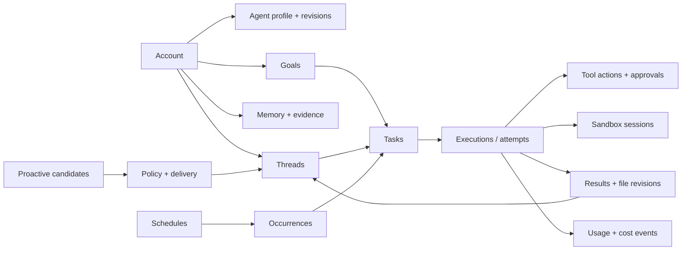
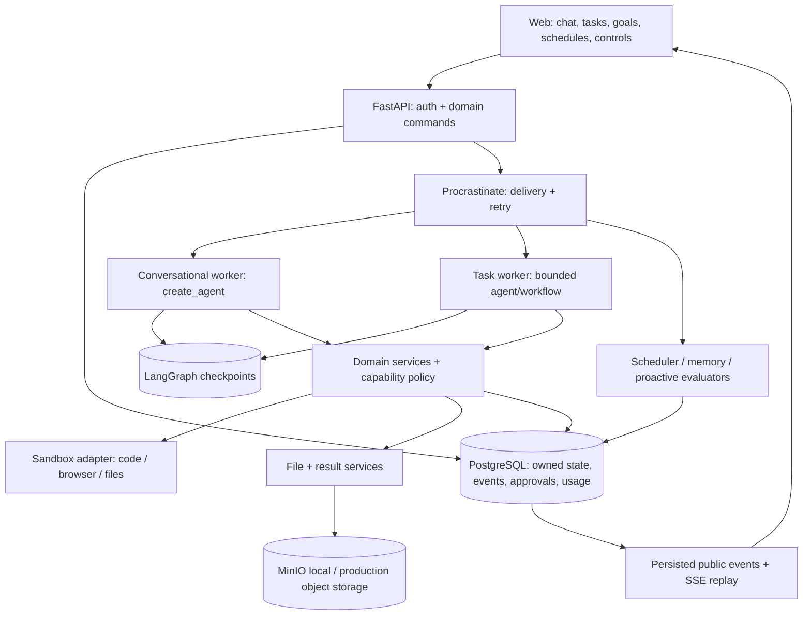

> Arsip perencanaan sebelum reset 18 Oktober 2026. Keputusan aktif mengikuti spesifikasi/backlog V1; instruksi menyimpan package V2 dan urutan A0–A10 di sini sudah tidak berlaku.

# 04 · Blueprint Teknis Ngertiin V1

Sumber: [Notion](https://app.notion.com/p/3fdabdd618738164bb8cfabe53fd49f6)

<!-- notion-content:start -->
Tanggal inspeksi: 18 Oktober 2026. Status: **blueprint implementasi Ngertiin berdasarkan arah V1 yang diminta pengguna**. Domain, API dan modul di bawah merupakan usulan rekonstruksi pengalaman. Temuan kode aktual dibedakan dari kemampuan yang masih perlu dibangun.

## 1. Keputusan arah dan cara membaca bukti

Arah baru yang diberikan untuk draf ini: **V1 menjadi asisten personal umum** dengan chat, persona dan memory, goal, eksekusi kode/browser/file yang terisolasi, schedule, pekerjaan background, proaktivitas, approval, hasil, dan usage. **V2 menambah Course/Lesson/Practice sebagai artifact terstruktur dan dedicated player**. Target near-parity harus dinilai dari kemampuan dan skenario pengguna yang teramati; jumlah menu, kemiripan screenshot, atau klaim pemasaran belum cukup.
Keputusan ini mengubah urutan delivery lama. `PRODUCT.md`, `docs/product/01-produk-dan-paket.md`, `03-agent.md`, dan `04-arsitektur-dan-delivery.md` masih menetapkan V1 belajar end-to-end dengan proaktivitas belajar terbatas; kesetaraan produk referensi justru dikecualikan. Draf ini **mengusulkan pengganti arah tersebut** berdasarkan instruksi baru, tanpa mengedit sumber lama. Backlog lama tidak dapat langsung dipakai sebagai urutan V1 baru.
Ada tiga tingkat bukti dalam draf:

- **Ada di kode saat inspeksi**: sumber dan migration dibaca pada working tree lokal, termasuk perubahan #05 yang belum seluruhnya menjadi commit.
- **Pernah diterima menurut dokumen lokal**: catatan implementasi/penerimaan #04–#05 dan ringkasan fondasi/konten pada dokumentasi dibaca; skenario browser, model, crash, dan database tersebut tidak dijalankan ulang pada inspeksi ini.
- **Usulan**: domain, package, tabel, UI, kebijakan, dan slice yang disarankan di bawah. Semuanya belum berarti telah dibangun atau diterima.
Tidak dilakukan fetch Notion live, uji production, benchmark biaya baru, atau pengujian vendor sandbox. Temuan Muse dari penjelajahan utama harus diberi tautan/bukti tersendiri saat dipadukan; dokumen ini tidak menambah klaim fitur Muse.

## 2. Inventaris actual versus planned

| Area | Keadaan aktual yang dibaca | Yang masih berupa rencana/gap | Implikasi untuk V1 baru |
| --- | --- | --- | --- |
| Workspace dan identitas | Monorepo `apps/web`  • satu package Python backend; Clerk `sub` dipetakan ke account; API dan worker memakai account milik server. | Penerimaan production dan operasi backup/restore belum dibuktikan oleh inspeksi ini. | Pertahankan fondasi; jangan membuat identitas atau owner dari argumen model. |
| Web dan design system | TanStack Start/React, shadcn primitives, Soft Matcha, desktop history panel/mobile Drawer. | Shell, onboarding, copy Gwen dan welcome masih berorientasi belajar; belum ada pengelolaan task, goal, schedule, memory, file produk, atau hasil umum. | Gunakan tokens/komponen, rancang ulang information architecture untuk asisten umum. |
| Chat personal | Main + side threads, history, draft/request key, durable message/event seq, SSE replay, stop/retry/recovery. | Belum ada attachment produk, general toolset, task progress/result references, maupun pencarian lintas history/memory yang lengkap. | Ini inti reusable terbesar; perlu kontrak event baru dan adapter UI yang bertipe. |
| Agent loop | `LangChain create_agent`, checkpoint LangGraph PostgreSQL, model/tool limits, bounded turn. | Tools hanya `read_recent_messages`, `read_agent_profile`, `request_course`. System prompt membatasi diri sebagai teman belajar. | Bukan general assistant tool runtime yang sudah selesai. Tambah capabilities melalui fungsi domain yang jelas. |
| Batas giliran | Satu active `chat_run` per thread; cap tiga run queued/running per account; timeout default 180 detik. | `waiting_approval` ikut active index dan menolak pesan berikutnya pada thread yang sama. | Pekerjaan lama dan approval task harus terpisah dari giliran chat. Pengguna tetap bisa bercakap di thread asal. |
| Approval | Proposal tersimpan, revision, exact arguments, decision key, expiry, resume dan write idempotent. | Implementasi menyaring `request_course` secara eksplisit; UI action args juga hanya goal/background. | Reuse prinsipnya; perlu action type, target/version, policy, dan projection umum. |
| Persona/soul | `agent_profiles` punya name, soul dan revision; bootstrap default Gwen. | Belum ada edit soul, riwayat revision, proposal soul, UI pengelolaan, atau validasi konflik soul. #16 masih Backlog pada mirror lokal. | Tabel profil bukan bukti persona personal lengkap. Prioritaskan alur perubahan yang dapat ditinjau. |
| Memory | Riwayat thread dan profil tersedia sebagai konteks. | Tidak ditemukan domain capture/evidence/recall/correction/forgetting. #17/#18 masih Backlog pada mirror lokal. | Active memory membutuhkan storage, extraction policy, retrieval, dan kontrol pengguna sendiri. |
| Goal | `course_requests` menyimpan tujuan Course sesudah approval. | Tidak ada general Goal dengan status, progress, next action, serta hubungan task/schedule. | Jangan mengganti label `course_requests` menjadi Goal lalu menganggap domain selesai. |
| Background jobs | Procrastinate menjalankan diagnostic dan chat; stalled recovery periodik; checkpoint LangGraph terpisah. | Tidak ada user Task umum, hasil yang dapat dicari, user schedule atau job goal. | Queue sudah ada; product lifecycle belum ada. |
| Schedule | Task sistem `foundation.recover_stalled` berjalan per menit. | Tidak ada jadwal pengguna, timezone/recurrence UI, occurrence idempotency, pause/edit/misfire policy. | Cron maintenance bukan fitur penjadwalan asisten. |
| Proaktivitas | Spesifikasi lama punya kandidat, reranking, cap global, quiet hours, mute dan thread routing. | Tidak ditemukan implementasi candidate/delivery domain; #19/#20 masih Backlog pada mirror. Pemicu masih tergantung domain belajar. | Perlu loop aktif yang berdiri tanpa Course, Practice, atau streak. |
| Storage/file | S3 adapter + `StoredObject`; upload/download/delete pada router `/dev`, max upload 5 MB; diagnostics gated development. | Tidak ada attachment chat, revision file, ingestion produk, sandbox workspace, hasil umum atau retention policy. | Reuse transport/storage; buat kontrak file produk. Jangan membuka diagnostics menjadi API produk begitu saja. |
| Code execution | Tidak ditemukan sandbox/user-code runner. | Isolasi OS/runtime, execution resource budget, filesystem, artifacts, cancel/cleanup, egress belum ada. | Capability baru yang harus lulus failure/isolation gates, bukan tool shell di host worker. |
| Browser execution | Tidak ditemukan browser worker/session produk. | Session ownership, credentials, navigation/action policy, source evidence, screenshot/download, recovery belum ada. | Browser untuk pengguna harus berada di runtime terisolasi dengan per-owner scope. |
| Usage dan entitlement | #05 menambah periods/grants/operations/events; reserve/commit/release/reverse dan fencing; chat admission + output settlement; `GET /quotas` dan composer summary. | Meter fixed `course`, `chat`, `material_pages`; tidak ada biaya sandbox/browser/search/background, billing checkout atau cost settlement variable. | Reuse ledger principles; policy/schema perlu versi baru untuk asisten umum. |
| Model usage | Chat projection mengumpulkan usage metadata per provider response ke run. | Belum ada cost accounting lintas model/tool/sandbox, price version, estimasi task, atau parent-child budget. | Token metadata bukan tagihan task yang lengkap. |
| Course content | Package `content/` pure: contracts, schemas, validators, answer keys, review/repair/handoff dan fixture inspector. | Belum menjadi ingestion, planner, generation runtime, player, progress atau grading learner. | Pertahankan sebagai aset V2; jangan menghapus atau menjadikannya prasyarat V1. |
| Deployment/stack | FastAPI, SQLModel/Alembic, PostgreSQL/pgvector, Procrastinate, LangChain/LangGraph, OpenAI adapter, structlog; MinIO lokal. | LiteLLM, LlamaIndex, LangSmith, R2 production ada pada dokumen acuan, tetapi bukan dependency/runtime yang terbukti pada kode yang dibaca. | Bedakan stack aktual dan stack acuan; jangan menambah service hanya untuk mencocokkan diagram lama. |

Sumber kode utama: `apps/backend/migrations/versions/0001_foundation.py`, `0002_chat.py`, `0003_chat_order.py`, `0004_quotas.py`; `apps/backend/src/ngertiin/{models.py,config.py,storage.py}`; `chat/{runtime.py,store.py,approvals.py,projection.py,recovery.py,api.py}`; `worker/{queue.py,tasks.py,workflow.py}`; `quotas/{policy.py,contracts.py,ledger.py}`; `api/{app.py,diagnostics.py}`; `apps/web/src/features/chat/{types.ts,agent-profile.tsx}` dan `apps/backend/pyproject.toml`.

## 3. Bentuk produk V1 yang diusulkan

Satu agent personal dapat menerima permintaan sederhana, mengingat konteks relevan, mengerjakan pekerjaan umum dengan tool yang tersedia, dan mengembalikan hasil yang bisa dibuka lagi. Pengguna dapat menyatakan tujuan, menjadwalkan pekerjaan, menentukan kapan agent boleh bertindak, dan menghentikan atau mengoreksi prosesnya.
Chat tetap menjadi pintu utama. Halaman lain membantu pengguna menemukan dan mengendalikan state yang berumur panjang:

- **Chat**: main/side threads, attachment, progress ringkas, approval, hasil dan tautan ke task.
- **Pekerjaan**: task aktif/menunggu/selesai/gagal, hasil, riwayat tindakan, stop/retry. Bisa menjadi panel sebelum perlu route penuh.
- **Goals**: tujuan, status, next action, task dan jadwal terkait; tidak mewajibkan planner besar.
- **Schedules**: sekali/berulang, timezone dan waktu berikutnya, edit, pause, jalankan sekarang, occurrence terakhir.
- **Memory & persona**: apa yang diingat, koreksi/lupakan, sumber, soul aktif dan history perubahan yang disetujui.
- **Files & results**: attachment pengguna dan hasil yang persisten, preview/download, hubungan thread/task dan kontrol hapus. Tidak harus menjadi Source Library pembelajaran.
- **Usage & controls**: pemakaian, batas, task memegang budget, proactivity preferences, akses tool dan sesi browser bila tersedia.
Onboarding pertama sebaiknya menghasilkan keberhasilan umum yang kecil, misalnya mengolah sebuah file atau menyelesaikan riset pendek. Membuat Course bukan gerbang penggunaan. Persona/memory boleh dipersonalisasi bertahap; pengguna tidak harus mengisi profil panjang sebelum chat.
Nilai near-parity harus diturunkan dari walkthrough Muse yang diverifikasi: untuk setiap kemampuan, catat trigger, perilaku yang terlihat, hasil, kontrol pengguna, state error, lalu padankan ke acceptance Ngertiin. Label “near-parity” baru dapat dipakai setelah daftar tersebut lengkap dan diuji.

## 4. Domain model dan istilah kanonis — usulan

| Istilah | Arti dan batas |
| --- | --- |
| Account | Pemilik data, izin, budget dan agent personal; tidak dipilih oleh model. |
| Agent profile / Soul revision | Identitas, suara dan preferensi perilaku agent yang disetujui. Satu revision aktif; bukan kumpulan fakta memory. |
| Thread | Percakapan dan rute penyampaian hasil. Thread bukan worker, sandbox, goal, atau durable execution. |
| Chat turn | Satu permintaan pengguna dan respons percakapannya, dengan loop model/tool yang dibatasi. Boleh menciptakan task lalu selesai. |
| Goal | Hasil yang ingin dicapai pengguna, success criteria, horizon opsional, status dan next action. Bisa dibantu banyak task/schedule dan hidup lebih lama dari chat. |
| Task | Satu pekerjaan yang diminta/diizinkan dengan intent, input snapshot/references, batas, hasil yang diharapkan dan status produk. Dapat berasal dari chat, occurrence schedule, atau keputusan proaktif yang diizinkan. |
| Task execution / Attempt | Percobaan mengeksekusi task dengan lease, checkpoint, tool actions, resource/cost budget dan terminal outcome. Retry sistem tidak mengubah identitas task. |
| Action | Satu operasi tool yang mempunyai input exact, target, efek, policy dan idempotency identity. Model mengusulkan; domain backend memvalidasi dan menjalankan. |
| Approval | Keputusan pengguna terhadap action/proposal revision tertentu. Bukan izin umum untuk semua aksi lanjutan. |
| Schedule | Instruksi pengguna untuk memulai task pada waktu/recurrence tertentu, bersama timezone, revision, cap dan policy overlap/misfire. |
| Occurrence | Satu pemicu schedule pada waktu yang dimaksud. Memiliki identitas stabil terpisah dari retry pengantaran job. |
| Proactive candidate | Peluang bantuan yang diturunkan dari bukti, dengan relevansi, expiry dan thread asal. Belum menjadi pesan atau izin eksekusi. |
| Delivery | Penyampaian hasil/pesan ke thread atau channel yang tersedia, dengan kunci dedup, status dan kebijakan waktu. |
| Memory entry | Fakta/preferensi/pengamatan terkurasi dengan evidence, scope, waktu, confidence/type dan lifecycle. Bukan source of truth bagi transaksi domain. |
| Evidence | Referensi terikat owner ke pesan, file revision, hasil task, atau event domain yang mendukung sebuah klaim. Konten eksternal diperlakukan sebagai data. |
| File revision | Isi berkas immutable yang dimiliki account. Identitas file logis boleh mempunyai beberapa revision. Attachment dan hasil menunjuk revision exact. |
| Result | Hasil task yang dipublikasikan: teks, tabel, file, gambar, laporan, kode atau preview yang diizinkan; mempunyai metadata, provenance dan lifecycle sendiri. |
| Sandbox session | Resource komputasi terisolasi dengan owner, task scope, filesystem, runtime, TTL dan resource limits. Bukan database utama aplikasi. |
| Capability grant | Izin penggunaan tool/session/target pada scope tertentu, dengan expiry/revocation jika diperlukan. Berbeda dari kuota dan approval exact satu action. |
| Usage reservation / Cost event | Komitmen kapasitas produk dan catatan biaya aktual. Kedua hal terkait, tetapi tidak harus memakai satu unit atau satu tabel. |

Hubungan inti:

Relasi Goal → Task bersifat opsional; menghitung CSV sekali tidak harus membuat Goal. Schedule dapat berdiri sendiri tanpa Goal. Mencatat Goal tidak otomatis menjadwalkan tindakan atau memberi akses browser. Task memiliki thread tujuan hasil secara eksplisit, sehingga schedule tidak bergantung pada browser yang kebetulan terbuka.

### State dan invariants

Task mempunyai state produk yang mudah dipahami: `queued`, `running`, `waiting_user`, `succeeded`, `failed`, `cancelled`. Menunggu resource/budget dapat menjadi reason terstruktur pada state yang sesuai; jangan menyamakan semua hal dengan “agent sedang berpikir”. Attempt mempunyai lifecycle teknis sendiri untuk recovery.

1. Owner selalu berasal dari execution context server; seluruh evidence/file/session/action/result harus cocok owner-nya.
2. Penyimpanan task + reservasi + enqueue atomik. Network/model/sandbox call berada di luar transaksi database.
3. Satu retry/reconnect tidak menciptakan task, occurrence, action, result publication, delivery, atau charge baru tanpa alasan domain.
4. Worker lama kehilangan hak menulis setelah lease dicabut. Cancel mencabut kemampuan membuat efek baru; penghentian resource sandbox juga perlu diperintahkan dan dikonfirmasi.
5. Result yang sudah berhasil dipublikasikan tidak hilang karena tahap opsional gagal. Status partial result dan batasnya terlihat jelas.
6. Action yang disetujui harus identik dengan proposal yang diperiksa, pada target revision/credential scope yang masih berlaku saat eksekusi.
7. `waiting_user` tidak memegang worker aktif, model stream, sandbox berbayar tanpa TTL, atau lock thread sepanjang waktu tunggu.
8. Fakta memory tidak dapat mengubah pembayaran, permission, task success, atau kelak completion belajar. Hanya fungsi domain yang dapat melakukannya.
9. Hasil sandbox menjadi durable hanya setelah dipindahkan ke object storage dan dicatat domain; file sementara sandbox bukan hasil tersimpan.
10. Pengiriman pesan bukan eksekusi task. Quiet hours dapat menunda notifikasi tanpa menghentikan occurrence yang secara eksplisit dijadwalkan berjalan saat itu.

## 5. Batas modul dan arsitektur — usulan

Pertahankan **LangChain ****`create_agent`**** + LangGraph + Procrastinate**. Kode saat ini sudah membuktikan boundary chat/queue/checkpoint pada lingkungan lokal menurut evidence yang tersimpan. Gap produk lebih banyak berada pada domain dan execution capabilities daripada kebutuhan mengganti framework. Tidak ada temuan dalam inspeksi ini yang membenarkan migrasi runtime.

| Modul usulan | Tanggung jawab | Tidak dimiliki modul ini |
| --- | --- | --- |
| `accounts` | Auth, account ownership, timezone/profile yang eksplisit. | Persona, hasil model dan budget inferensi. |
| `chat` | Threads/messages, draft transport, turn, history, event projection. | Seluruh lifecycle pekerjaan lama atau tabel goal/schedule. |
| `tasks` | Task/execution state, attempt/lease, cancellation, recovery, progress/result publication. | Implementasi browser/code dan penentuan permission sendiri. |
| `agent` | Context assembly, tool registration, model routing, bounded agent loop. | Source of truth transaksi domain atau database abstrak serbaguna. |
| `approvals` | Proposal exact, expected revision, decision, policy checks, audit. | Menjalankan sembarang fungsi berdasarkan nama tool dari client. |
| `memory` | Capture evidence, curation/supersede, retrieval, correction/forgetting. | Mengubah soul, task success, billing atau data belajar. |
| `profiles` | Soul revisions, proposal edit, active snapshot. | Facts/events yang seharusnya memory. |
| `goals` | Intent, success criteria, state dan next action, hubungan ke task. | Menjalankan scheduler atau menyimpulkan completion tanpa evidence. |
| `schedules` | Schedule revision, timezone, occurrence, overlap/misfire policy, dispatch. | Satu cron decorator per jadwal pengguna. |
| `proactivity` | Evidence-based candidates, ranking/dedup/expiry, timing, delivery budget. | Izin implisit melakukan external side effect. |
| `files` / `results` | Owned immutable file revisions, attachments, artifact manifests, preview/download/delete. | Runtime filesystem atau learning Source Library sebagai asumsi wajib. |
| `execution` | Sandbox lifecycle, resource limits, code/browser adapters, tool action outcomes. | DB credentials aplikasi atau otorisasi account berdasarkan input kode. |
| `usage` / `quotas` | Product admission/reservation/settlement; cost events dan limit policy. | Verifikasi pembayaran gateway atau penentuan kualitas output. |
| `billing` | Provider payment verification, entitlement lifecycle, reconciliation. | Approval tool, model inference, atau sumber kebenaran task. |

Ini batas tanggung jawab, bukan perintah membuat seluruh folder dan base class di muka. Mulai dari fungsi domain yang dibutuhkan slice, lalu extract bila sudah ada tanggung jawab nyata. Tool wrapper dibuat tipis; hindari generic workflow factory, registry plugin dinamis, atau supervisor banyak agent tanpa kebutuhan terukur.

### Chat dan pekerjaan lama

Giliran chat menerima instruksi, dapat langsung menjawab, memakai tool singkat, atau memanggil `start_task`. Setelah Task durable tercipta, turn mengirim acknowledgement/task card dan dapat selesai. Task berjalan lewat ID eksekusi sendiri; hasilnya masuk sebagai message/result reference baru dengan identitas delivery stabil.
Konsekuensi penting: pengguna bisa bertanya hal lain pada thread yang sama sambil Task menunggu approval. Ordering transcript mengikuti event seq, sedangkan causal relation mengikuti `task_id`, `action_id`, dan `reply_to`/referensi yang eksplisit. Jangan menyambungkan hasil Task lama menjadi kelanjutan token dari jawaban chat yang lebih baru.
Jangan memaksa semua pertanyaan melalui planner/task. Jawaban sederhana tetap satu turn murah. Task dipakai untuk pekerjaan yang lama, dijadwalkan, memerlukan resource execution, atau harus dapat diinspeksi/dilanjutkan tersendiri.

### Durable I/O dan action ledger

LangGraph checkpoint memberi state runtime; Procrastinate memberi pengantaran/retry; database domain memberi ownership, action authorization, budget dan hasil sah. Ketiganya punya tanggung jawab berbeda.
Setiap efek berarti mempunyai stable action key, fingerprint input, status dan evidence hasil. Bila provider mendukung idempotency, gunakan key tersebut. Bila browser menekan tombol lalu koneksi putus sebelum acknowledgement, status harus dapat menjadi **unknown** dan melalui rekonsiliasi; retry buta dapat menggandakan efek. Jangan menjanjikan exactly-once bagi seluruh HTTP/browser actions hanya karena ada checkpoint.
Resource budget terpisah dari timeout satu chat turn: wall-clock, model/tool call count, token/cost budget, CPU/memory/disk, browser steps, bytes/download dan concurrency. Task child, retry, repair dan background evaluation memakai budget parent yang tercatat; tidak boleh membuat loop gratis dengan memecah task.

### Sandbox code, browser dan files

Runtime berisiko dijalankan di environment terisolasi per owner/task, melalui adapter yang sempit. Jangan menjalankan generated code pada API/worker host atau memasang filesystem/repo pengguna sebagai working directory sandbox. Vendor/teknologi isolasi dipilih lewat PoC dan dokumen pihak pertama terkini; inspeksi ini belum memilih vendor.
PoC harus membuktikan create/resume/stop/cleanup, batas CPU/memory/disk/network, pengambilan hasil, status timeout, isolasi account, dan biaya saat waiting approval/idle. Konfigurasi egress dan akses browser memakai capability yang dibutuhkan tugas; credential aplikasi utama tidak masuk ke sandbox. Credential/session browser pengguna harus owner-scoped, dapat dicabut, dan lifecycle-nya terpisah dari hasil publik.
File input dipasang sebagai revision immutable; tool boleh membuat output di workspace task. Publikasi hasil memeriksa path, tipe, ukuran dan manifest sebelum mengunggah. HTML/JS hasil tidak dirender dengan origin aplikasi dan session aplikasi. Preview hasil adalah renderer terkontrol atau origin sandbox terpisah dengan policy yang jelas. Link publik ke hasil, jika kelak ditawarkan, adalah aksi tersendiri yang terlihat oleh pengguna.
Browser task menyimpan source URL/waktu/evidence yang relevan, screenshot atau download bila diperlukan. Read/navigate dan aksi yang mengubah sistem eksternal dibedakan pada policy. Kegagalan login, MFA/CAPTCHA, session expiry dan halaman berubah menghasilkan status yang dapat dilanjutkan pengguna, bukan klaim task selesai.
Konten web/file/tool output tidak boleh mengubah policy, owner, budget, soul atau capability grant. Instruksi yang ditemukan pada halaman adalah input tugas; otorisasi tetap berasal dari pengguna dan backend.

### Persona dan memory

Mulai dengan empat jenis yang dibedakan: pernyataan eksplisit pengguna, preferensi, observasi/inferensi agent, dan fakta domain yang dirujuk. Simpan evidence reference, waktu, scope, lifecycle, confidence/type dan revision. Retrieval memperhitungkan relevansi dan freshness dalam budget konteks; tidak memuat seluruh history lintas thread ke setiap turn.
Capture berjalan sesudah message/task event durable, dengan extraction idempotent per evidence+kind. Correction/forgetting mencatat suppression terhadap sumber/fakta lama agar background extraction tidak langsung menghidupkan kembali hal yang dihapus. Memory yang salah tidak dihapus bersama history tanpa kebijakan tersendiri; UI menjelaskan perbedaan kedua tindakan.
Perubahan soul mengikuti proposal revision dan approval pengguna seperti maksud #16 lama. Memory tidak menjadi jalan belakang untuk menerapkan persona ditolak. Turn/task menggunakan snapshot profile yang jelas; perubahan berlaku pada interaksi berikutnya atau lewat mekanisme refresh yang dinyatakan, bukan berubah diam-diam di tengah action.

### Goals, schedules dan proaktivitas

Goal menyimpan outcome, success criteria, status dan next action. Agent boleh menyarankan langkah; membuat jadwal atau mulai task memakai aturan otorisasi yang terlihat. Status achieved didukung hasil atau konfirmasi pengguna, bukan banyaknya token/pesan yang dibuat agent.
Schedule menyimpan intent dan revision immutable untuk occurrence yang sudah dibuat. Satu periodic coordinator membaca due schedules, mengklaim occurrence secara atomik, membuat Task + budget reservation + enqueue, lalu menghitung waktu berikutnya. Queue retry tidak menciptakan occurrence baru. Edit/pause/revoke memiliki semantics jelas untuk occurrence queued/running yang sudah diterima.
Usulan policy awal: timezone IANA eksplisit, preview tiga waktu berikutnya, tanggal akhir opsional, satu occurrence aktif per schedule dengan `skip/coalesce` untuk overlap, dan coalesce kejadian yang terlewat setelah downtime sesuai jenis tugas. Angka grace window serta task tertentu yang memang memerlukan catch-up ditetapkan sebelum release. Uji schedule lintas timezone dan DST meski mayoritas pengguna memakai zona Indonesia.
Proaktivitas berbeda dari schedule: candidate berasal dari bukti, rerank, expiry dan dedup; tidak mengirim jika tidak ada manfaat yang cukup. Spesifikasi lama mewajibkan fallback pembahasan terakhir; **usulan revisi untuk V1 umum adalah no-op ketika kandidat lemah**, supaya cadence tidak memaksa percakapan tanpa tujuan. Ini perubahan policy produk yang perlu dinyatakan saat spesifikasi diperbarui.
Cap awal dua pesan proaktif/hari dan quiet hours 21.00–07.00 dari dokumen lama dapat dipakai sebagai default sementara, dengan timezone/mute/snooze/focus preference yang nyata. Scheduled result delivery dipisahkan dari pesan inisiatif agar tugas yang diminta tidak diam-diam hilang karena cap proaktif; delivery dapat ditunda/digest mengikuti preferensi. Pekerjaan background yang diizinkan dan timing notifikasinya tetap dua keputusan terpisah.

### Model, retrieval, observability

Pertahankan adapter model yang sudah ada untuk baseline. Routing model berdasarkan jenis dan kesulitan task menjadi keputusan aplikasi yang dapat diukur; jangan menyalin model/model-name Muse yang tidak terbukti. Price/version model dan tool harus tercatat pada cost events.
pgvector tersedia sebagai fondasi tetapi memory retrieval/embedding belum ada. Retrieval awal bisa disembunyikan di balik fungsi kecil seperti `recall_context` dan `read_file_excerpt`; LlamaIndex baru ditambahkan jika memang mengurangi kerja ingestion/retrieval yang nyata. LiteLLM baru menjadi service bila kebutuhan multi-provider/gateway/budget terpusat membuktikannya. LangSmith atau observability lain harus diputuskan dan diverifikasi tersendiri, bukan dianggap sudah aktif karena tertulis pada spesifikasi.
Trace harus dapat menghubungkan account, thread, turn, task, execution, action, schedule occurrence, approval, result, delivery dan usage operation. Public progress menampilkan apa yang dilakukan dan hasil ringkas; raw checkpoint, secrets, chain of thought internal dan output tool sensitif tidak otomatis diteruskan ke UI.

## 6. Data dan API minimum yang diusulkan

Skema final mengikuti slice, tetapi hubungan berikut perlu direncanakan agar migrasi tidak mengunci V1 pada domain Course:

| Kelompok data | Atribut/constraint penting |
| --- | --- |
| `tasks`, `task_executions` | Owner, input/intent snapshot, origin thread/goal/occurrence, status, version, lease, budget, cancel, timestamps; stable request key + input fingerprint. |
| `tool_actions`, approval proposals | Owner/task/execution, tool/action version, exact args hash, target revision, policy decision, idempotency key, status termasuk unknown, result/evidence; approval decision idempotent. |
| `goal_records` | Owner, outcome, criteria, state/revision, target date opsional, active next action; tidak otomatis menjadi recurring job. |
| `schedules`, `schedule_occurrences` | Owner, timezone, recurrence/one-shot, instruction revision, next fire, pause/expiry; unique occurrence identity; association task dan outcome. |
| `memory_entries`, evidence dan suppressions | Owner, typed claim, scope, confidence, evidence ref, observed/valid times, revision/supersede, user correction/forgetting tombstone. |
| `profile_revisions` | Owner, expected base revision, approved content, decision reference, active pointer. |
| Product files/revisions, result manifests | Owner, content hash, immutable storage key, MIME/size, upload/processing state, retention, task/thread refs; result status/preview/provenance. |
| Sandbox sessions | Owner, task/execution, opaque provider resource ID, lifecycle, TTL, policy/resource budget, cleanup outcome; credentials ditangani terpisah. |
| Candidates/deliveries | Owner, evidence, origin thread, expiry, ranking/dedup key, timing, policy snapshot, stable message publication identity. |
| Usage/cost records | Product reservation + cost events per billable invocation/resource, price/version, estimated/actual status; association parent task dan retry reason. |

Usulan endpoint/commands: `POST /tasks`, `GET /tasks/:id`, `POST /tasks/:id/stop|retry`; CRUD terkontrol goals/schedules; `POST /schedules/:id/pause|resume|run`; memory list/correct/forget; profile proposal/decision; file upload/attach/download/delete; task result read; usage summary. Semua adalah rancangan; endpoint belum tersedia.
General approval API tidak menerima arbitrary function name untuk dieksekusi. Server memilih domain handler berdasarkan proposal tersimpan yang valid. Mutasi schedule/file/memory sebaiknya mempunyai expected revision dan request key saat dibutuhkan, termasuk request melalui agent.
Event schema diperluas dengan `task.upsert`, `action.upsert`, `result.published`, `delivery.status` dan referensi file/approval yang aman. Tentukan versi envelope dan kompatibilitas reducer; public DTO dipisahkan dari DB row serta runtime checkpoint. History lama tetap dapat dirender. Event retention/compaction mempertahankan snapshot+cursor recovery.

## 12. Register sumber lokal yang dibaca

| Sumber | Apa yang dipakai sebagai evidence |
| --- | --- |
| `PRODUCT.md`, `README.md`, `docs/product/01-produk-dan-paket.md`, `03-agent.md`, `04-arsitektur-dan-delivery.md` | Arah lama, stack acuan, boundary v1, policy persona/memory/proactivity, dan paket. |
| `docs/backlog/README.md`, task #16–#20, #23 dan #25 | Status mirror lokal dan dependency/acceptance lama; tidak dianggap sebagai readback Notion terkini. |
| `docs/engineering/chat-04-implementation.md` | Riwayat penerimaan #04, batas tool/proposal Course, UI, stream duplication audit dan cleanup. |
| `docs/engineering/quota-05-policy.md`, `quota-05-implementation.md` | Policy/ledger/integration boundary, catatan penerimaan database dan browser #05. |
| `apps/backend/pyproject.toml`, `config.py`, `api/app.py` | Dependency/runtime aktual, settings bounded chat, router dan gating diagnostics. |
| `apps/backend/migrations/versions/0002_chat.py`, `0003_chat_order.py`, `0004_quotas.py` | Actual tables/indexes/constraints untuk profil, thread, run, approvals, Course request dan kuota. |
| `chat/runtime.py`, `store.py`, `approvals.py`, `projection.py`, `recovery.py`, `api.py` | Agent tools, context, timeout, active-run behavior, ownership/lease, exact approvals, public projection dan delivery recovery. |
| `worker/queue.py`, `tasks.py`, `workflow.py` | Queue/checkpoint ownership, maintenance periodic task dan model-free diagnostic workflow. |
| `models.py`, `storage.py`, `api/diagnostics.py` | Scope actual StoredObject, S3 transport, diagnostic-only upload/download/delete. |
| `quotas/policy.py`, `contracts.py` | Fixed meters, integer units, material measurement dan future consumer contracts. |
| `content/__init__.py` serta catatan #003 pada dokumentasi lokal | Batas pure content contracts; tidak diklaim sebagai generation/player/runtime. |
| `apps/web/src/features/chat/types.ts`, `agent-profile.tsx`, `ui/app-shell.tsx`, `routes/index.tsx` | Actual public DTO dan UI yang masih berorientasi belajar. |
| `docs/research/agent-soul-memory.md`, `proactive-agent-frameworks-2026-10-14.md` | Konteks desain lama dan istilah; bukan verifikasi ulang API/library/vendor eksternal. |

Inspeksi menggunakan working tree lokal, termasuk perubahan kuota #05 yang belum seluruhnya menjadi commit. MCP graph tidak tersedia pada sesi ini sehingga discovery kode memakai fallback lokal. Tidak ada app code atau status backlog yang diubah oleh laporan ini.
<!-- notion-content:end -->

Readback Notion: 2026-10-18T04:45:10.818Z. Bukti raw berada pada `.firecrawl/muse-re-20261018/`; status implementasi mengikuti backlog.
