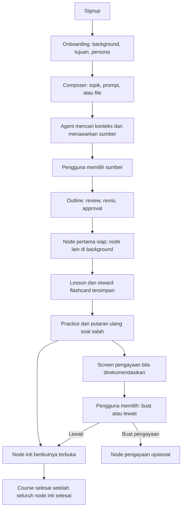

# Arsip brainstorming user flow — 13 Oktober 2026

Arsip pembahasan dan usulan. Acuan implementasi terkini: [User Flow](../../product/02-user-flow.md).

---

# Ngertiin v1 — alur pengguna dan keputusan terbuka

Diperbarui 13 Oktober 2026. Sumber utama: keputusan pengguna dalam brainstorming. Ini catatan rinci lokal; dokumentasi ringkas dan backlog berada di [Notion Ngertiin](https://app.notion.com/p/3f8abdd6187381e39753f0d54ee2556b). Belum menjadi bukti implementasi atau pengujian UX.

Status dibedakan menjadi **disepakati**, **usulan**, dan **terbuka**. Alur inti sudah cukup koheren untuk menjadi spesifikasi. Walkthrough/prototype tetap diperlukan untuk menguji pengalaman nyata.

## Alur inti — disepakati

- Onboarding mengetahui background, goals, dan persona yang disukai. Demo interaktif mengarahkan pengguna membuat Course pertama mereka sendiri. Tooltip/tour menunjukkan kemampuan composer dan attachment sesuai tahap yang sedang berlangsung.
- Sumber dapat berupa file/web milik pengguna yang sudah ada atau hasil pencarian internet. Pencarian otomatis; pemilihan sumber dan outline menggunakan HITL.
- Course tidak terikat Study Space. Jumlah node/aktivitas ditentukan oleh kebutuhan dan standar belajar, bukan kuota node.
- Setiap node mempunyai beberapa Lesson dan Practice. Setelah soal terakhir, pengguna menjawab ulang soal yang salah. Sesudah putaran review, node inti berikutnya tetap terbuka walaupun hasil masih rendah.
- Pengayaan opsional tidak mengubah denominator progress Course inti. Course dinyatakan selesai ketika seluruh node inti selesai; pengayaan bisa tetap dipelajari setelah itu.
- Jika pengayaan direkomendasikan, tampilkan screen tersendiri pada rangkaian penyelesaian Practice setelah seluruh soal dan putaran ulang jawaban salah selesai, dengan pola presentasi seperti screen streak/flashcard. Screen berisi alasan dan konsep yang perlu diperkuat secara singkat, tombol utama **Buat pengayaan** yang menonjol sebagai approval pembuatan node opsional, serta action sekunder **Lewati** untuk melanjutkan Course. Node inti berikutnya tetap terbuka.
- Flashcard reward tersimpan untuk review. Streak berasal dari aktivitas belajar valid, bukan membuka aplikasi atau sekadar chat.
- Practice mandiri dan Exam berada di luar v1. Slash command menuju flow yang sama dengan percakapan, termasuk HITL; command tidak langsung melewati approval.

## Agent saat belajar — disepakati

Saat pengguna membuka Course, chat tersedia sebagai panel di dalam Course. Agent otomatis mengetahui Course dan Lesson aktif. Di HP panel memakai drawer. Composer tetap menyediakan input file.

Agent tersebut adalah agent personal yang sama dengan agent di Beranda. Soul dan memory bersifat lintas topik; konteks materi serta aktivitas yang sedang dipelajari mengikuti Course/Lesson aktif.

Side chat mempunyai thread sendiri. Pesan proaktif terkait pembahasan suatu thread muncul pada thread tersebut; agent personal tetap sama lintas thread. Struktur penyimpanan riwayat global/per-Course dan hubungan side chat dengan Course masih membutuhkan spesifikasi lebih rinci.

Usulan detail interaksi:

- Tampilkan konteks aktif secara singkat, misalnya nama Lesson, sehingga pengguna mengetahui apa yang sedang dipahami agent.
- Membuka atau menutup panel mempertahankan posisi Lesson, jawaban Practice, dan draft pesan.
- Pergantian Lesson memperbarui konteks pada pesan berikutnya tanpa mencampur jawaban asynchronous dari Lesson sebelumnya.
- Riwayat percakapan Course ditampilkan kembali saat Course dibuka; agent juga dapat mengambil memory lintas Course yang relevan. Satu agent personal tidak mensyaratkan seluruh percakapan berada dalam satu thread raksasa.
- Jika pengguna memberi topik baru yang akan menjadi Course lain, agent mengonfirmasi konteks/tujuan dan menggunakan flow pembuatan Course melalui HITL.

Granularitas riwayat percakapan global/per-Course serta letak indikator konteks masih merupakan detail usulan, belum keputusan UI final.

## Struktur aplikasi — usulan

Navigasi utama sederhana: **Beranda**, **Courses**, dan **Flashcards**. Pengaturan agent, memory, akun, dan paket berada di pengaturan profil. Materi reusable dapat dipilih dari composer dan dilihat pada konteks/sumber Course; halaman pengelolaan materi tersendiri belum diputuskan.

| Situasi | Tampilan dan tindakan utama yang diusulkan |
| --- | --- |
| Pengguna baru | Onboarding ringkas, lalu composer untuk Course pertama dan tour sesuai state |
| Course pertama sedang disiapkan | Status persiapan, outline tetap terlihat, akses node pertama ketika sudah siap |
| Pengguna kembali dengan Course aktif | Kartu Lanjutkan belajar ke posisi terakhir, composer agent tersedia, pesan proaktif relevan pada thread yang sesuai |
| Beberapa Course aktif | Courses menampilkan progress dan titik lanjut; pilihan pengguna menentukan konteks belajar aktif |
| Course selesai | Rekap kemajuan, flashcard untuk review, pengayaan opsional, serta tawaran tujuan/Course berikutnya |

Onboarding yang diusulkan hanya meminta konteks minimum untuk mulai: tingkat/background belajar, tujuan, dan pilihan gaya agent. Detail tambahan dapat diperbarui kemudian. Cara skip, jumlah langkah, dan nilai awal persona belum dikunci.

## Progress dan pemulihan — usulan untuk dikunci

| Keadaan | Perilaku yang diusulkan |
| --- | --- |
| File sedang diproses | Jelaskan status dan materi yang sudah siap; materi gagal tidak diam-diam dipakai sebagai evidence |
| Sumber belum memadai | Minta konteks yang kurang atau tawarkan sumber lain; pertahankan input dan file pengguna |
| Outline sedang direvisi | Outline sebelumnya tetap terlihat sampai revisi tervalidasi siap untuk review |
| Browser ditutup saat generation | Pekerjaan berlanjut; ketika kembali, tampilkan status dan konten yang sudah siap |
| Node berikutnya belum siap | Progress belajar tetap tersimpan; tampilkan status tanpa membuat pengguna mengulang node selesai |
| Sebagian generation gagal | Pertahankan node siap, tampilkan masalah yang dapat ditindaklanjuti, dan retry bagian yang gagal |
| Koneksi putus saat belajar | Simpan posisi/draft/jawaban dan pulihkan saat kembali; jangan menggandakan reward, attempt, atau progress |
| Course gagal memenuhi outline yang disetujui | Berikan status yang jelas dan pulihkan slot Course sesuai kebijakan; Course tidak ditagih kembali untuk retry sistem |

Detail kapan slot Course direkam, bagaimana pembatalan dibedakan dari kegagalan sistem, dan batas retry perlu spesifikasi eksplisit. UX selalu menghitung Course, sementara biaya tiap tahap dicatat internal.

## Proaktivitas — pemicu dinamis, reranking, dan delivery per thread

Agent dapat memberi semangat, saran, dan menyiapkan aktivitas relevan dari memory/progress. Ia tidak mengubah soul secara otomatis. Perubahan Course tetap menggunakan HITL; kegiatan pengayaan untuk tujuan Course yang sama tidak memakai slot Course baru.

Keputusan pengguna terbaru: **proaktivitas muncul sebagai assistant message pada thread yang relevan**, termasuk side chat. Follow-up pembahasan side chat masuk ke side chat tersebut. Keputusan ini menggantikan aturan sebelumnya yang memusatkan semua pesan proaktif pada main chat.

Pemicu diperluas: pembahasan terbaru pengguna, konteks atau tujuan yang perlu ditindaklanjuti, informasi baru yang relevan, serta progress/event belajar. Kandidat pesan harus melalui **reranking** agar perluasan pemicu tidak menghasilkan spam.

Keputusan tambahan pengguna: jika tidak ada kandidat yang cukup bernilai setelah reranking, agent mengirim **follow-up pembahasan terakhir pengguna** pada thread pembahasan tersebut. Pengguna juga menyetujui batas total **dua pesan proaktif per hari per pengguna, lintas thread**. Fallback tetap mengikuti timing dan pencegahan pesan berulang.

Timing dasar dirangkum di [03 · Agent di Notion](https://app.notion.com/p/3f8abdd6187381658b61f4283ee83428), dengan perluasan pemicu/routing dari keputusan pengguna terbaru:

- Contoh pemicu belajar tetap tersedia: streak terancam, node selesai, dua hari absen, H-7 ujian, atau pengguna mentok. Daftar ini menjadi contoh, bukan daftar pemicu tertutup.
- Decision mempertimbangkan urgensi, maksimum **dua pesan proaktif per hari per pengguna di seluruh thread**, di luar quiet hours **21.00–07.00**, dan pengguna tidak sedang fokus.
- Compose berlangsung di worker dengan mempertimbangkan soul; setiap pesan memiliki **satu CTA utama**.
- Delivery berupa pesan assistant pada thread yang relevan, dengan badge dan kontrol mute satu ketukan. Cakupan mute per thread/global perlu ditetapkan.

Trigger H-7 memerlukan jadwal ujian/target yang diketahui. Trigger itu adalah konteks tujuan belajar; Exam builder tetap di luar v1 sesuai keputusan pengguna terbaru. Batas dua pesan berlaku untuk pesan proaktif, bukan seluruh respons assistant dalam percakapan.

Usulan alur seleksi dan pengiriman:

1. Kumpulkan sinyal dari pembahasan terbaru, memory/progress, tujuan belajar, dan informasi relevan yang baru ditemukan. Sinyal membuat kandidat; belum langsung menghasilkan pesan yang dikirim.
2. Setiap kandidat menyimpan asal konteks, thread tujuan, alasan/manfaat, evidence, waktu yang sesuai, dan kaitan dengan saran sebelumnya. Informasi terbaru harus mempunyai sumber dan waktu yang dapat diperiksa.
3. Saring kandidat yang sudah dibahas/diselesaikan, berulang, tidak lagi relevan, atau sedang ditunda/mute. Percakapan normal dan respons yang sudah diberikan agent tidak otomatis menjadi follow-up baru.
4. Rerank kandidat berdasarkan relevansi pada tujuan/thread, manfaat untuk pengguna, kebaruan, urgensi, kekuatan evidence, dan waktu yang tepat. Pertimbangkan respons pengguna terhadap saran sebelumnya serta pesan proaktif yang belum ditanggapi.
5. Pilih kandidat yang layak setelah ranking. Bila tidak ada yang cukup bernilai, gunakan follow-up pembahasan terakhir pengguna sebagai fallback, pada thread asal pembahasan itu. Pesan fallback ikut batas total **dua pesan proaktif per hari per pengguna di seluruh thread**.
6. Sebelum compose/send, periksa ulang quiet hours, kondisi fokus, budget, konteks terbaru, dan apakah saran masih relevan. Pesan tertunda perlu dievaluasi ulang, bukan seluruh antrean dikirim ketika quiet hours berakhir.
7. Compose pesan sesuai soul dan evidence, kirim sekali pada thread tujuan, lalu catat tindak lanjut pengguna untuk membantu seleksi berikutnya.

Fallback bersumber dari pembahasan pengguna yang benar-benar tercatat dan bisa berupa pertanyaan perkembangan atau tawaran melanjutkan topik. Pesan proaktif yang belum dibalas tidak dengan sendirinya menjadi pembahasan pengguna baru. Fallback tidak melewati mute/snooze, quiet hours, kondisi fokus, atau pemeriksaan duplikasi; bila terhalang aturan tersebut, pengiriman ditunda dan konteks dievaluasi ulang pada waktu yang sesuai.

Kebijakan fallback dan batas total lintas thread telah disepakati. Urutan rinci dan kriteria ranking merupakan usulan implementasi; bobot ranking, threshold, cooldown per thread, dan jadwal evaluasi belum dikunci atau dianggap telah teruji.

Usulan routing thread:

| Asal konteks | Thread tujuan |
| --- | --- |
| Follow-up pembahasan main chat | Main chat tersebut |
| Follow-up pembahasan side chat | Side chat asal pembahasan |
| Progress atau kesulitan pada Course/Lesson | Thread Course terkait |
| Informasi baru terkait topik yang dibahas | Thread tempat topik/tujuan itu dibahas |
| Fallback pembahasan terakhir pengguna | Thread asal pembahasan terakhir tersebut |
| Pengingat umum tingkat akun tanpa konteks thread tertentu | Main chat |

Pesan tidak diduplikasi ke beberapa thread. Bila beberapa konteks beririsan, pilih thread yang paling tepat melalui seleksi/routing; jangan membuat broadcast dari satu kandidat.

Usulan detail interaksi:

- Simpan dan tampilkan pesan proaktif pada riwayat thread tujuan. Persiapan dapat terjadi di background; pengguna memilih tindakan saat melihat tawarannya.
- Pesan terkait Course menyediakan tindakan untuk membuka Course atau menyetujui pengayaan yang ditawarkan. Interaksi approval/HITL mengikuti tawaran pada thread tersebut.
- Beri alasan singkat berbasis aktivitas nyata, misalnya kesulitan pada konsep tertentu atau flashcard yang perlu diulang.
- Pesan menyediakan satu CTA utama untuk tindak lanjut. Pengguna dapat menunda atau melewati tawaran lewat percakapan; jangan mengirim ulang saran identik yang telah ditangani.
- Batasi interupsi dan sediakan kontrol mematikan saran. Saat pengguna sedang belajar, prioritaskan konteks aktif.
- Pisahkan persiapan kandidat aktivitas dari perubahan Course yang membutuhkan approval.

Pemicu dinamis, reranking, fallback pembahasan terakhir, delivery per thread, dan batas total dua pesan per hari lintas thread menjadi keputusan pengguna. Quiet hours dan kondisi fokus tetap mengikuti timing Notion. Detail implementasi yang belum ditulis pada halaman sumber: timezone quiet hours/reset harian, definisi terukur kondisi fokus/mentok/streak terancam, kebijakan snooze, serta ranking/routing rinci. Usulan memakai timezone pengguna konsisten dengan streak; ini belum disebut eksplisit pada sumber Notion.

Pencarian informasi baru perlu difokuskan pada topik/tujuan yang relevan dengan budget background yang dibatasi; belum ada komitmen mencari seluruh internet terus-menerus. Kapan kandidat aktivitas boleh disiapkan sebelum approval tetap harus mengikuti budget yang telah diizinkan pengguna dan batas HITL. Notifikasi di luar riwayat chat belum diputuskan sebagai kemampuan v1.

## Soul dan memory — prinsip disepakati, pengelolaan UI diusulkan

Soul berubah hanya atas permintaan eksplisit pengguna: agent mengusulkan perubahan, pengguna melihatnya dan menyetujui atau menolak, lalu versi tersimpan. Soul tidak berubah sebagai akibat samping pembaruan memory.

Memory diperbarui aktif dari percakapan penting, history, dan aktivitas belajar. Nilai, progress, streak, dan reward tetap fakta domain aplikasi, bukan fakta yang dapat diubah lewat ingatan agent.

Usulan UI: pengaturan Agent untuk persona/soul dan pengaturan Memory untuk melihat, mengoreksi, atau melupakan ingatan yang dikurasi. Batas penghapusan memory dibanding percakapan, materi, dan progress Course harus jelas. Tampilan dan aturan koreksi/penghapusan masih terbuka.

## Kuota dan langganan — baseline disepakati, exception perlu dikunci

Baseline sementara: Free 1 Course/30 hari dan Plus Rp49.000/30 hari untuk 5 Course; model Luna/Sol, fitur dan kualitas sama. Angka halaman lintas format serta biaya masih memerlukan validasi. [Rancangan bisnis dan asumsi biaya](../business-model-2026-10-13.md).

Usulan flow:

- Sebelum approval pembuatan, tampilkan sisa kuota Course. Bila habis, tawarkan menunggu reset atau upgrade; Course/flashcard yang sudah tersedia tetap bisa dipelajari.
- Pembayaran berhasil mengaktifkan paket dan menampilkan tanggal berakhir, kuota, serta cara memperpanjang. Keadaan pembayaran pending/gagal tidak dianggap berhasil.
- Course yang sudah disetujui memakai satu slot untuk seluruh outline, termasuk generation background dan pemulihan sistem.
- Expiry/downgrade tidak menghapus Course yang sudah dibuat. Kebijakan akses, penyimpanan, dan retensi akun tetap perlu dipublikasikan.

Keputusan terbuka: anchor periode Free, waktu mulai periode Plus saat upgrade, perlakuan slot yang masih reserved ketika periode berganti, pembatalan pembuatan, serta pembayaran pending/refund. Pilihan tersebut perlu ditulis sebagai skenario, bukan diserahkan pada interpretasi UI.

## Status kesiapan dan pembahasan berikutnya

Alur inti, penempatan agent, serta delivery/timing proaktivitas sudah cukup untuk menyusun PRD dan backlog awal. Pengalaman kembali belajar, error/recovery, detail operasional proaktivitas, pengelolaan memory, dan exception langganan belum seluruhnya dikunci atau diuji dengan walkthrough.

Urutan pembahasan yang disarankan:

1. Review satu skenario lengkap pengguna baru dan satu pengguna kembali, termasuk panel Course/drawer HP serta satu kegagalan generation.
2. Kunci pengelolaan memory dan exception kuota/pembayaran.
3. Catat detail operasional ranking/routing proaktivitas berdasarkan pemicu dinamis per thread dan timing Notion, tanpa membuka ulang batas frekuensi/quiet hours.
4. Susun dokumentasi final dan backlog yang mencakup alur normal, loading, error, recovery, serta acceptance criteria; baru kemudian buat database dan kanban Notion.

Dokumen ini belum merupakan persetujuan pengguna atas seluruh usulan detail di atas.
