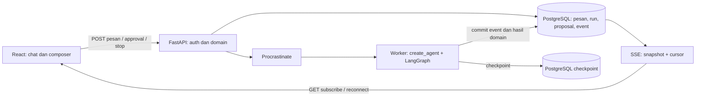

# Riset backlog #04: chat personal, streaming, tools, dan recovery

Tanggal: **16 Oktober 2026**. Status: **riset dan rekomendasi implementasi**. Sumber utama: dokumentasi/kode resmi framework, versi terpasang, desain Pen, dan inspeksi UI langsung. Tidak ada perubahan runtime aplikasi, dependency proyek, status backlog, atau isi Notion.

## Rekomendasi utama

Lanjutkan fondasi LangChain `create_agent` + LangGraph + Procrastinate + PostgreSQL yang sudah dipilih. Tambahkan kontrak event percakapan dan transport SSE yang durable, lalu implementasikan tampilan chat memakai Soft Matcha. Smooth streaming berasal dari konsistensi data, micro-batching, renderer parsial, dan perilaku scroll yang tepat; animasi menjadi lapisan presentasinya.

Keputusan pengguna pada percakapan ini: **side chat baru memiliki riwayat kosong**. Soul/profil dasar dipakai bersama lintas thread. Referensi Course/Lesson/teks hanya dibawa ketika pengguna memilih tindakan eksplisit seperti “Tanyakan Lesson ini”; tidak ada pewarisan seluruh percakapan thread asal.

| Batas tanggung jawab | Rekomendasi |
| --- | --- |
| Percakapan dan pemilihan tool | LangChain `create_agent`; satu agent loop dinamis |
| Checkpoint dan resume agent | LangGraph/PostgreSQL; pisahkan dari ledger domain |
| Eksekusi dan pemulihan pekerjaan | Worker Procrastinate; approval yang menunggu tidak memegang worker |
| Otorisasi, pesan, approval, kuota, event | FastAPI + database aplikasi; server menjadi otoritas |
| Pengiriman ke browser | SSE melalui fetch; snapshot konsisten dan cursor tersimpan |
| State frontend awal | Satu reducer event domain; TanStack Query untuk snapshot/daftar/history |
| Client SSE | `eventsource-client` kandidat utama; parser low-level hanya jika dibutuhkan |
| Scroll | Kandidat headless `@shadcn/react/message-scroller`; buktikan di HP/reload |
| Markdown streaming | Streamdown; spike styling Tailwind/CSS sebelum adopsi |
| Reasoning/tool/approval | Pola shadcn AI Elements/Trace dan Beautiful UI, memakai token Pen |

Ini pilihan awal berdasarkan batas repo, bukan keputusan menambah semua package di tabel. Perbandingan AI SDK UI, LangChain React, dan assistant-ui ada di bagian frontend. Satu spike harus memilih satu pemilik state/protokol frontend; jangan memakai beberapa SDK chat untuk state yang sama.



Diagram menunjukkan aliran informasi; perubahan run dan enqueue ditargetkan atomik pada jalur command; integrasi connector perlu dibuktikan, atau gunakan outbox agar dispatch tetap andal. API subscription tidak menjalankan model. Event dikirim setelah tersimpan. LangGraph checkpoint bukan transcript UI, dan stream browser bukan pemilik umur pekerjaan.

## Temuan yang memengaruhi rencana

1. Agent Python yang ditanamkan ke FastAPI tidak otomatis memperoleh seluruh Agent Server API/stream-resume. Kita tetap memiliki persistence event, authorization, cursor, dan approval domain.
2. Pemulihan dari checkpoint tidak menjamin sebuah panggilan model yang terputus dapat meneruskan token tepat dari posisi terakhir. Tentukan attempt/epoch dan kebijakan mengganti jawaban parsial tanpa mengulang efek tool.
3. State input tool dan state execution berbeda. UI baru menyatakan running setelah ada event eksekusi; proposal pending/rejected/stale tetap dibedakan.
4. AI SDK Elements lama sedang dimigrasikan ke shadcn/ui. Gunakan pola upstream saat ini untuk pekerjaan baru; kode lama yang sudah disalin tidak tiba-tiba berhenti bekerja.
5. Pen sudah memberi acuan main chat, daftar thread, composer, Course panel/drawer, dan recovery. State lifecycle streaming/tool/approval perlu dilengkapi sebagai bagian desain #04.
6. Reasoning yang tampil adalah summary yang provider memang sediakan atau aktivitas aplikasi yang teramati. Dukungan gateway/model belum dibuktikan oleh riset dokumentasi ini.

Referensi produk: [tiket #04](../backlog/tasks/04-chat-personal-thread-dan-streaming-resumable.md), [Agent](../product/03-agent.md), [Arsitektur](../product/04-arsitektur-dan-delivery.md), [fondasi](../engineering/development.md), dan [Pen](../walkthrough-ux.pen). Riset ini memperinci cara mengimplementasikan scope tersebut; tidak mengubah acceptance atau memasukkan fitur Course/memory/proaktivitas lebih awal.

## Bukti dan batas verifikasi

- Baca dokumentasi primer dan source/type declarations package resmi; inspeksi versi backend terpasang serta snapshot npm.
- Baca token/nodes Pen dan periksa screenshot main chat serta panel desktop/HP; tidak mengubah desain.
- Buka Beautiful UI dan periksa expand Thinking/Tool Chips; demo visual tidak dianggap bukti backend production.
- Jalankan probe backend offline dengan fake model/InMemorySaver/ASGI serta dua smoke frontend: parser SSE dan client reconnect dengan response sintetis. [Hasil dan batas](evidence/chat-04/streaming-smoke.json), [snapshot package kandidat](evidence/chat-04/dependency-snapshot.json).
- Belum menjalankan chat aplikasi end-to-end, panggilan provider, benchmark latency/biaya, atau acceptance worker crash. Angka cadence/animasi yang disarankan adalah hipotesis pengujian.

Rincian sumber dan rekomendasi per lapisan mengikuti di bawah.

---

## Runtime backend: keputusan dan bukti

Baseline **Python LangChain `create_agent` + LangGraph + Procrastinate + PostgreSQL** memadai untuk melanjutkan #04. Paket inti yang terkunci kompatibel menurut metadata dependensi dan probe offline. Belum ada bukti kompatibilitas end-to-end model gateway: adapter model dan LiteLLM tidak terpasang di environment backend ini.

Rekomendasi utama:

1. LangChain memilih jawaban/tools secara dinamis; LangGraph menyimpan state eksekusi; Procrastinate mengirim dan menjalankan job; aplikasi memiliki pesan, event, approval, otorisasi, budget, dan status publik.
2. Pakai **event ledger aplikasi dengan cursor durable**, tersimpan sebelum dikirim. HTTP SSE membaca ledger; reconnect tidak menjalankan ulang agent.
3. Untuk baseline #04, normalisasi `agent.astream(..., stream_mode=["messages", "updates", "custom"], version="v2")` di worker. API event streaming v3 tersedia tetapi **eksperimental di source lokal**, sehingga adopsinya perlu keputusan terpisah.
4. Gunakan **SSE melalui `fetch` dengan Bearer auth** untuk kontrak HTTP sekarang. SSE tersedia langsung di FastAPI terpasang; tidak perlu memasang `sse-starlette` untuk memperoleh encoding SSE dasar.
5. Approval tersimpan di aplikasi, terikat pada proposal/revisi/interrupt. Setelah checkpoint interrupt aman, tandai run `waiting_approval` dan akhiri job. Keputusan pengguna menjadwalkan job resume baru.
6. Jalankan paling banyak satu penulis graph per thread. Thread lain milik pengguna tetap independen. Pekerjaan panjang mendapat `execution_id` dan graph thread tersendiri.
7. Bedakan replay event yang sudah tersimpan dari recovery graph yang mungkin mengulang model/tool. **Tidak ada klaim exactly-once untuk panggilan model atau API eksternal.**

Ini keputusan desain yang disarankan, bukan fitur yang telah terimplementasi. Dasar produk: [backlog #04](../backlog/tasks/04-chat-personal-thread-dan-streaming-resumable.md), [Agent](../product/03-agent.md), dan [Arsitektur & Delivery](../product/04-arsitektur-dan-delivery.md).

## Cara membaca bukti

- **Lokal terverifikasi**: lock, metadata distribusi, source paket terpasang, source aplikasi, atau probe offline yang benar-benar dijalankan.
- **Kapabilitas terdokumentasi**: dokumentasi resmi yang dibuka pada tanggal riset; tidak otomatis membuktikan integrasi Ngertiin.
- **Rekomendasi**: rancangan aplikasi yang diturunkan dari kebutuhan produk dan batas runtime.
- **Belum diketahui / PoC**: membutuhkan pengujian berikutnya; tidak dihitung sebagai acceptance yang lulus.

Tool graph codebase tidak tersedia di sesi sidecar ini. Penelusuran menggunakan file/source lokal sebagai fallback. Tidak membaca `.env`, tidak mencetak nilai secret, tidak memanggil model berbayar, tidak menjalankan layanan atau migrasi, tidak mengubah code/Notion/dependensi. Probe dijalankan melalui `apps/backend/.venv/bin/python -B` dari stdin; state hanya di memori. Pemeriksaan backend tidak mengubah source aplikasi; bukti frontend dan screenshot referensi ditambahkan pada bagian berikutnya.

## 1. Snapshot versi dan kondisi implementasi

### 1.1 Lock sama dengan distribusi terpasang

**Lokal terverifikasi.** Snapshot repo `c4db395`; Python aktual **3.13.12**, constraint proyek `>=3.12,<3.14`. SHA-256 `apps/backend/uv.lock` saat pemeriksaan:

```text
caa7b5cd98627e9c39e9a004b2bb876e299cd5702f0aa98de2509c6ec13d2959
```

| Paket | `uv.lock` | `.venv` |
| --- | --- | --- |
| langchain | 1.4.6 | 1.4.6 |
| langchain-core | 1.6.10 | 1.6.10 |
| langgraph | 1.2.15 | 1.2.15 |
| langgraph-checkpoint | 4.3.0 | 4.3.0 |
| langgraph-checkpoint-postgres | 3.2.0 | 3.2.0 |
| langgraph-prebuilt | 1.1.1 | 1.1.1 |
| langgraph-sdk | 0.4.7 | 0.4.7 |
| procrastinate | 3.10.0 | 3.10.0 |
| fastapi | 0.143.1 | 0.143.1 |
| starlette | 1.8.0 | 1.8.0 |
| psycopg / psycopg-pool | 3.3.6 / 3.3.3 | sama |
| uvicorn | 0.54.0 | 0.54.0 |
| pydantic | 2.14.1 | 2.14.1 |

`langchain-openai`, `langchain-litellm`, `litellm`, `openai`, dan `sse-starlette` **tidak ada dalam lock maupun distribusi terpasang**. `langgraph-sdk` adalah dependensi; keberadaannya tidak berarti aplikasi menjalankan LangGraph Agent Server.

Metadata distribusi diperiksa dengan `importlib.metadata` dan `packaging.Requirement`, bukan hanya kesamaan versi:

| Pemilik constraint | Constraint penting | Hasil lokal |
| --- | --- | --- |
| LangChain 1.4.6 | core `>=1.6.10,<2`; LG `>=1.2.12,<1.3` | terpenuhi |
| LangGraph 1.2.15 | checkpoint `>=4.3,<5`; prebuilt `>=1.1,<1.2`; SDK `>=0.4.6,<0.5` | terpenuhi |
| Postgres checkpointer 3.2.0 | checkpoint `>=4.3,<5`; psycopg `>=3.2`; pool `>=3.2` | terpenuhi |
| FastAPI 0.143.1 | Starlette `>=0.46`; Pydantic `>=2.9` | terpenuhi |
| Procrastinate 3.10.0 | psycopg dengan pool | terpenuhi |

Ini pemeriksaan dependency inti terpilih, bukan sertifikasi seluruh kemungkinan extras/provider. Bukti: [pyproject](../../apps/backend/pyproject.toml), [lock](../../apps/backend/uv.lock), serta direktori `*.dist-info/METADATA` di `apps/backend/.venv/lib/python3.13/site-packages/`.

### 1.2 Yang sudah ada di aplikasi

**Lokal terverifikasi.** Backend saat ini memiliki slice diagnostic, bukan runtime chat #04:

- [workflow diagnostic](../../apps/backend/src/ngertiin/worker/workflow.py): Functional API `@entrypoint`/`@task`, `PostgresSaver`, thread `diagnostic:{run_id}`, recovery memakai input `None` jika checkpoint ada, dan `durability="sync"`.
- [tasks](../../apps/backend/src/ngertiin/worker/tasks.py): task async membungkus workflow sync melalui `asyncio.to_thread`; retry maksimal tiga attempts; recovery periodik setiap menit dan saat startup, khusus task `foundation.diagnostic`.
- [worker](../../apps/backend/src/ngertiin/worker/__main__.py): queue `default` dan `maintenance`, concurrency 2, graceful shutdown timeout 20 detik.
- [models](../../apps/backend/src/ngertiin/models.py): `Account`, `DiagnosticRun`, `StoredObject`; belum ada tabel thread/pesan/chat run/event/proposal approval.
- [auth](../../apps/backend/src/ngertiin/accounts/auth.py): request wajib `Authorization: Bearer ...`, diverifikasi Clerk, akun ditentukan server.
- [API](../../apps/backend/src/ngertiin/api/app.py): CORS mengizinkan `Authorization` dan `Content-Type`; `Last-Event-ID` belum tercantum dalam allow-headers eksplisit.

Recovery diagnostic tidak membuktikan stream replay, HITL, cancellation chat, ataupun keamanan tool domain sudah selesai. Jangan menyalin wrapper `to_thread` itu sebagai jaminan cancellation model.

## 2. Streaming LangChain/LangGraph dan tool-call assembly

### 2.1 API yang tersedia dan sudah diprobe

**Lokal terverifikasi.** `create_agent` menerima `BaseChatModel` atau nama model, tools, middleware, `checkpointer`, `store`, `context_schema`, dan system prompt; hasilnya `CompiledStateGraph`. Tanpa tools, graph dapat langsung menjawab. Dengan tools, model dapat memilih rangkaian panggilan. Source: `langchain/agents/factory.py:892` di site-packages lokal. Dokumentasi resmi: [Agents](https://docs.langchain.com/oss/python/langchain/agents).

Pemanggilan yang diuji dengan model palsu:

```python
parts = [
    part
    async for part in agent.astream(
        {"messages": [{"role": "user", "content": "uji"}]},
        config={"configurable": {"thread_id": "dynamic"}},
        stream_mode=["messages", "updates", "custom"],
        version="v2",
        durability="sync",
    )
]
```

Setiap `part` v2 memiliki `type`, `ns`, dan `data`. **Jangan menyamakan** `astream(version="v2")` ini dengan `astream_events(version="v2")`: yang kedua merupakan format callback events, bukan envelope mode yang sama. Source lokal: `langgraph/pregel/main.py:3115–3230,3704–3810`; [panduan streaming](https://docs.langchain.com/oss/python/langchain/streaming).

| Mode | Makna runtime | Rekomendasi proyeksi aplikasi |
| --- | --- | --- |
| `messages` | pasangan message chunk dan metadata pemanggilan LLM | delta teks/summary/tool input dengan message/part ID |
| `updates` | keluaran node per langkah | rekonsiliasi pesan/tool lengkap dan status; bukan sumber delta teks kedua |
| `custom` | data dari `get_stream_writer()` di tool/node | progress domain yang sudah divalidasi |

Jangan mengirim raw graph state, tool output, metadata callback, atau mode debug langsung ke browser. Adapter harus memilih field publik dan membedakan output yang boleh ditampilkan dari data internal. Jika graph membungkus agent sebagai subgraph, `ns` dan opsi `subgraphs=True` perlu diuji; jangan berasumsi semua message berasal dari jawaban akhir. [Streaming LangGraph](https://docs.langchain.com/oss/python/langgraph/streaming).

**Kapabilitas terdokumentasi dan lokal.** `stream_events(version="v3")` menyediakan proyeksi bertipe. Probe lokal memperoleh output, tetapi mengeluarkan `LangChainBetaWarning`; docstring lokal menyebut API eksperimental. Dokumentasi terbaru merekomendasikannya untuk aplikasi baru, sedangkan rekomendasi konservatif laporan ini adalah v2 terlebih dahulu. Ini keputusan stabilitas, bukan ketidaktersediaan v3. Jangan mencampur opsi `stream_mode`/`subgraphs` v2 ke v3; source lokal menolaknya.

### 2.2 Chunk tool bukan argumen siap eksekusi

**Lokal terverifikasi.** `AIMessageChunk.tool_call_chunks` dapat membawa `index`, potongan `args`, serta `id`/`name` yang hanya hadir pada chunk awal. `AIMessageChunk + AIMessageChunk` menggabungkannya; source `langchain_core/messages/ai.py:651` menggunakan merger daftar chunk dan mengonstruksi kembali tool chunks.

Probe dua panggilan terseling:

```text
chunk 1: index=0, id=c0, name=lookup, args={"x":
         index=1, id=c1, name=lookup, args={"x":
chunk 2: index=1, id=null, name=null, args=2}
chunk 3: index=0, id=null, name=null, args=1}
hasil: c0 -> {"x": 1}; c1 -> {"x": 2}
```

**Rekomendasi:** buffer harus berscope setidaknya invocation/message, namespace, dan tool index; index `0` muncul lagi pada panggilan model berikutnya. Jangan memakai index sendirian sebagai ID global. Gunakan penjumlahan chunk LangChain di batas adapter dan lakukan validasi final melalui tool schema. Parsed partial JSON bisa tampak valid sebelum stream selesai; itu bukan izin mengeksekusi tool.

ToolNode/agent loop menjadi pemilik eksekusi tool. Subscriber SSE hanya menampilkan event. Bila `messages` sudah menampilkan teks secara incremental, keluaran penuh dari `updates` harus merekonsiliasi message yang sama, bukan menambah bubble atau menempelkan teks kedua kali.

## 3. Checkpoint, event ledger, dan replay

**Kapabilitas terdokumentasi.** Checkpointer menyimpan state per thread pada batas super-step; pending writes dapat menyelamatkan node lain yang telah selesai dalam step yang sama. Replay dari checkpoint lama mengeksekusi ulang langkah sesudahnya, termasuk model/API/interrupt. [Checkpointers](https://docs.langchain.com/oss/python/langgraph/checkpointers).

**Lokal terverifikasi.** `astream` mendukung durability `sync`, `async` (default), dan `exit`. `sync` menyimpan checkpoint sebelum step berikutnya; ini tidak mengubah setiap token yang sedang dihasilkan menjadi checkpoint. `AsyncPostgresSaver` tersedia; `from_conn_string` membuat koneksi `autocommit=True`, `prepare_threshold=0`, dan `dict_row`; `setup()` diperlukan saat penggunaan awal. Source: `langgraph/checkpoint/postgres/aio.py:45–112`; [panduan produksi Postgres](https://docs.langchain.com/oss/python/langgraph/add-memory#use-in-production).

**Rekomendasi pemisahan tanggung jawab:**

| Penyimpanan | Otoritas |
| --- | --- |
| LangGraph checkpoints/writes | posisi dan state internal untuk melanjutkan graph |
| aplikasi: thread, messages, runs | history publik, owner, urutan pesan, lifecycle |
| aplikasi: `chat_events` | data publik immutable untuk delivery/replay dan cursor |
| aplikasi: approvals/actions | keputusan manusia, revisi, audit, dedup side effect |
| Procrastinate jobs | delivery/retry job; bukan history percakapan |

Jangan merekonstruksi replay browser dengan menjalankan ulang graph atau mengonversi seluruh checkpoint history menjadi token lama. Event ledger dibutuhkan oleh acceptance #04 walaupun graph sudah mempunyai checkpoint. UI boleh memiliki adapter transport berbeda; ledger domain tetap sama.

### 3.1 Identitas dan cursor

| Identitas yang disarankan | Masa hidup dan tujuan |
| --- | --- |
| `thread_id` | percakapan; map server ke LangGraph thread dan owner |
| `run_id` | satu chat turn/request; tetap sama selama retry/approval-resume turn itu |
| `attempt_id` | satu percobaan worker/invocation; baru setelah recovery |
| `execution_id` | workflow panjang seperti generation Course; terpisah dari chat run |
| `message_id`, `part_id` | proyeksi pesan dan bagian yang stabil |
| `proposal_id`, `action_id` | identitas persetujuan dan operasi domain yang tidak dibuat ulang saat replay |
| `job_id` | delivery Procrastinate; bukan thread/run ID produk |
| `checkpoint_id` | posisi graph internal; bukan cursor SSE |
| `seq` | urutan durable per thread yang menjadi cursor delivery |
| `request_key` | dedup submit/retry HTTP milik pengguna |

Contoh envelope **usulan**, belum menjadi schema aplikasi:

```json
{
  "schema_version": 1,
  "thread_id": "thread_A",
  "seq": 123,
  "run_id": "run_B",
  "attempt_id": "attempt_C",
  "message_id": "message_D",
  "type": "message.text_delta",
  "data": {"part_id": "part_1", "revision": 1, "text": "Halo"}
}
```

Simpan `(thread_id, seq)` sebagai unique key. Untuk v1, alokasikan seq dan insert batch event di transaksi pendek yang mengunci row counter thread; ini menjaga urutan **commit**, bukan hanya menghasilkan angka berbeda. Sequence global yang dialokasikan sebelum commit bisa membuat cursor melewati transaksi lebih lambat. Jangan memakai timestamp sebagai cursor. Gap tidak perlu ditambal dengan event palsu, tetapi tidak boleh ada event lebih kecil yang baru muncul setelah cursor dilewati.

Commit delta sebelum subscriber bisa membacanya. Batch kecil boleh menggabungkan token sebelum persist untuk mengurangi write amplification; batas waktu/ukuran batch perlu benchmark. Jika DB gagal, tahan publikasi dan hentikan/batasi upstream buffer; jangan mengirim delta yang belum durable. Snapshot proyeksi pesan harus membawa `through_seq`, lalu replay hanya event sesudahnya.

Reader melakukan `WHERE thread_id = ... AND seq > cursor ORDER BY seq` secara berbatas. Polling pendek memadai untuk PoC; `LISTEN/NOTIFY` dapat menjadi wake-up hint setelah commit, dengan polling/recheck sebagai pemulihan notifikasi hilang. PostgreSQL mendokumentasikan notifikasi ke listener dan delivery sesudah commit; payload besar/rahasia tetap di tabel. [PostgreSQL NOTIFY](https://www.postgresql.org/docs/16/sql-notify.html).

### 3.2 Dua jenis duplikasi yang berbeda

| Kejadian | Penanganan yang disarankan |
| --- | --- |
| Reconnect menerima event lama lagi | client mengabaikan `seq <= last_applied_seq`; update reducer dan cursor bersama |
| HTTP submit diulang | unique owner/thread/request key mengembalikan run yang sama |
| Provider stream putus setelah sebagian teks tersimpan, graph belum checkpoint model result | attempt baru dapat menghasilkan teks lain; tutup attempt lama sebagai interrupted, lalu reset/supersede revision pesan secara eksplisit |
| Model selesai, checkpoint durable, tetapi event final belum tersimpan | reconciler meng-upsert proyeksi/final marker secara idempotent dengan identitas stabil |
| Side effect tool berhasil, process mati sebelum checkpoint | baca action ledger/reconcile status eksternal; jangan otomatis mengeksekusi ulang tanpa idempotency key |

Dedup `seq` hanya menyelesaikan redelivery event identik. Ia tidak menghapus duplikasi semantik dari model yang dipanggil ulang. Jangan menyambung awal jawaban attempt pertama dengan awal jawaban attempt kedua tanpa event pergantian revision. Delta yang belum lengkap bukan jawaban final; terminal state harus eksplisit.

Checkpoint dan event ledger memakai commit terpisah secara default, walaupun sama-sama di PostgreSQL. Perlakukan celah di antaranya sebagai failure case nyata; jangan mengklaim atomicity lintas checkpointer/domain event/job tanpa implementasi dan uji transaksi yang membuktikannya.

## 4. HITL: proposal tersimpan, park, dan resume

**Lokal terverifikasi.** LC 1.4.6 mempunyai `HumanInTheLoopMiddleware`, default `interrupt_mode="batched"`, serta opsi `"per_call"`. Batched memakai `decisions` yang berkorespondensi menurut urutan action; per-call memakai mapping interrupt ID ke decision. Probe approve/reject dan per-call lulus. Source: `langchain/agents/middleware/human_in_the_loop.py:396–510`; [HITL resmi](https://docs.langchain.com/oss/python/langchain/human-in-the-loop).

Contoh pemanggilan yang diuji, dua bentuk alternatif:

```python
# Batched, satu action pada probe:
Command(resume={"decisions": [{"type": "approve"}]})

# Per-call, gunakan ID interrupt yang benar-benar tersimpan:
Command(resume={interrupt_id: {"type": "approve"}})
```

**Kapabilitas terdokumentasi.** `interrupt()` membutuhkan checkpointer dan thread ID; resume memakai thread yang sama. Node diulang dari awal, sehingga kode sebelum interrupt berjalan lagi. Jangan menangkap exception interrupt dengan blanket `except` yang mengubahnya menjadi sukses/gagal biasa. [Interrupts](https://docs.langchain.com/oss/python/langgraph/interrupts).

**Rekomendasi lifecycle aplikasi:**

1. Buat proposal durable secara idempotent: owner, origin thread/run, action yang tepat, argumen/snapshot, hash isi, expected revision, expiry, status, serta policy/budget terkait.
2. Capai interrupt; setelah graph call berakhir dengan checkpoint pause, ikat interrupt ID/checkpoint pada proposal dan publish event `approval.requested`. Crash di antara kedua penyimpanan ditangani reconciler; jangan mengirim proposal sebagai siap-resume sebelum binding aman.
3. Tandai run `waiting_approval`, lepas lease eksekusi, dan **return dari task Procrastinate**. Tidak ada loop tidur menunggu manusia, koneksi DB terbuka, atau worker slot yang tetap dipakai.
4. Endpoint keputusan memvalidasi akun, status pending, expiry, revisi, hash, dan idempotency request. Simpan keputusan dengan compare-and-set; keputusan ganda tidak membuat dua action.
5. Commit keputusan dan permintaan dispatch resume secara andal, misalnya domain outbox + dispatcher/reconciler. Jangan meninggalkan celah keputusan tersimpan tetapi job tak pernah dikirim. Enqueue di transaksi yang sama hanya boleh diklaim setelah integrasi connector terbukti.
6. Worker resume memuat keputusan server, memvalidasi ulang akses/revisi/cancellation/budget, lalu meneruskan `Command(resume=...)`. Browser tidak boleh mengirim arbitrary graph command atau mengganti thread/checkpoint.
7. Tool domain menerapkan tepat proposal yang disetujui dengan `action_id` stabil. Penolakan menghasilkan feedback tanpa mutasi domain. Perubahan argumen material memerlukan proposal/revisi persetujuan baru.

Middleware membantu pause, tetapi tidak menggantikan approval table, auth, revision control, atau action ledger. Source lokal menyatakan tool yang tidak tercantum dalam `interrupt_on` auto-approved; backend harus membangun daftar tools dan approval policy secara eksplisit, terutama ketika tool baru ditambahkan.

**Replay dan side effect:** upsert proposal sebelum interrupt harus idempotent. Tempatkan mutasi sesudah persetujuan, pisahkan operasi, dan simpan hasil action. Bahkan sesudah interrupt, crash antara API eksternal sukses dan checkpoint masih memungkinkan replay. Gunakan idempotency provider bila ada; jika hasil ambigu, park untuk reconciliation, bukan retry buta. Probe lokal menemukan counter sebelum interrupt = **2**, sesudah interrupt = **1** untuk satu pause/resume.

### Thread independen dan satu eksekusi aktif

Keputusan produk yang sudah disetujui pengguna: side chat baru **kosong dan independen**, memakai soul/profil pengguna yang sama; konteks sumber hanya ditambahkan melalui tindakan pengguna yang disengaja. Jangan menyalin main-chat history, selected text, node aktif, atau source context ke side chat secara otomatis. Shared soul/profile tidak sama dengan shared message history. Pemisahan checkpointer per thread dan store lintas thread didukung runtime. [Persistence](https://docs.langchain.com/oss/python/langgraph/persistence).

Untuk #04, rekomendasi sederhana adalah satu run belum selesai per thread dan satu attempt yang sedang menulis graph. Saat thread A menunggu approval, ia boleh tetap memiliki turn unresolved, tetapi tidak memegang worker/lease aktif dan thread B tetap dapat berjalan. Jangan memakai lock global user untuk semua percakapan.

Menerima turn baru pada **graph thread yang sama** saat interrupt lama pending perlu keputusan tambahan: antrekan pesan, atau workflow proposal dipisah ke graph thread sendiri. Jangan memulai invocation baru pada checkpoint yang sama sambil berharap resume lama tetap aman. Untuk workflow Course panjang, gunakan `execution_id`/graph thread terpisah dan kirim status kembali ke origin chat.

## 5. Procrastinate: execution, heartbeat, recovery, cancellation

**Kapabilitas terdokumentasi dan lokal.** Worker heartbeat default **10 detik**, stalled-worker timeout **30 detik**. `get_stalled_jobs()` memakai heartbeat dengan default `seconds_since_heartbeat=30`; parameter lama `nb_seconds` mengabaikan kesehatan worker dan deprecated. Stalled job perlu recovery policy yang memanggil retry; keberadaan heartbeat bukan jaminan semua pekerjaan dipulihkan otomatis. [Retry stalled jobs](https://procrastinate.readthedocs.io/en/stable/howto/production/retry_stalled_jobs.html). Source lokal: `procrastinate/worker.py:48–49,481–490`; `manager.py:223–273`.

**Rekomendasi:** perluas recovery secara sengaja untuk task chat/resume, termasuk batas attempts, cancellation, expiry, dan action ambigu. Worker sehat yang model request-nya macet masih mengirim heartbeat; tambahkan deadline model/tool dan batas idle/run. Event-loop stall atau DB partition juga bisa membuat heartbeat hilang tanpa process lama benar-benar mati.

`configure(lock=f"chat:{thread_id}")` dapat menserialkan job pada thread yang sama; `queueing_lock` adalah mekanisme berbeda untuk membatasi job yang menumpuk. Jangan menggantikan keduanya secara sembarang. Job terjadwal/tidak dikonsumsi dengan lock yang sama dapat menghambat job berikutnya. [Procrastinate locks](https://procrastinate.readthedocs.io/en/stable/howto/advanced/locks.html).

Lock queue disarankan sebagai lapisan pertama. Untuk recovery dari split-brain/stale worker, gunakan owner/lease epoch yang diperiksa setiap write domain dan sebelum side effect. Unique constraint/claim transaksi membatasi satu attempt aktif; fencing menolak write dari epoch lama. Fencing aplikasi tidak dapat membatalkan API eksternal yang sudah diterima provider. Hindari transaksi panjang selama streaming/model call.

**Cancellation terdokumentasi.** `cancel_job_by_id_async(job_id, abort=True)` menandai running job untuk abort. Coroutine dicancel melalui asyncio; sync task perlu memeriksa `context.should_abort()` dan berhenti sendiri. [Procrastinate cancellation](https://procrastinate.readthedocs.io/en/stable/howto/advanced/cancellation.html). Source lokal `_abort_job` membedakan kedua jenis task (`worker.py:527–545`).

**Risiko lokal:** task diagnostic adalah coroutine yang menunggu `asyncio.to_thread(run_workflow, ...)`. Membatalkan await tidak menjamin fungsi sync yang sedang berjalan dalam thread berhenti. Future yang sedang berjalan tidak dapat dibatalkan begitu saja. [Python Future.cancel](https://docs.python.org/3.13/library/concurrent.futures.html#concurrent.futures.Future.cancel). Untuk chat, pilih jalur async model/checkpointer dan cooperative cancellation; uji drain sebelum melepaskan ownership.

Kontrak cancellation yang disarankan: simpan `cancel_requested` dahulu; abort job yang relevan; worker memeriksa flag sebelum model/tool/action berikutnya, menutup upstream stream, menulis terminal event, dan melepaskan claim setelah eksekusi benar-benar berhenti. Cancel saat approval pending menandai proposal tak dapat diterapkan. Disconnect SSE hanya melepas subscriber; tidak meng-cancel job. Biaya model yang telah dikirim dan side effect yang telah terjadi mungkin tetap ada.

## 6. FastAPI SSE, auth, dan reconnect

**Kapabilitas resmi dan lokal.** SSE bawaan ditambahkan pada FastAPI 0.135.0, tersedia di versi lokal 0.143.1. Import `EventSourceResponse`/`ServerSentEvent` dari `fastapi.sse`; route memakai `yield` dan `response_class=EventSourceResponse`. Field `data` selalu JSON encoded, termasuk string; `raw_data` alternatif tanpa JSON. `id`, `event`, `retry`, dan `comment` didukung. Routing lokal menambahkan keepalive idle 15 detik, `Cache-Control: no-cache`, dan `X-Accel-Buffering: no`. [FastAPI SSE](https://fastapi.tiangolo.com/tutorial/server-sent-events/), [referensi SSE](https://fastapi.tiangolo.com/reference/sse/).

Rekomendasi endpoint konseptual, belum implementasi:

| Endpoint | Peran |
| --- | --- |
| `POST /chat/threads/{id}/runs` | terima pesan/request key; persist dan enqueue; kembalikan run ID |
| `GET /chat/threads/{id}/events?after={seq}` | hanya replay/tail ledger setelah auth/ownership check |
| `GET /chat/threads/{id}/messages` | snapshot/history dengan `through_seq` dan pagination |
| `POST /chat/approvals/{id}/decision` | persist keputusan tervalidasi dan dispatch resume |
| `POST /chat/runs/{id}/cancel` | persist cancellation dan minta abort |

Native browser `EventSource` menerima URL dan `withCredentials`, tanpa opsi arbitrary Authorization header. Native reconnect mendukung `Last-Event-ID`, tetapi ini bukan penyimpanan history server. [HTML SSE standard](https://html.spec.whatwg.org/multipage/server-sent-events.html). `fetch` menyediakan headers, method/body, credentials, dan abort signal. [Fetch RequestInit](https://fetch.spec.whatwg.org/#requestinit).

Dengan auth Bearer lokal, rekomendasi transport adalah authenticated `fetch` untuk GET event stream. Reconnect loop mengirim token segar dan cursor terakhir yang **sudah diterapkan**, bukan mengirim ulang POST pesan. Query `after` hanya angka/opaque cursor, bukan token. Jika memakai `Last-Event-ID` header pada cross-origin fetch, tambahkan header itu ke CORS; konfigurasi saat ini belum mengizinkannya eksplisit. Alternatif cookie/BFF memerlukan keputusan auth tersendiri.

Aturan transport yang perlu disepakati:

- Parser SSE harus mendukung UTF-8 terpotong antar-network chunk, multiline `data`, komentar, serta frame tidak lengkap. Satu network chunk bukan satu event. `fetch` tidak otomatis memberikan mekanisme reconnect/reducer EventSource.
- Verifikasi status HTTP dan content type sebelum membaca body; pada 401 refresh auth secara berbatas, lalu replay cursor yang sama. Ownership tetap diperiksa untuk history, event, decision, cancel, dan execution.
- Gunakan SSE `id` sebagai representasi cursor ledger dan kirim seq juga dalam payload. Jangan memajukan durable client cursor sampai event berhasil diterapkan. Redelivery aman bila reducer idempotent.
- Snapshot, catch-up, dan tail harus menutup celah event yang commit saat subscriber berpindah mode. Jadikan NOTIFY hint; selalu query ulang setelah wake/reconnect.
- Tentukan retention: cursor terlalu tua menghasilkan respons reset/snapshot yang eksplisit, bukan stream kosong seolah lengkap. Validasi cursor milik thread yang diminta; cursor lebih maju dari high-water perlu ditangani.
- Stream terminal/error adalah event durable yang aman bagi pengguna. Setelah response headers terkirim, error generator bukan lagi HTTP error JSON biasa.
- Batasi buffer/subscriber dan waktu koneksi; subscriber lambat boleh diputus lalu replay. Jangan mempertahankan session/transaction DB selama koneksi SSE hidup. Proxy buffering, timeout, dan kompresi perlu uji deployment; header lokal saja tidak membuktikan seluruh jalur flush.

## 7. Reasoning summary dan batas adapter LiteLLM

### 7.1 Summary adalah capability opsional

| Provider | Yang dinyatakan sumber resmi | Implikasi #04 |
| --- | --- | --- |
| OpenAI | Raw reasoning tokens tidak diekspos; Responses dapat mengembalikan summary jika diminta melalui `reasoning.summary`, misalnya `"auto"`; dukungan bergantung model | tampilkan hanya summary publik bila benar-benar diterima; jangan menjanjikan private reasoning |
| Anthropic | Extended thinking pada model yang didokumentasikan dapat mengembalikan summarized thinking blocks | bentuk/dukungan mengikuti model dan endpoint; bukan format universal |
| Google Gemini | Thought summaries dapat diaktifkan; summary bisa kosong/absen dan streaming summary berbeda dari thought signature | tangani ketiadaan summary sebagai kondisi normal; signature bukan teks UI |

Sumber primer: [OpenAI reasoning summaries](https://developers.openai.com/api/docs/guides/reasoning#reasoning-summaries), [Claude extended thinking](https://platform.claude.com/docs/en/build-with-claude/extended-thinking), [Gemini thinking](https://ai.google.dev/gemini-api/docs/thinking).

**Rekomendasi:** event publik bernama `reasoning.summary_delta` hanya untuk data summary yang provenance/capability-nya jelas. Status seperti mencari konteks atau menunggu tool berasal dari lifecycle/tool progress yang benar-benar terjadi, bukan rekonstruksi pikiran model. Jangan mengubah raw `reasoning_content`, encrypted reasoning, signatures, prompts internal, atau debug trace menjadi payload publik secara otomatis. Jika provider tidak memberi summary, tetap kirim jawaban/tools/status biasa; jangan menambah panggilan LLM hanya untuk membuat panel berpikir.

Label model Luna/Sol pada dokumen produk belum diverifikasi terhadap route gateway yang berjalan. Penelitian ini tidak membaca secret/config deployment atau memanggil endpoint model. Availability summary pada jalur yang dipilih tetap **unknown**.

### 7.2 Pilihan adapter perlu capability probe

**Dokumentasi resmi:** `ChatLiteLLM`/`ChatLiteLLMRouter` tersedia melalui paket terpisah `langchain-litellm`, dengan deklarasi tools, streaming, async, dan usage. [Integrasi LangChain LiteLLM](https://docs.langchain.com/oss/python/integrations/chat/litellm). Source LC lokal mengenali provider `litellm` pada `langchain/chat_models/base.py:88`, tetapi paket implementasinya belum terpasang.

`ChatOpenAI` menargetkan spesifikasi OpenAI. Dokumentasinya menyatakan field nonstandar provider seperti `reasoning_content`/`reasoning_details` tidak diekstrak/dipertahankan, dan mengarahkan penggunaan integrasi provider khusus. Reasoning config OpenAI dapat merutekan ke Responses API. [ChatOpenAI API scope dan reasoning](https://docs.langchain.com/oss/python/integrations/chat/openai). Mengubah `base_url` ke gateway tidak membuktikan preservation semua field.

LiteLLM mendokumentasikan normalisasi `reasoning_content`/`thinking_blocks` serta endpoint Responses. [Reasoning content](https://docs.litellm.ai/docs/reasoning_content), [Responses](https://docs.litellm.ai/docs/response_api). Ini kemampuan produk, bukan bukti versi deployment Ngertiin atau kompatibilitas semua kombinasi provider/adapter. Fallback/routing dapat mengganti provider dan bentuk/continuity reasoning; jangan mengambil raw normalized field sebagai izin menampilkannya.

**Rekomendasi keputusan:** pilih satu jalur secara eksplisit saat implementasi: native LangChain LiteLLM adapter, atau adapter OpenAI-spec ke LiteLLM proxy apabila hanya capability standar yang diperlukan dan terbukti. Pin versi adapter/gateway dan uji terhadap lock; jangan memasang dua lapisan retry/router tanpa menghitung total attempts. Jangan mengklaim support Responses summary dari deklarasi tool calling Chat Completions saja.

PoC adapter minimum: async token stream; dua tool call terseling dan ID konsisten; tool schema/binding; final/usage-only chunks; provider error sebelum/sesudah delta; summary ada/tidak ada; cancellation; timeout; retry/fallback; preservasi opaque state yang dibutuhkan provider. Rekam effective model, endpoint family, versi adapter, usage, finish reason, dan attempt ID tanpa secrets. Semua ini belum diuji live.

## 8. Budget dan batas efek eksternal

**Lokal terverifikasi:** tersedia `ModelCallLimitMiddleware(run_limit=..., thread_limit=...)` dan `ToolCallLimitMiddleware`. Source di `langchain/agents/middleware/model_call_limit.py:94` dan `tool_call_limit.py:141`. Batas pemanggilan ini tidak dengan sendirinya menjadi batas rupiah lintas worker.

**Rekomendasi:** reservasi budget di aplikasi sebelum dispatch/model/tool mahal; batasi output tokens, model calls per run, tool calls, timeout, concurrency global, dan total attempts. Rekonsiliasi usage/cost aktual ketika diterima; stream putus bisa membuat usage tidak lengkap. Retry SDK, adapter, gateway, graph, dan Procrastinate harus dihitung bersama agar batas tidak berlipat tanpa sengaja. Biaya saat hasil eksternal ambigu perlu allowance konservatif, bukan otomatis dikembalikan ke saldo.

Batasi history thread melalui pagination, window/summarization yang disengaja, dan attachment/snapshot context; jangan mengirim seluruh history lintas thread. Persist soul/profile revision yang dipakai run untuk audit. Saat approval dilanjutkan setelah lama, cek ulang izin/budget/revisi; snapshot approval tidak memberi otorisasi baru tanpa batas waktu.

Untuk mutasi domain di DB, unique `action_id` dan transaksi dapat menghasilkan efek idempotent dalam lingkup DB. Untuk provider eksternal, gunakan idempotency key atau reconciliation yang disediakan provider. Model request dapat telah diproses/ditagih walaupun koneksi putus sebelum respons tersimpan. Tidak ada exactly-once external-call guarantee dari gabungan queue, checkpointer, dan SSE.

## 9. Probe yang benar-benar dijalankan

Seluruh hasil di bawah memakai paket `.venv` aktual, model palsu LangChain, `InMemorySaver`, dan/atau HTTP ASGI di memori. Tidak ada DB/socket jaringan/provider call. Fake tool hanya mengubah list/counter proses.

| Probe offline | Hasil teramati | Batas bukti |
| --- | --- | --- |
| No-tool `create_agent`, `astream` v2 | 10 `messages`, 1 `updates`; setiap envelope tepat `type/ns/data` | jumlah chunk spesifik fake model, bukan benchmark |
| Dua tool berurutan dari fake model | tool inputs `[1,2]`; 5 `messages`, 5 `updates`, 2 `custom` | membuktikan wiring API/loop, bukan kualitas pemilihan tool |
| Batched HITL approve | 1 interrupt, mutasi sebelum = 0, sesudah = 1 | state memory, belum Postgres recovery |
| Batched HITL reject | 1 interrupt, mutasi sesudah = 0 | belum stale approval/auth HTTP |
| Per-call HITL | resume keyed by interrupt ID berhasil; response schema tersedia | belum multiple concurrent interrupts |
| Dua tool chunks terseling | assembly menghasilkan `c0:{x:1}`, `c1:{x:2}` | input sintetis, belum proxy/provider stream |
| Node interrupt replay | counter before = 2, after = 1 | menunjukkan replay, bukan perlindungan idempotency |
| `stream_events(version="v3")` | output dict tersedia; warning experimental | bukan pilihan default laporan |
| FastAPI SSE ASGI + `Last-Event-ID: 1` | mengembalikan IDs 2,3; content type benar; no-cache dan no-buffer header | resume dilakukan generator probe; tidak berarti FastAPI menyimpan event otomatis |
| Metadata dependency terpilih | constraint inti pada tabel §1 terpenuhi | adapter model tidak terpasang, belum diuji |

Probe SSE menggunakan route `response_class=EventSourceResponse`, membaca header sebagai `Header`, lalu yield `ServerSentEvent(data=..., id=..., event="chat")`. `httpx.ASGITransport` hanya memanggil aplikasi di memori; uji ini tidak membuktikan timing flush, reconnect browser, proxy, Clerk, heartbeat, atau recovery proses.

### Bukti source paket lokal yang penting

Semua path di bawah relatif terhadap `apps/backend/.venv/lib/python3.13/site-packages/`; line numbers adalah snapshot versi §1, bukan permalink upstream:

| File | Lokasi yang diperiksa |
| --- | --- |
| `langchain/agents/factory.py` | 892: signature dan compiled graph |
| `langchain/agents/middleware/human_in_the_loop.py` | 396–510: modes/default/decision policy |
| `langchain_core/messages/ai.py` | 651: `add_ai_message_chunks` |
| `langgraph/pregel/main.py` | 3115–3230: `astream`; 3704–3810: event protocol/version warning |
| `langgraph/types.py` | 903: interrupt replay/checkpointer contract |
| `langgraph/checkpoint/postgres/aio.py` | 45–112: async saver, connection options, setup |
| `procrastinate/worker.py` | 48–49: defaults; 481–490: heartbeat; 527–545: abort |
| `procrastinate/manager.py` | 223–273: stalled jobs; 404: async cancel |
| `fastapi/sse.py` | 20–153: response marker dan event fields |
| `fastapi/routing.py` | 546–666: serialization, keepalive, response headers |
| `starlette/responses.py` | 225–285: streaming/disconnect handling |

## 10. Unknowns dan PoC sebelum acceptance #04

| Prioritas | Skenario | Syarat lulus yang diusulkan |
| --- | --- | --- |
| P0 | Stream disconnect saat worker tetap hidup | reconnect hanya membaca ledger, tidak menambah model request/tool execution |
| P0 | Crash sesudah sebagian delta, sebelum model checkpoint | attempt/revision lama ditutup; hasil baru tidak menggandakan atau menyambung jawaban salah |
| P0 | Crash sesudah tool sukses, sebelum checkpoint/event final | idempotency/reconciliation mencegah mutasi kedua atau memarkir hasil ambigu |
| P0 | Approval tertunda, worker restart, side chat berjalan | worker slot bebas; side chat kosong dengan shared soul/profile; resume hanya proposal tepat |
| P0 | Dua submit/resume/cancel bersamaan pada thread sama | satu writer; request/decision idempotent; stale attempt ditolak |
| P0 | Worker mati/partition dan heartbeat false-stale | recovery bounded; epoch lama tidak memublikasikan state baru; API eksternal tetap diperlakukan ambigu |
| P0 | Cancel model stream / `to_thread` / pending approval | eksekusi didrain, final state konsisten; tidak release claim sementara thread lama menulis |
| P0 | Cursor saat transaksi lambat, snapshot, reconnect | tidak ada event commit terlambat yang terlewati; cursor dan projection konsisten |
| P0 | Clerk token expired/CORS/proxy/slow subscriber | refresh/replay berbatas, owner isolation, buffer bounded, koneksi putus tidak membatalkan run |
| P0 | Adapter dan gateway yang benar-benar dipilih | tool chunks, usage, summary opsional, errors, cancellation terbukti pada versi pinned |
| P0 | Dua run lintas worker mendekati quota | reservasi atomik dan retry budget menjaga batas global |
| P1 | Retention/history panjang | snapshot reset/pagination/checkpoint retention tidak merusak pending approval |

PoC DB/worker/HTTP browser dan paid provider probe di atas **belum dijalankan**. Tidak ada klaim latency, biaya per turn, SLA reconnect, exactly-once model execution, atau keberhasilan deployment. Native LangGraph React transport, AI SDK, dan komponen rendering dibahas pada bagian frontend di bawah; pilihan itu dapat memproyeksikan ledger yang sama tanpa memindahkan otoritas domain ke client.

## Daftar sumber primer

Diakses 16 Oktober 2026; beberapa halaman LangChain direstrukturisasi/redirect, sehingga versi source lokal §1/§9 menjadi acuan perilaku yang benar-benar terpasang.

1. [LangChain streaming](https://docs.langchain.com/oss/python/langchain/streaming) — mode, envelope v2, event streaming.
2. [LangGraph streaming](https://docs.langchain.com/oss/python/langgraph/streaming) — stream modes/subgraphs.
3. [LangChain HITL](https://docs.langchain.com/oss/python/langchain/human-in-the-loop) — review tool calls.
4. [LangGraph interrupts](https://docs.langchain.com/oss/python/langgraph/interrupts) — pause/resume dan replay node.
5. [LangGraph persistence](https://docs.langchain.com/oss/python/langgraph/persistence) — checkpointer/store scope.
6. [LangGraph checkpointers](https://docs.langchain.com/oss/python/langgraph/checkpointers) — super-step, replay, durability.
7. [LangGraph memory, produksi](https://docs.langchain.com/oss/python/langgraph/add-memory#use-in-production) — Postgres sync/async dan setup.
8. [Procrastinate stalled-job recovery](https://procrastinate.readthedocs.io/en/stable/howto/production/retry_stalled_jobs.html) — heartbeat dan retry policy.
9. [Procrastinate locks](https://procrastinate.readthedocs.io/en/stable/howto/advanced/locks.html) — serialisasi eksekusi.
10. [Procrastinate cancellation](https://procrastinate.readthedocs.io/en/stable/howto/advanced/cancellation.html) — async/sync abort.
11. [FastAPI SSE tutorial](https://fastapi.tiangolo.com/tutorial/server-sent-events/) dan [API reference](https://fastapi.tiangolo.com/reference/sse/) — native SSE.
12. [WHATWG HTML SSE](https://html.spec.whatwg.org/multipage/server-sent-events.html) — EventSource, framing, reconnect.
13. [WHATWG Fetch](https://fetch.spec.whatwg.org/#requestinit) — headers, credentials, signal.
14. [PostgreSQL 16 NOTIFY](https://www.postgresql.org/docs/16/sql-notify.html) — listener dan commit semantics.
15. [Python 3.13 Future.cancel](https://docs.python.org/3.13/library/concurrent.futures.html#concurrent.futures.Future.cancel) — batas cancellation pekerjaan berjalan.
16. [OpenAI reasoning](https://developers.openai.com/api/docs/guides/reasoning#reasoning-summaries) — summary dan private reasoning.
17. [Claude extended thinking](https://platform.claude.com/docs/en/build-with-claude/extended-thinking) — summarized thinking.
18. [Gemini thinking](https://ai.google.dev/gemini-api/docs/thinking) — thought summaries/signatures.
19. [LangChain ChatLiteLLM](https://docs.langchain.com/oss/python/integrations/chat/litellm) — paket adapter dan capability deklaratif.
20. [LangChain ChatOpenAI](https://docs.langchain.com/oss/python/integrations/chat/openai) — API scope dan reasoning output.
21. [LiteLLM reasoning content](https://docs.litellm.ai/docs/reasoning_content) dan [Responses](https://docs.litellm.ai/docs/response_api) — gateway format/capability.

Sumber primer lokal: lock, metadata, dan source paket §1/§9; source aplikasi §1.2; kontrak produk/backlog pada awal laporan. Fakta deployment/provider yang tidak diperiksa tetap ditandai unknown.


---

## Frontend, protokol, dan rendering

### Pilihan yang direkomendasikan untuk #04

Pertahankan React/TanStack Start dan React Query yang sudah ada. Untuk irisan #04, gunakan event aplikasi bertipe, satu reducer percakapan, dan SSE melalui fetch. Kandidat client adalah `eventsource-client` untuk parsing/reconnect; `fetch` + `eventsource-parser` adalah alternatif lebih rendah tingkatnya bila kebijakan koneksi aplikasi memerlukan kontrol khusus. Jangan memasang keduanya sebagai dependency langsung untuk fungsi yang sama. Identitas pesan, status run, approval, dan cursor tetap dimiliki backend. Ini rekomendasi desain untuk repo saat ini, bukan klaim satu pendekatan selalu paling sederhana.

`eventsource-client` mendukung custom headers, custom fetch, reconnect policy, dan initial last-event ID. Custom fetch dapat mengambil token Clerk yang masih berlaku sebelum setiap koneksi. Menutup client menghentikan subscription; pembatalan pekerjaan tetap melalui endpoint domain tersendiri. Source package menyatakan dependency `eventsource-parser: ^3.0.0`, sehingga versi parser 4 tidak boleh dipaksakan melalui override tanpa verifikasi. [Client resmi](https://github.com/rexxars/eventsource-client), [parser resmi](https://github.com/rexxars/eventsource-parser).

Gunakan `@shadcn/react/message-scroller` sebagai kandidat utama perilaku scroll: headless, sesuai CSS existing, mengikuti live edge, dan menjaga posisi saat history lama dimuat. Package 0.3.1 masih sebelum 1.0; pin versi dan buktikan perilaku mobile sebelum adopsi. `use-stick-to-bottom` merupakan alternatif bila prototype menunjukkan scroller baru belum cocok, bukan dependency tambahan yang berjalan bersamaan. [Message Scroller headless](https://ui.shadcn.com/docs/react/message-scroller), [alternatif scroll](https://github.com/stackblitz-labs/use-stick-to-bottom).

Gunakan Streamdown untuk Markdown yang belum lengkap, dengan plugin math dan code sesuai kebutuhan. Integrasikan styling secara sengaja: dokumentasi stock Streamdown membutuhkan Tailwind; repo sekarang menggunakan CSS biasa dan belum memasang Tailwind/shadcn. Pilih satu dari (a) Tailwind yang dibatasi untuk komponen baru, sambil mempertahankan semantic tokens dan meninjau pengaruh reset/preflight; atau (b) override komponen renderer dan CSS lokal dengan biaya pemeliharaan yang dicatat. Jangan menganggap `streamdown/styles.css` menggantikan seluruh styling Tailwind: file itu terutama menyertai animasi. Rekomendasi awal adalah spike styling kecil sebelum mengunci dependency. [Setup](https://streamdown.ai/docs/getting-started), [math](https://streamdown.ai/docs/plugins/math), [animasi](https://streamdown.ai/docs/animation).

### Alternatif SDK frontend yang diteliti

| Pendekatan | Yang diberikan | Pekerjaan yang tetap dimiliki Ngertiin | Penilaian untuk #04 |
| --- | --- | --- | --- |
| SSE client + reducer aplikasi | Cursor domain langsung, state sesuai kontrak produk, sedikit konsep tambahan | Reducer parts, snapshot/replay, lifecycle, approval | Rekomendasi awal untuk fondasi Python/PostgreSQL existing; ukur ukuran adapter sebelum finalisasi |
| AI SDK UI (`ai` + `@ai-sdk/react`) | `useChat`, typed message parts, tool/reasoning states, transport | Adapter Python ke UIMessage stream, ledger, approval/stop server, replay | Alternatif kuat jika spike membuktikan jumlah kode lebih kecil; dapat dipakai frontend-only tanpa mengganti LangChain |
| `@langchain/react` | Message/tool projections, interrupts, thread hydration, stream selectors | Adapter/protokol yang cocok dengan Python terpasang, domain auth/approval, durable replay | Layak jika kita sengaja mengadopsi kontrak SDK; bukan drop-in untuk SSE event aplikasi arbitrer |
| assistant-ui ExternalStoreRuntime | UI primitives dan konversi dari store existing | Store, transport, persistence, adapter capability | Berguna bila kebutuhan branching/editing bertambah; belum perlu menambah runtime presentasi kedua |

AI SDK mendokumentasikan backend non-JavaScript termasuk Python. Protocol-nya mencakup text/reasoning start-delta-end, tool input/output, approval, dan custom data parts. Apabila dipilih, gunakan transport tersebut sebagai proyeksi frontend, bukan agent runtime kedua di Node. Contoh resume resmi memakai Redis dan `resumable-stream`; itu pola contoh, bukan kewajiban PostgreSQL kita ikut menambah Redis. Reconnect/reload perlu dibedakan: default transport menganggap resume sebagai full replay; continuation tanpa replay penuh mempunyai keterbatasan parser setelah reload. [Protocol](https://ai-sdk.dev/docs/ai-sdk-ui/stream-protocol), [transport](https://ai-sdk.dev/docs/ai-sdk-ui/transport), [resume](https://ai-sdk.dev/docs/ai-sdk-ui/chatbot-resume-streams).

Dokumentasi frontend LangChain menjelaskan `useStream` dan selectors. Inspeksi tarball resmi `@langchain/react` 1.2.4 menunjukkan API adapter v1, sedangkan `FetchStreamTransport` masih tersedia pada export legacy `@langchain/langgraph-sdk/react`. Interface `AgentServerAdapter` memuat send/open/stream serta kontrak replay dan opsional getState/getHistory. Jangan menyalin contoh dari generasi API lama ke package baru tanpa verifikasi; agent Python embedded juga tidak otomatis menyediakan Agent Server API. URL `frontend/custom-transport` yang dicoba mengembalikan 404, sehingga bukan sumber kemampuan. [Frontend resmi](https://docs.langchain.com/oss/javascript/langchain/frontend/overview), [source SDK](https://github.com/langchain-ai/langgraphjs/tree/main/libs/sdk-react), [ExternalStoreRuntime](https://www.assistant-ui.com/docs/runtimes/custom/external-store).

### AI Elements: perubahan upstream yang relevan

Pada pembacaan 16 Oktober 2026, situs AI SDK Elements menampilkan pemberitahuan migrasi ke shadcn/ui dan deprecation proyek lama pada akhir November 2026. Dokumentasi shadcn menyatakan komponen yang dahulu disalin ke repo tetap bekerja; untuk proyek baru, gunakan pola dan primitives shadcn saat ini. Jangan memasang seluruh registry AI Elements lama untuk #04. [Pemberitahuan](https://elements.ai-sdk.dev/components/reasoning), [panduan migrasi](https://ui.shadcn.com/docs/ai-elements#migrating-from-ai-sdk-elements).

Pola baru `Trace` cocok untuk langkah/tool yang dapat diperluas. Approval ditempatkan sebagai permintaan terpisah yang jelas, bukan disembunyikan dalam trace. State product yang kita tampilkan tetap berdasarkan event backend. Sebagai contoh, input tool yang selesai disusun belum membuktikan tool sudah berjalan; gunakan event execution dari worker untuk label “sedang berjalan”. [Tool pattern](https://ui.shadcn.com/docs/ai-elements/base/tool).

`@shadcn/helpers/ai-sdk` adalah helper percakapan deterministik untuk preview tanpa model/API key, bukan pengganti transport production. Gunakan hanya jika spike UI memakai AI SDK; jika memakai reducer domain sendiri, fixture event domain memberikan simulasi yang lebih langsung. [Helper resmi](https://ui.shadcn.com/docs/helpers/ai-sdk).

## Pemetaan desain Pen dan Beautiful UI

File `docs/walkthrough-ux.pen` dibaca melalui Pencil MCP. Tidak ada node atau token yang diubah. Screenshot diekspor sebagai bukti referensi, bukan rancangan baru.

| Referensi Pen | Node desktop / HP | Yang digunakan untuk #04 |
| --- | --- | --- |
| New conversation | `KuGjR` / `axZuW` | Welcome, composer, hierarchy, Nunito Sans dan ruang baca |
| Conversation list open | `m3FnIy` / `ASssq` | Main chat terpisah dari side chats, daftar/search thread |
| Attachment ready / sent | `MCEfX`, `R7aBos` / `IWvsS`, `V9goiC` | Acuan visual attachment; ingestion produk tetap #06 |
| Lesson with chat panel | `dQFxn` / `MkPoW` | Komponen pesan, composer, referensi konteks Lesson; layar belajar penuh tetap #11 |
| Lesson with chat overlay | `gC72n` / `UNUif` | Acuan varian overlay saat integrasi #11 |
| Outline review | `D9TfUa` / `t4J1v8` | Konsistensi presentasi proposal; domain outline tetap #08 |
| Connection recovery | `G1QDK` / `E6GTb` | Copy yang menenangkan dan pemulihan state tersimpan |

Contoh export: [Main chat](evidence/chat-04/KuGjR.png), [daftar thread](evidence/chat-04/m3FnIy.png), [panel desktop](evidence/chat-04/dQFxn.png), [panel HP](evidence/chat-04/MkPoW.png).

Semantic tokens dibaca langsung dari Pen: Nunito Sans; background light `#EEEADF`, dark `#1C1C1E`; card light `#FAF8F1`, dark `#262628`; primary `#B8D993`. CSS repo memiliki sebagian dark values yang berbeda (contoh background `#1d1c1a`, card `#282623`). Saat implementasi, selaraskan komponen chat dengan token Pen yang dipilih dan catat perubahan lintas shell; jangan menimpa seluruh tema tanpa pemeriksaan visual.

Inventaris frame yang relevan tidak menunjukkan frame khusus untuk streaming/tool/approval lifecycle. Tambahan state yang perlu didesain adalah queued/thinking, ringkasan proses streaming, penyusunan tool input, tool running/success/error, approval waiting/approved/rejected/stale, reconnect dengan jawaban parsial, stop, serta retry dengan attempt baru. Desktop/mobile dan dark mode perlu dinilai untuk state ini; screenshot statis Pen tidak membuktikan animasi maupun scroll.

### Pola Beautiful UI yang diambil

Situs dibaca melalui scrape dan browser langsung; interaction expand pada Thinking dan Tool Chips diperiksa. Demo tersebut menunjukkan presentasi, bukan bukti durable backend production. [Situs](https://www.beautifului.dev/).

| Pola | Adaptasi Ngertiin |
| --- | --- |
| [Loading State](https://www.beautifului.dev/#loading-state) | Indikator singkat dan elapsed time; tanpa persentase buatan |
| [Thinking](https://www.beautifului.dev/#thinking-state) | Satu ringkasan proses yang dapat dibuka; tidak memindahkan fokus saat status berubah |
| [Streaming Text](https://www.beautifului.dev/#streaming-text) | Teks muncul bertahap, sumber dan tindakan melekat pada pesan |
| [Tool Chips](https://www.beautifului.dev/#tool-chips) | Label ramah seperti “Membaca materi”, status aktual, hasil ringkas; JSON teknis bukan tampilan default |
| [Task Rows](https://www.beautifului.dev/#task-rows) | Pekerjaan panjang: daftar tahap nyata dan hasilnya, bukan progress palsu |
| [Approval Card](https://www.beautifului.dev/#approval-card) | Pertanyaan/keputusan yang terlihat jelas dan tetap tersimpan setelah reload |
| [Context Cards](https://www.beautifului.dev/#context-cards) | Referensi materi yang sengaja dibawa pengguna; terhubung ke evidence yang dapat dibuka |

Halaman license situs menyatakan MIT. Bila menyalin bagian kode yang substansial, pertahankan notice lisensinya. Rekomendasi riset adalah mengambil pola interaksi dan menerapkan Soft Matcha, bukan menyalin keseluruhan tampilan gelap situs. [Lisensi pemilik](https://www.beautifului.dev/license).

## Kontrak tampilan reasoning, tool, dan approval

Bedakan tiga sumber informasi: (1) teks jawaban, (2) ringkasan penalaran yang memang diberikan provider, dan (3) aktivitas aplikasi yang dapat dibuktikan dari event tool/job. Tampilkan label “Proses” untuk aktivitas aplikasi; tampilkan “Ringkasan penalaran” hanya bila provider mengembalikannya. Jangan merekayasa reasoning dari timer, membuka private chain-of-thought, atau mengubah token terenkripsi menjadi konten pengguna. Bila gateway tidak mendukung summary, gunakan status proses sebagai fallback tanpa panggilan model tambahan.

Urutan parts harus mempertahankan timeline: text → tool → text → approval jika demikian urutan run. Jangan mengumpulkan semua reasoning/tool di atas pesan sehingga penjelasan setelah tool terlihat seperti mendahului hasilnya. Multiple reasoning blocks dapat dikelompokkan visual per tahap tanpa mengubah urutan dan ID aslinya.

Usulan state tool: `preparing_input` → `awaiting_approval` atau `queued` → `running` → `succeeded` / `failed` / `cancelled`; `rejected` adalah keputusan pengguna, bukan error sistem. Output tool yang tampil memakai allowlist ringkasan/tautan domain, bukan seluruh payload internal. Proposal membawa ID dan revisi dari server; tombol ganda atau tab kedua tidak boleh menjalankan perubahan dua kali.

Approval yang pending tetap jelas di luar accordion. Ketika ditolak, state tetap tercatat dan agent menerima feedback penolakan. Ketika revisi sudah berubah, kartu menjadi stale dan meminta proposal baru; client tidak boleh hanya mengirim `approved: true` tanpa identitas proposal. Retry dilakukan terhadap pekerjaan yang gagal, bukan dengan mengirim ulang percakapan lama secara buta.

## Apa yang membuat streaming terasa smooth

Nilai di bawah adalah titik awal eksperimen, bukan latency/SLA yang sudah diukur:

- Simpan delta dalam micro-batch berbasis batas waktu/ukuran, misalnya mulai menguji 30–60 ms; flush segera saat tool, approval, error, atau finish mengubah urutan. Publish ke SSE setelah commit. Jangan satu transaksi per token dan jangan menahan transaksi saat menunggu provider.
- Pisahkan data yang diterima dari reveal visual. Gunakan animasi kata singkat sekitar 120–150 ms; tanpa antrean typewriter panjang. Saat selesai, konten penuh terlihat segera.
- Render ulang pesan aktif dan bagian yang berubah; pesan lama memakai ID/key stabil. Memoize batas renderer, bukan seluruh aplikasi. Jangan jalankan reparse Markdown atas seluruh riwayat pada setiap chunk.
- Pertahankan live DOM sampai snapshot final dengan cursor setara/lebih baru diterima. Rekonsiliasi berdasarkan message/part ID agar tidak berkedip ketika stream selesai.
- Auto-follow hanya saat pengguna berada di live edge. Scroll ke atas melepaskan auto-follow; tampilkan tombol menuju pesan terbaru. History prepend dan pembukaan detail tool mempertahankan posisi pembaca.
- Hormati reduced motion; jangan mengumumkan setiap token ke screen reader. Gunakan status sopan untuk perubahan tahap yang bermakna dan tombol yang tetap dapat difokuskan.
- Tabel/code/rumus panjang mempunyai overflow horizontal lokal, bukan memperlebar layar. Plugin code/math tidak perlu menghambat jawaban teks pertama; ukur bundle dan lazy loading.
- Bedakan disconnect dari stop: disconnect menutup subscription, sedangkan Stop mengirim perintah pembatalan server. Proses background yang sudah diserahkan ke domain mengikuti kebijakan pembatalannya sendiri.

Streamdown mendokumentasikan per-word animation, penanganan Markdown parsial, serta plugin KaTeX/code; Message Scroller mendokumentasikan live-edge dan preserve-on-prepend. Keberhasilan perilaku gabungan tetap harus diverifikasi di aplikasi nyata. [Animasi](https://streamdown.ai/docs/animation), [scroll](https://ui.shadcn.com/docs/react/message-scroller).

## Snapshot dependency dan pemeriksaan riset frontend

Registry npm resmi dibaca pada 16 Oktober 2026; ini versi kandidat saat riset, bukan dependency yang sudah diinstal atau versi yang otomatis harus dipakai:

| Package | Versi teramati | Catatan |
| --- | --- | --- |
| `streamdown` | 2.7.0 | React 18/19 peer; styling Tailwind perlu spike |
| `@streamdown/math` | 1.0.3 | KaTeX; syntax delimiter diselaraskan dengan prompt |
| `@streamdown/code` | 2.0.0 | Shiki; Node >=20; evaluasi pemuatan |
| `@shadcn/react` | 0.3.1 | Headless scroller, React >=19; API sebelum 1.0 |
| `eventsource-client` | 1.2.0 | Fetch SSE client; parser dependency ^3 |
| `eventsource-parser` | 4.1.2 | Alternatif low-level, zero runtime deps; Node >=22.12 |
| `ai` / `@ai-sdk/react` | 7.0.142 / 4.0.146 | Alternatif projection/transport frontend |
| `@langchain/react` | 1.2.4 | Alternatif SDK frontend; adapter harus cocok |
| `use-stick-to-bottom` | 1.1.6 | Alternatif scroller; pilih satu |

Metadata sumber: [Streamdown](https://registry.npmjs.org/streamdown/2.7.0), [shadcn React](https://registry.npmjs.org/@shadcn%2freact/0.3.1), [eventsource-client](https://registry.npmjs.org/eventsource-client/1.2.0), [eventsource-parser](https://registry.npmjs.org/eventsource-parser/4.1.2), [AI SDK React](https://registry.npmjs.org/@ai-sdk%2freact/4.0.146), [LangChain React](https://registry.npmjs.org/@langchain%2freact/1.2.4).

Tarball resmi dibaca di direktori sementara untuk memeriksa exports/types; dependency repo tidak berubah. Smoke sementara terhadap parser 4.1.2 berhasil untuk UTF-8 yang terpotong antarchunk, CRLF, multiline data, heartbeat, dan contoh filter cursor. Smoke kedua memakai client 1.2.0 dengan dependency parser 3.1.1 yang sesuai range: custom fetch sintetis terputus setelah event 41, reconnect mengirim Last-Event-ID 41, hook fetch mengganti token uji, event 42 diterima, lalu client ditutup eksplisit. Itu bukti perilaku library di proses Bun dengan Response sintetis; tidak membuktikan Clerk asli, browser/proxy, durable replay, worker crash, atau integrasi UI. Scroller belum dijalankan end-to-end pada aplikasi.

## Irisan implementasi dan verifikasi yang disarankan

1. Kunci kontrak thread/run/message/part/event/proposal dan snapshot+cursor. Buat fixture stream deterministik untuk teks, tool, summary, approval, error, serta reconnect. Side chat baru kosong; soul/profil dasar bersama; referensi Course hanya lewat tindakan eksplisit pengguna.
2. Bangun satu tampilan main chat dan daftar thread berdasarkan Pen, dengan reducer, client SSE, scroller, dan Markdown. Putuskan styling renderer melalui spike kecil. Uji scroll serta rekonsiliasi final sebelum menambah tools domain.
3. Sambungkan `create_agent` di worker, checkpoint, iterasi/budget, context window, dan model adapter. Replay event yang sama harus mempertahankan message/part ID; restart generasi yang belum checkpointed memakai attempt/epoch baru yang jelas.
4. Tambahkan approval tersimpan, validasi revisi, stop, dan retry. Skenario: proposal ditinggalkan, pengguna membuka side chat lain, worker restart, keputusan lama ditolak bila stale, dan efek domain tetap idempotent.
5. Jalankan penerimaan browser desktop/mobile dan light/dark serta statis/build proyek. Integrasi Course nyata mengikuti #07–#08; jangan menyatakan kriteria Course end-to-end lulus hanya dari fixture approval.

| Skenario penerimaan | Bukti yang harus dicari |
| --- | --- |
| Jawaban tanpa tool | Teks mengalir, pesan durable sama setelah reload |
| Dua tool berurutan | Urutan parts dan status tepat; hanya hasil yang relevan ditampilkan |
| Input tool masih parsial | Tidak dieksekusi dan tidak dilabeli running sebelum worker memulai |
| Approval tertunda | Kartu bertahan setelah reload; slot worker bebas; thread lain berjalan |
| Approval ganda/stale/ditolak | Satu keputusan sah, tidak ada efek ganda atau perubahan setelah penolakan |
| Disconnect dan reload | Snapshot+cursor konsisten, tanpa duplikasi teks/tool/sumber |
| Worker mati saat model streaming | Bagian durable tetap terlihat; attempt pengganti tidak menambahkan ulang prefix |
| Worker mati setelah side effect | Hasil domain dipulihkan atau direkonsiliasi berdasarkan idempotency key |
| Membaca pesan lama dan prepend history | Tidak ditarik ke bawah; posisi pembaca tetap |
| Stop versus tutup tab | Stop membatalkan run sesuai kebijakan; tutup tab hanya melepas subscription |
| Dua akun | Seluruh snapshot/event/proposal/run dibatasi owner; ID asing tidak membocorkan data |
| HP, keyboard, reduced motion | Composer tetap bisa digunakan, focus stabil, tidak ada pengumuman per token |

Catat queue wait, waktu ke event bermakna pertama, waktu ke teks pertama, cadence commit/delivery/render, reconnect recovery, serta latency tool. Bandingkan p50/p95 dan biaya pada skenario nyata; angka micro-batch/animasi di atas tetap hipotesis sampai diukur. Jangan menjanjikan throughput atau biaya model hanya dari dokumentasi library.
