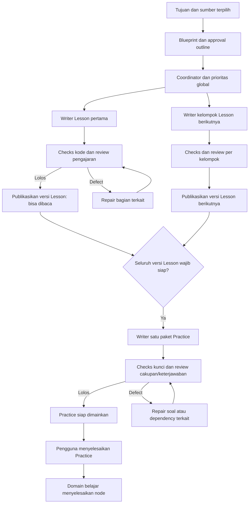

# Riset engine generation Course: kualitas dan waktu mulai belajar

Tanggal: 15 Oktober 2026. Status: **brainstorming dan usulan desain**, belum menjadi spesifikasi implementasi atau perubahan backlog. Riset memakai dokumentasi resmi LangGraph, TypeSafe, OpenAI, panduan pengajaran, dan penelitian primer. Tidak ada benchmark provider Ngertiin baru atau implementasi engine pada pekerjaan ini. Standar prototipe adalah konteks produk, bukan cetak biru yang disalin.

**Keputusan pengguna dalam sesi ini:** pengguna boleh mulai membaca Lesson yang sudah diperiksa ketika Practice masih dibuat. Ini memperbarui arah UX dari menunggu seluruh node lengkap. `lesson_ready`, `practice_ready`, `node_content_ready`, dan `node_completed` harus berbeda; yang terakhir berasal dari aktivitas belajar pengguna, bukan selesainya generation. Keputusan tersebut diselaraskan ke spesifikasi Notion dan mirror lokal saat penerimaan #003; runtime mengikuti #008/#009/#011/#012.

## Rekomendasi desain

Bangun coordinator Course dan worker konten yang kecil dengan LangGraph. Jalur prioritas menghasilkan **Lesson pertama yang utuh, berguna, dan lolos pemeriksaan**. Lesson selanjutnya dapat dibuat dalam microbatch koheren sesuai dependency dan ukuran output. Setelah semua Lesson yang diperlukan terbit, buat seluruh paket Practice dari snapshot versi Lesson tersebut, lalu periksa cakupan, keterjawaban, dan kuncinya sebelum membuka Practice.

Ukuran batch, pemilihan model, ambang Jev, dan concurrency adalah parameter eksperimen. Belum ada dasar untuk menjanjikan angka detik tertentu, menyatakan satu panggilan besar selalu tercepat, atau menganggap jumlah format tertentu membuktikan kualitas belajar.

## Dasar kualitas belajar

CMU menekankan keselarasan tujuan yang teramati, aktivitas pengajaran, dan asesmen; mengajar untuk analisis tetapi hanya menanyakan hafalan merupakan ketidakselarasan. IES merekomendasikan kombinasi contoh terselesaikan dengan latihan, hubungan konkret–abstrak, dan pertanyaan penjelasan. Studi retrieval practice pada teks sains juga mengukur manfaat retensi dan inferensi setelah satu minggu. Sumber tersebut mendukung desain instruksional, bukan satu topologi panggilan AI. [CMU alignment](https://www.cmu.edu/teaching/assessment/basics/alignment.html), [IES practice guide](https://ies.ed.gov/ncee/wwc/PracticeGuide/1), [Karpicke dan Blunt, 2011](https://learninglab.psych.purdue.edu/downloads/2011/2011_Karpicke_Blunt_Science.pdf).

**Implikasi desain:** rancang kemampuan dan bukti penguasaannya sebelum menulis. Setiap Lesson menambah kontribusi pengajaran, misalnya membangun model konsep, menunjukkan contoh beralasan, membandingkan kasus, atau menjelaskan batas penerapan. Kebutuhan kontribusi menentukan jumlah Lesson; jumlah layar dan panjang kata sendiri bukan kedalaman.

Untuk prosedur baru, penjelasan contoh dapat diikuti tugas dengan dukungan yang berkurang. Renkl dan kolega menemukan manfaat fading terutama pada near transfer; tidak ada alasan menerapkannya identik untuk semua mata pelajaran atau mengklaim transfer jauh otomatis. Kajian Mayer dan Moreno mendukung pengurangan materi yang tidak relevan dan pengaturan beban pada multimedia; adaptasi ke Lesson teks perlu diuji. [Renkl et al., 2002](https://doi.org/10.1080/00220970209599510), [Mayer dan Moreno, 2003](https://doi.org/10.1207/S15326985EP3801_6).

Rentang 2–6 Lesson, 4–6 soal, dan minimal tiga format dari pembahasan sebelumnya tetap **kebijakan editorial awal**, bukan kesimpulan ilmiah. Pada iterasi desain, nilai apakah rentang itu membantu cakupan atau justru menciptakan filler. Perubahan kebijakan disepakati secara eksplisit; engine tidak diam-diam mengurangi kualitas atau cakupan demi biaya.

## Blueprint bersama sebelum penulisan paralel

`CourseBlueprint` menyimpan tujuan, batas cakupan, prasyarat, urutan node dan hubungan kemampuan. `NodeBlueprint` merinci kemampuan akhir, kontribusi setiap Lesson, evidence yang mendukungnya, serta intent asesmen. Satu panggilan perencanaan dapat menggabungkan keputusan yang memang berbagi konteks, tanpa menulis seluruh prosa dan kunci final dua kali.

Blueprint yang dibekukan sebelum penulisan mencakup:

- ID tujuan/kriteria dan pemetaan kontribusi Lesson serta intent soal.
- Definisi/istilah bersama, asumsi awal, dan simbol yang harus konsisten.
- Evidence berupa sumber, revisi, lokasi, dan cuplikan yang benar-benar diperlukan.
- Contoh bersama jika dibutuhkan; nilai hitungan disiapkan/diverifikasi kode pada domain yang didukung.
- Dependency yang nyata: apakah sebuah Lesson membutuhkan hasil penulisan Lesson lain, atau cukup blueprint yang sama.
- Inventory miskonsepsi dan kasus batas yang penting untuk diajarkan dan dinilai.

Detail per-node dapat dipersiapkan saat mendekati pengerjaan, selama outline yang disetujui tetap menjadi batas scope. Revisi tujuan/sumber membatalkan pekerjaan turunan yang relevan. Evidence retrieval tidak boleh menghilangkan cuplikan yang sudah ditetapkan sebagai prasyarat pengajaran.

Blueprint bersama mengurangi risiko writer paralel memakai definisi atau contoh yang bertentangan. Ia tidak membuktikan kualitas final; pemeriksaan tetap membaca konten sebenarnya.

## Orkestrasi LangGraph untuk publikasi bertahap

Graph API dan Functional API memakai runtime yang sama. Pilih `StateGraph` kecil untuk cabang pemeriksaan/repair yang perlu terlihat; fungsi biasa cukup untuk validasi dan pemrosesan data. Kecepatan berasal dari pengurangan dependency dan pekerjaan berulang, bukan nama API. [Choosing APIs](https://docs.langchain.com/oss/python/langgraph/choosing-apis).

`Send` mendukung fan-out, tetapi downstream pada superstep bersama menunggu cabang lain. Karena itu, publikasi Lesson pertama tidak ditempatkan setelah join seluruh writer. Worker anak yang memuat generate → validate → review → publish dapat menerbitkan hasil sebelum kembali ke parent; alternatifnya setiap kelompok menjadi job mandiri. Usulan awal menggunakan job mandiri melalui queue yang sudah ada untuk memudahkan prioritas dan isolasi recovery, tanpa memperkenalkan engine durable tambahan. [Parallel branches](https://docs.langchain.com/oss/python/langgraph/use-graph-api#create-branches), [idempotency](https://docs.langchain.com/oss/python/langgraph/graph-api#re-execution-and-idempotency).

**State readiness:** Lesson dan Practice mempunyai status serta revisi sendiri. Node boleh dibaca sebagian, tetapi generation belum tentu selesai. `node_content_ready` berarti materi wajib dan Practice tersedia. `node_completed` berarti aturan penyelesaian belajar terpenuhi. UI menjelaskan bagian yang masih disiapkan serta mempertahankan posisi/draft ketika terjadi kegagalan.

Review Lesson awal memeriksa akurasi terhadap sumber, kejelasan prasyarat, kontribusi pengajaran yang utuh, dan referensi/rendering yang diperlukan. Review Practice kemudian memeriksa paket terhadap semua Lesson terbit dan cakupan node. Lesson awal yang lolos bukan sertifikasi bahwa keseluruhan node sudah baik.

Lesson yang sudah dibaca adalah snapshot ber-versi. Jika review akhir menemukan kesalahan pengajaran, koreksi menerbitkan revisi baru dengan penanganan pembaca dan validasi ulang dependensinya. Jangan mengganti isi yang sudah dibaca secara diam-diam. Practice menyimpan daftar versi Lesson yang menjadi dasarnya; publish memeriksa kembali versi tersebut.

## Ukuran batch: pisahkan empat mekanisme

| Mekanisme | Bentuk | Kegunaan dan batas |
| --- | --- | --- |
| Generation beberapa artefak dalam satu respons | Satu request menghasilkan beberapa Lesson atau seluruh soal | Menghemat overhead/konteks; output panjang dapat menunda item pertama dan memperbesar dampak truncation. |
| Panggilan generatif paralel | Beberapa request independen berjalan bersama | Mengurangi jalur serial; tunduk pada kapasitas, TPM/RPS, dan dependency nyata. |
| Batch keputusan Jev | Satu state, banyak pertanyaan semantik independen | Memakai konteks bersama tanpa round trip per keputusan; pertanyaan tidak dapat memakai jawaban pertanyaan lain dalam request yang sama. |
| Provider Batch API asinkron | File berisi pekerjaan untuk antrean batch | Cocok untuk evaluasi/offline; bukan jaminan latency interaktif. OpenAI saat ini memakai completion window 24 jam. |

LangChain `abatch` secara default menjalankan beberapa `ainvoke` secara konkuren; nama tersebut tidak membuktikan batching native provider. Dokumentasi OpenAI juga menguraikan trade-off antara jumlah request, paralelisme, dan panjang output. [abatch](https://reference.langchain.com/python/langchain-core/runnables/base/Runnable/abatch), [official latency guidance](https://developers.openai.com/api/docs/guides/latency-optimization), [Batch create](https://developers.openai.com/api/reference/resources/batches/methods/create).

**Usulan awal setelah keputusan progressive UX:**

1. Batch pertama berisi satu Lesson bermakna yang diperlukan untuk mulai belajar.
2. Lesson berikutnya dikelompokkan berdasarkan konteks, dependency, dan perkiraan output; dua Lesson per kelompok adalah kandidat eksperimen, bukan angka final.
3. Kelompok independen berjalan paralel. Kelompok yang memerlukan hasil Lesson sebelumnya tetap menunggu dependency tersebut.
4. Review beberapa Lesson dalam kelompok yang sama dapat digabung dengan laporan temuan per Lesson. Jangan menggabungkan review awal dengan semua pekerjaan Course sehingga jalur pertama kembali terblokir.
5. Seluruh soal satu Practice dibuat sebagai satu paket, dengan coverage, variasi, kunci dan pembahasan yang terkoordinasi. Repair kemudian boleh hanya satu atau beberapa soal.
6. Draft soal spekulatif dari blueprint sambil Lesson ditulis adalah eksperimen lanjutan. Tetap perlu rekonsiliasi terhadap Lesson final; speculative waste dan repair bisa menghapus penghematan waktu. Baseline menulis soal setelah snapshot Lesson siap.

Memotong penjelasan yang diperlukan untuk mengurangi token akan merusak tujuan. Pengurangan output diarahkan pada metadata berulang, penulisan ulang konten valid, intro generik, dan laporan review yang panjang. Laporan review cukup temuan terlokasi dan alasan yang dapat diperiksa.

## Pembagian keputusan: kode, Jev, dan model generatif

| Tugas | Pemilik awal | Alasan |
| --- | --- | --- |
| Ownership, kuota, ID, jumlah, dependency siap, prioritas, repair budget | Kode | Aturan pasti, cepat, dapat diperiksa langsung. |
| Referensi valid, opsi/key tersedia, shuffle, keunikan token, angka/unit yang didukung | Kode | Tidak membutuhkan model untuk menghitung atau melakukan lookup. |
| Relevansi passage, indikasi duplikasi kontribusi, kelayakan kandidat format | Jev bila memberi manfaat terukur | Keputusan semantik terbatas atas kandidat dan evidence pendek. |
| Tujuan/urutan pengajaran, penulisan Lesson, paket soal | Model generatif yang dievaluasi per peran | Membutuhkan sintesis dan penjelasan, bukan pemilihan label saja. |
| Ambiguitas jawaban, alasan ilmiah kompleks, konflik review, repair semantik | Model reasoning pada scope terkait | Membutuhkan penalaran dan koreksi yang tidak ditangani aturan tepat. |

Pola Jev: satu request dapat memuat beberapa pertanyaan atas evidence/artefak bersama. Misalnya, passage mana mendukung subskill, apakah kandidat ordering benar-benar menyatakan dependency, dan apakah dua kontribusi tampak berulang. Kode menggabungkan hasil serta memilih cabang. State dipangkas ke konteks relevan; jangan mengirim satu Course penuh untuk tiap keputusan kecil. [TypeSafe API](https://docs.typesafe.ai/api), [parallel questions](https://docs.typesafe.ai/cookbooks/parallel_questions), [fan-out](https://docs.typesafe.ai/patterns/fan-out).

Jev tidak menghasilkan Lesson dan bukan kalkulator. Dokumentasi 1.13 mencatat kelemahan numeric precision, indirection dan context berisi distraksi. Choice/Score confidence adalah ringkasan distribusi jawaban, sedangkan Noul mengembalikan probabilitas yes tanpa confidence terpisah. Ambang harus dikalibrasi pada konten Indonesia dan jenis keputusan kita. [Jaggedness](https://docs.typesafe.ai/model-jaggedness/jev-1.13), [confidence](https://docs.typesafe.ai/confidence).

Jangan menambah Jev pada setiap langkah jika satu planner sudah menghasilkan keputusan yang dibutuhkan. Mulai dari keputusan yang menggantikan panggilan generatif terpisah atau memang memangkas konteks/eskalasi. Ukur waktu total termasuk Jev. Pola verifier → reasoning pada cookbook TypeSafe merupakan contoh extraction, bukan bukti bahwa Jev cukup untuk menyetujui seluruh kualitas belajar. [Cascade cookbook](https://docs.typesafe.ai/cookbooks/sde_cascade).

Dokumentasi saat riset menampilkan Jev 1.14.0 sebagai release terbaru/preview dan `jev-latest` masih mengarah ke 1.13.0. Kandidat evaluasi dipin dengan ID versi; pergantian alias tidak boleh mengubah keputusan produksi tanpa pengukuran ulang. Bahasa utama pelatihan masih English menurut vendor. [Models](https://docs.typesafe.ai/models).

Baseline kualitas tetap pemeriksaan pengajaran dan Practice yang eksplisit. Jev dapat dimulai sebagai shadow signal untuk keputusan yang berisiko; menghapus reviewer material hanya dipertimbangkan setelah sensitivitas defect dan false hold-nya terbukti memadai. Satu masalah kunci serius tidak boleh tertutup oleh rata-rata skor kualitas yang tinggi.

## Practice yang beragam dan valid

Keragaman dinilai dari kemampuan, konteks, miskonsepsi, serta format. Satu konsep yang ditanyakan ulang dengan lima UI berbeda belum tentu memberi lima bukti penguasaan. NBME menyediakan panduan soal one-best-answer dan cacat item, dengan konteks asal pendidikan kesehatan yang harus dibedakan dari kebijakan universal. [NBME guide](https://www.nbme.org/sites/default/files/2021-02/NBME_Item%20Writing%20Guide_R_6.pdf).

| Format | Kontribusi yang sesuai | Risiko yang harus diperiksa |
| --- | --- | --- |
| Multiple choice | Memilih tindakan/model atau menganalisis kasus | Lebih dari satu jawaban benar; distractor lemah atau petunjuk bentuk. |
| True/false | Mendeteksi satu miskonsepsi yang penting | Klaim majemuk, konteks kurang, absolut yang tidak sah. |
| Definitive short answer | Mengingat istilah/nilai atau menghitung hasil | Variasi valid ditolak; unit/toleransi salah; tugas sebenarnya terbuka. |
| Ordering | Urutan yang memang ditentukan dependency/kronologi/kriteria | Urutan konvensional dianggap satu-satunya; tindakan independen bisa ditukar. |
| Word bank | Melengkapi hubungan/konsep dalam konteks | Sinonim sama-sama benar; grammar membocorkan jawaban. |

Satu studi teacher-rating distractor melaporkan banyak usulan masih memerlukan edit; hasilnya bukan ukuran performa model 2026. Implikasi desainnya adalah menyimpan miskonsepsi di balik pengecoh dan memeriksa accidental correctness. Studi lain tentang reviewer LLM mendokumentasikan bias posisi, verbosity dan self-enhancement pada penilaian chatbot. Keduanya mendukung kalibrasi manusia, bukan penambahan reviewer tanpa batas. [Bitew et al., 2023](https://arxiv.org/abs/2307.16338), [Zheng et al., 2023](https://arxiv.org/abs/2306.05685).

Grounding membandingkan klaim dengan sumber. Answerability membandingkan soal dengan Lesson terbit plus prasyarat yang dinyatakan. Keduanya diuji terpisah. Contoh turunan yang logis boleh; fakta baru yang tidak didukung tidak otomatis sah hanya karena punya citation ID.

Sebuah key-blind solver dapat menjadi eksperimen audit batch: menyelesaikan soal dari Lesson tanpa melihat key penulis, lalu membandingkan hasil. Kesepakatan dua model tidak membuktikan tidak adanya jawaban alternatif. Jika keys masih ada dalam prompt, solver tersebut tidak benar-benar blind. Jangan memasukkan audit tambahan ini ke semua jalur sebelum biaya/manfaatnya diukur.

## Recovery, cache, dan prioritas

Pending writes/checkpoint membantu mempertahankan hasil cabang selesai, tetapi efek eksternal tetap memerlukan idempotency. Publikasi menggunakan transaksi pendek yang memvalidasi generation/revisi aktif lalu menyimpan konten dan event. Jangan menahan transaksi database selama panggilan provider. `sync` checkpoint memberi batas recovery kuat; overhead diukur sebelum mempertimbangkan mode yang mempunyai crash window. [Checkpointers](https://docs.langchain.com/oss/python/langgraph/checkpointers).

Pisahkan retry transport 429/5xx/timeout dari repair kualitas. Total attempts dan deadline tetap dibatasi agar retry SDK tidak berlipat dengan retry graph. Budget repair awal yang dibahas adalah maksimal dua; kegagalan menahan bagian terkait, tanpa menghapus Lesson yang sudah siap. [Fault tolerance](https://docs.langchain.com/oss/python/langgraph/fault-tolerance).

`max_concurrency` suatu invocation tidak membatasi seluruh fleet worker. Admission harus memperhitungkan provider RPS/TPM dan biaya seluruh pekerjaan. Prioritas: Lesson yang sedang ditunggu pengguna, Lesson berikutnya yang diperlukan, Practice node aktif, lalu node background. Sisakan kapasitas untuk pekerjaan foreground dengan fairness antar pengguna. [RunnableConfig](https://reference.langchain.com/python/langchain-core/runnables/config/RunnableConfig), [executor source](https://github.com/langchain-ai/langgraph/blob/2d3121a17cb070d980450b404299dacdcd60a6bd/libs/langgraph/langgraph/pregel/_executor.py#L122-L155).

Cache hasil aplikasi berbeda dari prompt caching provider. Cache aplikasi memakai scope pemilik/akses, source revision, blueprint, model, prompt/schema/rubric, serta dependency Lesson yang tepat. Provider prompt caching menggunakan prefix yang cocok dan settings yang kompatibel; manfaat serta biaya bergantung model. Jangan membuat prompt lebih panjang hanya untuk mengejar cache tanpa pengukuran. [Node cache](https://docs.langchain.com/oss/python/langgraph/graph-api#node-caching), [OpenAI prompt caching](https://developers.openai.com/api/docs/guides/prompt-caching).

Stream publik hanya berisi event allowlist dan konten yang sudah diterbitkan. Raw graph state dapat berisi kunci dan review privat; streaming token draf tidak sama dengan Lesson yang layak dibaca. Visual opsional bisa menyusul, tetapi visual yang diperlukan untuk memahami atau menjawab harus siap sebelum konten terkait diterbitkan. [Streaming](https://docs.langchain.com/oss/python/langgraph/streaming), [private-state caveat](https://docs.langchain.com/oss/python/langgraph/graph-api#multiple-schemas).

## Eksperimen sebelum menetapkan engine

Gunakan sumber, tujuan, rubrik dan corpus penilaian yang sama. Pertahankan ukuran materi yang setara; jangan memperoleh latency lebih rendah dengan menghilangkan pengajaran. Ulangi sampling dan pisahkan cache dingin/hangat serta worker tunggal/berbeban. Eksperimen ini adalah protokol pengukuran yang diusulkan; tooling-nya mengikuti kebijakan pengujian proyek dan belum dibuat.

| Kandidat | Perbedaan yang diuji |
| --- | --- |
| A: batch node penuh | Seluruh Lesson/soal satu respons; pembanding biaya/koherensi, bukan pilihan UX awal. |
| B: progressive, Lesson berikutnya per item | Lesson pertama segera ditinjau; item selanjutnya paralel sesuai dependency; Practice satu paket. |
| C: progressive, microbatch | Lesson pertama sendiri; Lesson berikutnya dalam kelompok koheren kecil; Practice satu paket. |
| D: C + Jev terpilih | Hanya menambah/mengganti keputusan semantik tertentu; bandingkan total waktu dan kesalahan. |

Awali dengan C sebagai hipotesis implementasi, bandingkan B untuk kasus panjang/dependency berbeda, dan gunakan A sebagai kontrol agar keuntungan grouping tidak diasumsikan. Setelah topologi terbaik diketahui, uji model per peran dan concurrency, misalnya 2/4/6 jika kuota mengizinkan. Hindari mengubah topology, rubric, model, dan ukuran konten sekaligus lalu mengatribusikan hasil kepada satu komponen.

Metrik utama:

- Waktu approval → **Lesson pertama yang lolos dan benar-benar bisa dibaca**, p50/p95.
- Waktu ke Lesson berikutnya dan jumlah/durasi pengguna tertahan saat menekan Lanjut.
- Waktu Practice node aktif siap, serta seluruh konten inti Course siap.
- Defect material yang lolos, false holds, cakupan, ambiguitas, dan keterjawaban.
- Frekuensi serta scope repair, token/biaya termasuk retry, waktu antre, dan speculative waste.
- Recovery setelah crash, publikasi/event ganda, serta respons terhadap outline/source revision.

Perkiraan critical path membantu diagnosis, bukan benchmark:

`T_first_lesson = antre + konteks/blueprint yang belum tersedia + write_first + validate + review_first + publish + expected_repair`

Untuk kelompok independen, waktu writer mendekati cabang terlama ditambah overhead, bukan jumlah semua durasi. Provider saturation, token budget, dan retry dapat mengubahnya. Optimalkan p95 waktu belajar pada kualitas yang sama, bukan jumlah request paling sedikit.

Pemeriksaan kualitas konten berbeda dari bukti hasil belajar. Studi 2025 tentang LLM-generated retrieval practice memberi sinyal kelayakan dengan pertanyaan yang divalidasi instructor, tetapi desain quasi-experimental, perbedaan materi dan sampelnya tidak membuktikan engine otonom lebih baik atau menjamin transfer jangka panjang. Pilot pembelajaran membutuhkan ukuran pre/post dan transfer tertunda yang terpisah dari completion/engagement. [Studi dan keterbatasannya](https://arxiv.org/html/2507.05629v2).

## Implikasi terhadap task #03

#03 perlu menghasilkan kontrak dan fixture untuk blueprint, evidence, Lesson dan lima tipe soal; rubrik pengajaran/Practice; hasil review terlokasi; readiness/revisi; serta batas repair dan invalidation. Tambahkan corpus berlabel manusia yang mencakup valid short content, verbose-but-shallow content, fakta tidak didukung, soal belum diajarkan, alternatif jawaban sah, dan valid uncommon answers. Hasil tersebut menjadi input implementasi planner #08, generation #09, player #11, dan Practice #12.

Usulan engine lengkap serta perubahan UX progressive perlu dijabarkan pada tiket terkait sebelum implementasinya. Riset ini menyimpan keputusan dan alternatif secara reviewable, tanpa menyalin kode prototipe atau menandai task implementasi selesai.
