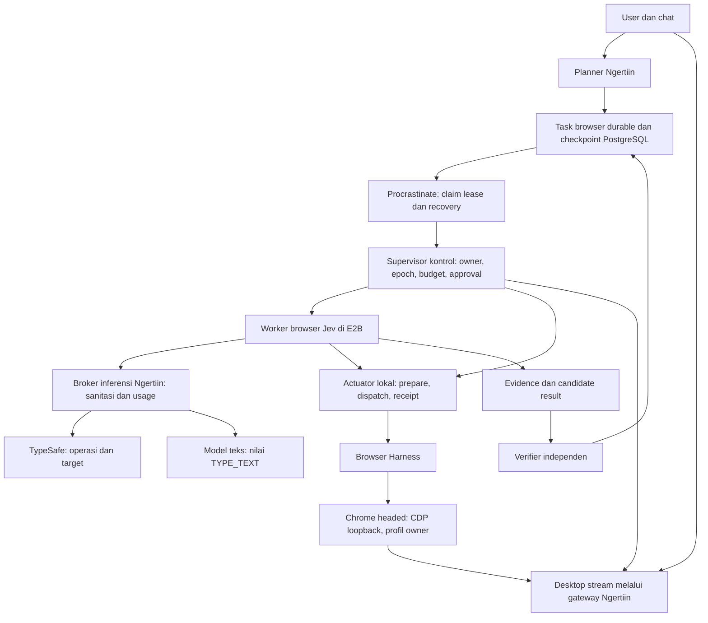

# Riset Jev, Browser Harness, dan E2B Desktop

Tanggal pemeriksaan: **23 Oktober 2026**. Status: **riset source dan dokumentasi; belum ada integrasi atau uji E2B/Jev berbayar yang dijalankan untuk riset ini**. Rekomendasi di bawah dibedakan dari perilaku upstream yang teramati.

## Sumber yang dipatok

| Sumber primer | Revision yang diperiksa | Kegunaan |
|---|---|---|
| [Jev Ultrafast](https://github.com/browser-use/jev-ultrafast/tree/1231850a0bf1a0c0341fe408ef1668dbbfdfac46) | `1231850a0bf1a0c0341fe408ef1668dbbfdfac46` | Loop browser, dependency, tab ownership |
| [Browser Harness](https://github.com/browser-use/browser-harness/tree/c6a941287424f32e2d20c7b7b892c8493f46808d) | `c6a941287424f32e2d20c7b7b892c8493f46808d` | Transport CDP, daemon, helper; dependency Jev wajib diperiksa juga pada wheel `0.1.13` |
| [Browser Use](https://github.com/browser-use/browser-use/tree/3df5806a0d097a1546d92c49bcf1b28c9972c3bd) | `3df5806a0d097a1546d92c49bcf1b28c9972c3bd` | Hubungan CLI dengan Harness |
| [E2B Desktop](https://github.com/e2b-dev/desktop/tree/a7b4cc3282bdea31b50c8b3c9a456116e734df5c) | `a7b4cc3282bdea31b50c8b3c9a456116e734df5c` | Template dan contoh desktop |
| [E2B SDK monorepo](https://github.com/e2b-dev/E2B/tree/db8d80dad5be3d6a94c960e29017c8a9e29680c4) | `db8d80dad5be3d6a94c960e29017c8a9e29680c4` | SDK Desktop, pause/resume, command lifecycle |

Dokumentasi daring bersifat mutable. Commit di tabel dipakai untuk mereproduksi pembacaan kode; bukan instruksi memakai `main` atau memasang dependency baru pada setiap sesi. SDK E2B pada checkout Ngertiin saat pemeriksaan dipatok `e2b==2.56.0`, sehingga kemampuan dokumentasi terbaru harus diperiksa terhadap versi tersebut sebelum dipakai ([pyproject lokal](../../apps/backend/pyproject.toml)).

## Temuan E2B dan browser yang mengubah kerangka awal

1. **Desktop E2B bukan orchestration agent.** Ia menyediakan mesin, desktop, input, viewer, filesystem, dan lifecycle. Menaruh loop di background dapat mempertahankan proses melewati disconnect SDK, tetapi tidak memberi checkpoint objective, receipt aksi, takeover, admission, atau publication Ngertiin. Perilaku background ini didokumentasikan E2B dan tetap memiliki command timeout serta sandbox timeout ([background commands](https://docs.e2b.dev/commands/background)).
2. **Fondasi headed browser/CDP/profil sudah ada di Ngertiin.** Launcher saat ini memakai display `:0`, profil `.ngertiin-browser`, remote debugging `127.0.0.1:9222`, proxy browser, serta noVNC. Adapter memakai ingress terautentikasi. Pekerjaan baru berpusat pada adapter Jev dan lifecycle kontrol, bukan membangun semuanya dari nol ([launcher lokal](../../apps/backend/src/ngertiin/computer/desktop.py), [desktop I/O lokal](../../apps/backend/src/ngertiin/computer/desktop_io.py), [adapter lokal](../../apps/backend/src/ngertiin/computer/e2b.py)).
3. **Same Chrome tidak otomatis berarti same visible tab.** Jev membuat tab `background=True`, memasang viewport `1120×780`, dan mengemulasi focus tanpa mengaktifkan tab desktop. noVNC menampilkan desktop nyata sehingga dapat memperlihatkan tab berbeda. Sebelum fallback koordinat atau takeover, aplikasi harus memilih dan menampilkan `targetId` pekerjaan yang sama ([Browser Jev](https://github.com/browser-use/jev-ultrafast/blob/1231850a0bf1a0c0341fe408ef1668dbbfdfac46/jev_ultrafast/browser.py#L21-L36)).
4. **Full pause dan filesystem pause adalah dua kontrak berbeda.** Full mempertahankan RAM/proses; filesystem membuangnya dan cold boot. Keduanya memutus koneksi klien luar. Memulihkan Chrome tidak mengesahkan kembali lease/control version lama ([filesystem snapshot E2B](https://docs.e2b.dev/sandbox/filesystem-only-snapshots), [persistence E2B](https://docs.e2b.dev/sandbox/persistence)).
5. **Pindah mode pause saja belum cukup.** `E2BComputer.start()` saat ini menjalankan launcher yang memanggil `stop()` terlebih dahulu: Chrome/proxy diterminasi, downloads dibersihkan. Jalur ini akan menghapus keuntungan live-process resume walaupun provider memakai full pause. Perlu memisahkan attach, resume, repair service, dan cold start ([adapter lokal](../../apps/backend/src/ngertiin/computer/e2b.py), [launcher lokal](../../apps/backend/src/ngertiin/computer/desktop.py#L89)).

## Template: apa yang sudah tersedia dan apa yang perlu ditambahkan

Template resmi sekarang berbasis Ubuntu 22.04 dan memasang Xfce, Xvfb, x11vnc, noVNC, Chrome stable, `xdotool`, `scrot`, serta `python3-pip`. Python 3.12 dan `uv` tidak ditetapkan di definisi tersebut. Jev memerlukan Python `>=3.12` dan mematok `browser-harness==0.1.13` ([template upstream](https://github.com/e2b-dev/desktop/blob/a7b4cc3282bdea31b50c8b3c9a456116e734df5c/template/template.py), [dependency Jev](https://github.com/browser-use/jev-ultrafast/blob/1231850a0bf1a0c0341fe408ef1668dbbfdfac46/pyproject.toml)).

E2B mendukung turunan `Template().from_template("desktop")`. Template kustom harus memiliki nama/version sendiri, lock dependency dan runtime yang diperiksa, serta manifest berisi versi Chrome, Python, Jev, Harness, envd, dan checksum actuator. Jangan menganggap alias desktop upstream immutable. Metode build dan penggunaan template kustom tersedia pada [README template resmi](https://github.com/e2b-dev/desktop/blob/a7b4cc3282bdea31b50c8b3c9a456116e734df5c/template/README.md).

**Rekomendasi build:** bakar dependency serta actuator tetap, tanpa key, cookie, profil user, instruksi task, atau background agent yang memiliki kewenangan. Buat profil owner sesudah resource dimiliki workspace. Kapasitas awal tetap mengikuti admission Ngertiin, saat ini 2 vCPU/4 GiB; contoh 8 vCPU pada README upstream bukan kebutuhan minimum yang terbukti ([validasi alokasi lokal](../../apps/backend/src/ngertiin/e2b.py)).

Ada detail penting pada prewarm: `set_start_cmd` dijalankan **pada akhir build**, lalu proses disnapshot; tidak dijalankan ulang pada setiap `Sandbox.create`. Environment per-sandbox saat create tidak diwarisi proses yang sudah berjalan saat build. Karena itu prewarm dapat menyiapkan desktop/daemon netral, sedangkan worker task harus menerima lease dan konfigurasi runtime melalui langkah terpisah ([start & ready commands](https://docs.e2b.dev/template/start-ready-command)).

Health check yang direkomendasikan memeriksa X display, window manager, Chrome process identity, `/json/version`, mapping target/session, proxy, dan kemampuan screenshot. Memeriksa port terbuka saja tidak membuktikan bahwa browser benar atau target yang terlihat cocok. Tidak ada bukti dari riset ini bahwa semua readiness check tersebut sudah diimplementasikan.

## CDP, Browser Use CLI, dan tab pekerjaan

Dokumentasi resmi CLI menyatakan `BU_CDP_URL`/`BU_CDP_WS` dapat menunjuk existing browser, dan CLI menggunakan Browser Harness. Itu tidak berarti paket CLI harus menjadi dependency runtime Jev. Jev mengimpor `ensure_daemon` dan `cdp` dari Harness secara langsung ([CLI resmi](https://docs.browser-use.com/open-source/browser-use-cli), [Browser Jev](https://github.com/browser-use/jev-ultrafast/blob/1231850a0bf1a0c0341fe408ef1668dbbfdfac46/jev_ultrafast/browser.py)).

Static compatibility diperiksa juga pada [wheel PyPI `browser-harness==0.1.13`](https://pypi.org/project/browser-harness/0.1.13/) dengan SHA-256 `2491459e4bfc0ee8aea22dc6c4680fc0f791b7ba553446323c50d2883449d769`, bukan hanya branch Harness terkini. Pada `daemon.py:get_ws_url` artefak tersebut, `BU_CDP_URL` berupa HTTP DevTools endpoint yang diselesaikan melalui `/json/version`; `BU_CDP_WS` memiliki prioritas lebih tinggi. Identitas/nama daemon dibaca ketika modul diimpor. **Rekomendasi:** set environment sebelum import, kosongkan override yang tidak dipakai, pakai identitas daemon per sandbox/session, dan fail closed jika browser milik sesi tidak tersedia. Tidak boleh diam-diam menemukan browser lain.

Chrome perlu memakai custom `--user-data-dir`: sejak Chrome 136, remote-debugging switch tidak berlaku untuk default data directory. Profil custom yang sudah ada pada launcher Ngertiin sejalan dengan rekomendasi Chrome. CDP memiliki kemampuan kuat terhadap browser; tidak cukup menjadikannya URL publik yang sekadar tidak dibagikan ([Chrome security change](https://developer.chrome.com/blog/remote-debugging-port)).

**Konfigurasi konseptual, belum snippet teruji:**

| Komponen | Kontrak yang disarankan |
|---|---|
| Desktop | Satu display dan satu browser workspace terikat owner |
| Chrome | Headed, custom profile, CDP bind `127.0.0.1:9222` |
| Harness | Endpoint eksplisit; tidak memakai Chrome discovery/autospawn untuk mengganti sesi |
| Tab | Persist `targetId`, browser instance identity, session generation; jangan persist CDP session ID sebagai otoritas lintas reconnect |
| Viewer | Memperlihatkan target pekerjaan sebelum input manusia/koordinat |
| Fallback | Re-observe setelah aktivasi tab; mapping koordinat berasal screenshot/viewport saat itu |

Saat ini helper `cdp.call()` Ngertiin memilih page pertama dari `/json/list`, bukan target yang dipersist. Ini perlu diubah bersama integrasi tab Jev; page pertama tidak menjamin page visible. Jev menggunakan referensi node dari snapshot dan CDP session target, sedangkan fallback desktop mengirim input pada window/focus nyata ([CDP lokal](../../apps/backend/src/ngertiin/computer/cdp.py), [desktop input lokal](../../apps/backend/src/ngertiin/computer/desktop_io.py)).

## Arsitektur yang disarankan: planner tetap di backend, actuator dekat browser

Berikut rekomendasi integrasi, bukan arsitektur yang telah tersedia.



Jev menjadi browser specialist yang menerima objective terbatas. Backend tetap memiliki instruksi task, budget, ownership, approval, publication, dan durable continuation. Actuator di E2B mempertahankan local CDP dan kecepatan interaksi, tetapi tidak menerima PostgreSQL/MinIO credentials atau E2B control-plane key. Model broker memegang TypeSafe/text-model key dan mengecek task, session generation, control version, expiry, serta budget sebelum memproses request. Ini rekomendasi desain untuk membatasi kewenangan mesin yang juga dapat dioperasikan user.

| Pilihan | Manfaat | Biaya/risiko | Penilaian riset |
|---|---|---|---|
| Seluruh Jev loop, raw model keys di E2B | Paling dekat dengan contoh upstream | Key ikut trust boundary desktop; takeover dan durable receipt belum ada; stale process dapat terus bekerja | Cocok hanya spike disposable berizin, bukan default produk |
| Model broker/backend, actuator tetap di E2B | CDP lokal, secret pusat, policy dapat difence | Perlu kontrak request/receipt dan perubahan seam Jev | Kandidat utama |
| Loop sepenuhnya di host, CDP relay privat | Secret/loop di backend | Relay CDP berprivilege; latency protokol dan jaringan; public CDP dilarang | Kandidat pembanding benchmark, bukan diasumsikan paling cepat |

Loop Jev upstream tidak menyediakan hook takeover/distributed lease sebagai kontrak produk. `Agent.run()` menjalankan loop dalam proses; tahap text generation terjadi sebelum input. Adapter harus membuka batas observe/decide/prepare-text/authorize/dispatch/receipt agar response model terlambat tidak dapat melewati Stop atau takeover. Mengelilingi `agent.run()` dengan mutex di host tidak memfence proses yang terus berjalan di sandbox ([agent upstream](https://github.com/browser-use/jev-ultrafast/blob/1231850a0bf1a0c0341fe408ef1668dbbfdfac46/jev_ultrafast/agent.py)).

## Secret, ingress, dan data halaman

E2B membedakan controller authentication (`X-Access-Token`) dari authentication public service ingress. `network.allow_public_traffic=False` mewajibkan `e2b-traffic-access-token` untuk public service URL. Keduanya perlu dijaga; mengganti SDK Desktop tidak otomatis mempertahankan semua policy Ngertiin ([secured access](https://docs.e2b.dev/sandbox/secured-access), [restrict public access](https://docs.e2b.dev/network/restrict-public-access)).

SDK Desktop menyediakan noVNC, tetapi `require_auth=False` adalah default pada `stream.start()`; `view_only` merupakan parameter URL viewer. Karena itu direct stream URL bukan pengganti gateway Ngertiin yang memvalidasi owner dan memfilter pesan input pada server. SDK dan contoh stream adalah primitive, bukan implementasi takeover aman ([Desktop SDK](https://github.com/e2b-dev/E2B/blob/db8d80dad5be3d6a94c960e29017c8a9e29680c4/packages/desktop-python/e2b_desktop/main.py#L133-L207), [gateway lokal](../../apps/backend/src/ngertiin/computer/viewer.py)).

Jangan expose 9222 melalui public ingress atau mengirim provider traffic token ke browser user. Bind localhost adalah satu lapisan; acceptance harus mencoba endpoint publik 9222/6080 tanpa token dan memastikan ditolak. Provider routing terhadap loopback service perlu diuji pada sandbox disposable; riset ini belum membuktikan detail reachability port 9222 pada environment live ([public URL E2B](https://docs.e2b.dev/network/public-url)).

**Analisis risiko:** desktop takeover memungkinkan manusia menggunakan mesin, termasuk terminal. Key di environment atau file pada OS user yang sama bukan batas secret terhadap pemilik desktop. Page JavaScript biasa tidak otomatis dapat membaca environment; masalahnya trust boundary mesin serta proses browser/worker. Template tanpa key dan model broker menghindari penyimpanan key jangka panjang di mesin user. Credential broker yang masih diperlukan harus singkat, terikat sesi dan budget, serta dapat dicabut.

E2B juga mendokumentasikan secret injection pada HTTPS di proxy luar sandbox. Ini opsi riset tambahan, bukan keputusan implementasi: service tujuan menerima key tanpa raw value dibaca guest. Namun rule harus memakai host terpercaya dan allow/deny egress yang benar; lookup gagal dapat meneruskan request tanpa header credential. Facility ini tidak menggantikan kontrol budget/task per request ([secret injection E2B](https://docs.e2b.dev/secrets/inject)).

Ada perubahan data yang perlu disepakati: CDP lokal saat ini mengekspor hash/fingerprint, bukan raw DOM/form values. Jev default membaca visible text dan controls yang dikirim pada model decision. Adapter harus meredaksi password, OTP, payment/secrets, URL query sensitif, dan mengatur batas ukuran/retention. Jangan menganggap menyensor screenshot sudah menyensor input DOM. Saat human control, jangan jalankan snapshot/model calls yang dapat mengambil input login user ([fingerprint lokal](../../apps/backend/src/ngertiin/computer/cdp.py), [loop Jev](https://github.com/browser-use/jev-ultrafast/blob/1231850a0bf1a0c0341fe408ef1668dbbfdfac46/jev_ultrafast/agent.py)).

## Takeover: quiesce dan fencing di actuator

Saat ini Ngertiin memiliki transisi `agent → handoff → human → resuming → agent`, menaikkan `control_version`, men-stale proposal/approval, menutup viewer grant, menunggu busy/channel lama selesai, dan mengharuskan observasi baru sebelum agent dilanjutkan. Mekanisme tersebut harus diperluas untuk CDP worker, bukan dilewati oleh loop otonom ([control lokal](../../apps/backend/src/ngertiin/computer/control.py)).

Urutan yang direkomendasikan:

1. Backend mengubah control menjadi `handoff` dan menaikkan generation; broker menolak request baru/hasil lama.
2. Actuator berhenti memulai observasi, model call, dan input baru. Aksi yang sudah dispatch diselesaikan/di-reconcile; handoff belum diakui sebelum ini jelas.
3. Actuator mengirim acknowledgement quiesced; jika putus, backend menunggu TTL dan fencing efektif, bukan sekadar proses dianggap mati.
4. Aktifkan target pekerjaan di desktop dan cocokkan screenshot. Baru kemudian beri viewer hak input manusia.
5. Saat kembali: cabut input manusia dan konfirmasi channel drain, periksa browser instance/target baru, hapus snapshot/proposal/input yang stale, observasi ulang, lalu terbitkan lease baru.

`SIGSTOP`/`SIGCONT` sendiri bukan kontrak yang cukup: respons model atau CDP input dapat sudah terbang sebelum freeze. Pausing seluruh VM juga membekukan komputer yang ingin dipakai manusia. Syarat produk adalah tidak ada dua pengendali, termasuk CDP, coordinate input, text generation yang menghasilkan aksi lama, dan verifier yang ternyata melakukan mutasi. Ini penalaran desain dari banyaknya jalur input, bukan jaminan upstream.

## Persistence: bedakan mesin, browser, worker, dan tujuan

| Lapisan | Apa yang perlu disimpan | Apa yang tidak dijamin |
|---|---|---|
| Task Ngertiin | Objective, subtask, progress/evidence, receipt, budget, lease generation | Tidak otomatis diperoleh dari VM snapshot |
| Profil browser | Cookies/local storage dan file profil milik owner | Tidak menjamin unsaved form atau DOM sama sesudah cold boot |
| Browser/process full pause | RAM, proses, koneksi internal sesuai snapshot | Koneksi eksternal, auth web, dan lease aplikasi tetap dapat stale |
| Filesystem pause | File yang sudah tersimpan | Proses, Python generator, DOM node handle, CDP session tidak hidup lagi |

Kontrak provider mendukung full dan filesystem pause; implementasi Ngertiin saat ini memilih filesystem dan secara eksplisit menutup Chrome. Untuk pekerjaan aktif yang menunggu singkat, full pause layak menjadi spike bila biaya/latensi menguntungkan, dengan semua actuator dibekukan **secara logis** sebelum capture dan difence kembali pada resume. Untuk retensi profil lintas task, filesystem pause tetap masuk akal. Keduanya memerlukan durable progress di database dan fresh observation ([pause SDK dipatok](https://github.com/e2b-dev/E2B/blob/db8d80dad5be3d6a94c960e29017c8a9e29680c4/packages/python-sdk/e2b/sandbox_async/main.py#L783-L846), [stop lokal](../../apps/backend/src/ngertiin/computer/e2b.py)).

Sandbox lifetime, command lifetime, SDK connection lifetime, dan Task deadline adalah batas berbeda. E2B menjelaskan runtime kontinu Hobby 1 jam/Pro 24 jam serta stream dapat putus sementara sandbox tetap hidup; batas plan aktual akun belum diverifikasi. Karena itu disconnect viewer/SDK tidak boleh disimpulkan sebagai task selesai atau proses mati ([lifetime resmi](https://docs.e2b.dev/faq/sandbox-lifetime)).

Bila actuator dijalankan background, simpan process identity dan instance generation, bukan PID saja; rekoneksi harus memastikan proses milik task tersebut. Persist event/receipt ke storage yang dibaca proses berikutnya; streamed stdout hanya dikirim ke proses pemulai, sedangkan output file dapat dibaca setelah reconnect. Tetap batasi log dan redaksi secret ([background commands E2B](https://docs.e2b.dev/commands/background)).

## Spike yang dibutuhkan sebelum mengunci fase implementasi

| Spike | Setup | Bukti kelulusan |
|---|---|---|
| Template deterministik | Sandbox disposable, versi manifest dipatok, tanpa install sesi | Python3.12/uv/Jev/Harness import; Chrome/CDP/desktop readiness; spawn dan resume latency tercatat |
| CDP attachment | `BU_CDP_URL` eksplisit, override lama dihapus sebelum import | Jev terhubung ke browser yang sama; fail closed jika endpoint mati; tidak ada Chrome kedua |
| Same target/screen | Tab Jev background, aktivasi controlled, resize | URL/DOM target, screenshot, noVNC, dan coordinate fallback terbukti menunjukkan halaman yang sama |
| Takeover races | Tunda model response, text response, dispatch, acknowledgement | Tidak ada model/snapshot/input saat human; response lama tidak diterapkan; fresh observe saat kembali |
| Full vs filesystem | Unsaved form, login fixture, worker/Chrome hidup lalu pause | Perbedaan proses/DOM/profile dibuktikan; lease stale ditolak; kehilangan session bisa dipulihkan tanpa replay |
| Worker/connection loss | Putus SDK/API, kill host worker, actuator hidup | Task bisa reconcile background process; tidak ada dua worker; no duplicate external write |
| Secret boundary | Desktop terminal dan guest code pada fixture | Tidak ada raw provider/model key di template/env/file/log; token scoped tidak bekerja setelah revoke/expiry |
| Ingress | Anonymous dan cross-owner request 9222/6080 | Tanpa token/owner sah ditolak; viewer input ditolak pada mode agent; URL/token tidak bocor UI/log |
| Data/prompt injection | Login fixture dan halaman berisi instruksi serangan | Data privat disaring sebelum model; konten halaman tidak memberi izin baru atau mengganti objective |

Belum ada klaim bahwa Jev stabil untuk pekerjaan panjang, takeover, atau semua HTML widget hanya dari demo cepat. Daftar spike di atas adalah syarat untuk memperjelas feasibility arsitektur; suite long-task serta pemulihan orchestration tetap diperlukan sesudahnya.


## Validasi Jev Ultrafast dan konsekuensi untuk Ngertiin

Riset source dilakukan pada 23 Oktober 2026. Ini penelitian statis dan rancangan eksperimen, bukan implementasi atau benchmark yang sudah lulus.

| Komponen | Versi yang diperiksa | Cara verifikasi |
| --- | --- | --- |
| Jev Ultrafast | commit `1231850a0bf1a0c0341fe408ef1668dbbfdfac46`, package 0.1.0 | shallow checkout source resmi |
| Browser Harness dependency Jev | `browser-harness==0.1.13` | pyproject Jev dan wheel PyPI resmi; SHA-256 diperiksa sebelum membaca source |
| Wheel Harness 0.1.13 | `2491459e4bfc0ee8aea22dc6c4680fc0f791b7ba553446323c50d2883449d769` | bukan asumsi dari branch main |
| TypeSafe model lokal | `jev-1.13.0` | Settings hanya dibaca untuk nama model dan boolean keberadaan key |

Sumber versi: [pyproject Jev](https://github.com/browser-use/jev-ultrafast/blob/1231850a0bf1a0c0341fe408ef1668dbbfdfac46/pyproject.toml), [PyPI Harness 0.1.13](https://pypi.org/project/browser-harness/0.1.13/).

1. Prasyarat akses perlu diubah dari asumsi menjadi probe.

Tiga secret sudah terkonfigurasi lokal: TypeSafe, model OpenAI-compatible, dan E2B. Riset ini tidak mengirim key ke output atau melakukan panggilan inference berbayar. Keberadaan key belum membuktikan validitas, model entitlement, rate limit, atau kredit. Dokumen TypeSafe mengarahkan pengguna ke console dan endpoint daftar model; banner waitlist di README Jev merujuk Browser Use Cloud. Tidak ada bukti yang cukup untuk menyatakan seluruh penggunaan Jev harus menunggu early access. Gate implementasi: verifikasi autentikasi dan satu keputusan sintetis, lalu satu TYPE_TEXT sintetis, tanpa data personal. [TypeSafe quickstart](https://docs.typesafe.ai/introduction/quickstart), [models account](https://docs.typesafe.ai/api/list-models), [README Jev](https://github.com/browser-use/jev-ultrafast).

TypeSafe saat riset mendokumentasikan stable alias `jev-latest` -> `jev-1.13.0`, preview -> `jev-1.14.0`. Pin model version saat evaluasi; catat ID model dari respons. Rate limit milik organization, bukan asumsi unlimited. Jev 1.13/1.14 pada tabel model menerima teks: jalur screenshot fallback tetap membutuhkan model vision/kemampuan lain yang teruji. [Models](https://docs.typesafe.ai/models), [errors](https://docs.typesafe.ai/api/errors).

2. Jev adalah policy browser bounded, belum durable executor produk.

`Agent` menyediakan `command('predict')`, `command('act')`, `run`, `snapshot`, dan close; source yang diperiksa tidak menyediakan pause/resume durable. State, histori dan pending text berada di objek Python. Batas demo adalah 60 aksi dan 120 keputusan; tiga aksi non-wait tanpa perubahan halaman menghasilkan blocked. Crash memerlukan rekonstruksi state oleh Ngertiin. Snapshot menyertakan keputusan dan text_calls: jangan simpan objek mentah sebagai checkpoint produk karena mengandung request/page/teks yang diketik. Temuan diverifikasi melalui pembacaan source dan AST, tanpa menjalankan library terhadap browser pengguna. [agent.py](https://github.com/browser-use/jev-ultrafast/blob/1231850a0bf1a0c0341fe408ef1668dbbfdfac46/jev_ultrafast/agent.py), [questions.py](https://github.com/browser-use/jev-ultrafast/blob/1231850a0bf1a0c0341fe408ef1668dbbfdfac46/jev_ultrafast/questions.py).

Pilihan operasi dan target kompatibel dikirim dalam satu request TypeSafe. Client HTTP sinkron, timeout 25 detik dan retry lokal hingga tiga attempts untuk status tertentu. TYPE_TEXT memakai endpoint `/chat/completions` dan mensyaratkan JSON `text`, sehingga kompatibilitas dengan endpoint/model Ngertiin yang sekarang memakai Responses API harus diprobe; nama 'OpenAI-compatible' tidak menjamin reasoning/json flags identik. Text dibuat di dalam `act`, sehingga approval exact atas teks memerlukan tahap prepare terpisah sebelum dispatch. [model.py](https://github.com/browser-use/jev-ultrafast/blob/1231850a0bf1a0c0341fe408ef1668dbbfdfac46/jev_ultrafast/model.py).

3. Koneksi lokal CDP terverifikasi, kesamaan tab belum otomatis.

Jev mengimpor `ensure_daemon` dan `cdp` dari Browser Harness. Wheel 0.1.13 mendukung `BU_CDP_URL` HTTP, menyelesaikan WebSocket lewat `/json/version`; `BU_CDP_WS` memiliki precedence lebih tinggi. `BU_NAME` dibaca saat import. Set variabel sebelum proses/import dimulai dan isolasi identitas daemon per workspace/generation. Browser Use CLI tidak dibutuhkan sebagai lapisan tambahan untuk menjalankan library Jev. [Harness source](https://github.com/browser-use/browser-harness/blob/c6a941287424f32e2d20c7b7b892c8493f46808d/src/browser_harness/daemon.py), [wheel resmi](https://pypi.org/project/browser-harness/0.1.13/), [Browser Use CLI](https://github.com/browser-use/browser-use/blob/main/browser_use/cli.py).

`Browser(url)` membuat target baru background dengan viewport 1120x780 dan focus emulation. Existing Ngertiin desktop memakai 1280x720 dan cdp.call memilih page pertama dari `/json/list`. Akibatnya screenshot desktop, verifikasi DOM, dan aksi dapat merujuk tab berbeda. Wajib ada canonical target ID dan satu kontrak resolusi; saat user melihat/ambil alih, aktivasi target tersebut secara eksplisit. Setelah reboot/navigation gunakan observasi baru; index `e1` dan node ID dari cache halaman bukan referensi durable. [browser.py](https://github.com/browser-use/jev-ultrafast/blob/1231850a0bf1a0c0341fe408ef1668dbbfdfac46/jev_ultrafast/browser.py), [snapshot.js](https://github.com/browser-use/jev-ultrafast/blob/1231850a0bf1a0c0341fe408ef1668dbbfdfac46/jev_ultrafast/snapshot.js), [CDP lokal](../../apps/backend/src/ngertiin/computer/cdp.py), [desktop lokal](../../apps/backend/src/ngertiin/computer/desktop.py).

4. Data dan izin bukan bagian yang bisa dipertukarkan secara transparan.

Snapshot Jev mengumpulkan label/value kontrol dan teks terlihat, dengan cap 250 aksi/6000 karakter teks. Password/file/hidden dikeluarkan dari kandidat kontrol, tetapi itu bukan detektor universal OTP/token/kartu, teks sensitif pada halaman, atau redaksi form login. Existing target fingerprint Ngertiin dihitung di Chrome tanpa mengembalikan raw form context. Tambahan DOM-to-model ini perlu aturan minimisasi, pemeriksaan field privat, redaksi URL/query dan trace; privacy takeover tetap menghentikan DOM read maupun screenshot/model calls. [snapshot.js](https://github.com/browser-use/jev-ultrafast/blob/1231850a0bf1a0c0341fe408ef1668dbbfdfac46/jev_ultrafast/snapshot.js), [fingerprint lokal](../../apps/backend/src/ngertiin/computer/cdp.py).

Jev memilih kandidat yang tersedia dan memvalidasi shape/probability, tetapi tidak mengetahui approval/version/budget Ngertiin. Batasi kandidat sesuai izin sebelum inferensi dan periksa izin lagi sebelum dispatch. Confidence operasi dan target adalah sinyal terpisah untuk dikalibrasi, bukan izin atau bukti task benar. Prompt injection dari label, teks, URL maupun instruksi yang menyerupai task diuji sebagai data adversarial. [Confidence](https://docs.typesafe.ai/confidence), [Jev jaggedness](https://docs.typesafe.ai/model-jaggedness/jev-1.13), [pemilihan source](https://github.com/browser-use/jev-ultrafast/blob/1231850a0bf1a0c0341fe408ef1668dbbfdfac46/jev_ultrafast/model.py).


Planner mendelegasikan satu subtask melalui tool yang membuat task durable dan mengembalikan handle. Tool chat tidak memblokir sampai loop browser selesai; itu akan membawa kembali timeout chat yang ditemukan audit. Backend API/queue/database/storage credentials tetap di host. Di sandbox hanya runner browser terspesialisasi, aktuator, dan daemon; bukan seluruh worker aplikasi.

Jev mentah memakai URL TypeSafe hardcoded dan client global. Broker inferensi memerlukan perubahan terkontrol pada transport/library, bukan sekadar memasang env baru. Rekomendasi minimal fork pinned atau upstream interface untuk browser/model dependencies serta `prepare -> authorize -> execute`; pertahankan snapshot/freshness/hit-test yang sudah diuji upstream. Hindari monkeypatch global antartask. Text generation harus selesai sebelum approval exact, dan stale target tidak boleh menyebabkan dispatch memakai nilai/target baru diam-diam.

Provider key E2B tetap host. TypeSafe/text key jangka panjang sebaiknya juga host; runner memakai kredensial broker pendek terikat task/control epoch, dengan pemutusan saat takeover/stop/expiry. Ini rancangan yang perlu diuji biaya/latensinya. Jangan memasukkan secret atau profil user ke template image. Dokumen teknik harus menjelaskan jalur privat broker/runner yang tersedia; public CDP bukan jalan pintas.


## Kontrol izin existing dan fallback

Tetap gunakan approval exact untuk klik/ketik/tombol/SELECT yang mengubah state sesuai kontrak existing sampai perubahan produk disepakati. Kecepatan policy DOM tidak menghapus kebutuhan approval produk. Jika ingin otonomi rutin, buat task-scoped grants yang terpisah; menonton noVNC atau login tidak menciptakannya.

Canvas/iframe/shadow roots/upload/pop-up/nested scroll di luar reader MVP, tetapi dukungan lebih luas pada Harness tidak otomatis tersedia pada Jev. Screenshot fallback adalah engine lain yang harus berbagi task, canonical target, lease/epoch, grants, meter dan receipt. Alihkan engine hanya setelah langkah lama selesai atau direkonsiliasi. Password/OTP/2FA/file privat ke takeover; jangan meneruskan blind click karena engine DOM mengembalikan BLOCKED. [Batas Jev](https://github.com/browser-use/jev-ultrafast/blob/1231850a0bf1a0c0341fe408ef1668dbbfdfac46/docs/performance.md).

Verifier mengambil evidence baru pada target yang sama. Pemeriksaan deterministik URL/domain, field/filter dan artefak diprioritaskan; klaim semantik dapat dinilai verifier terpisah tetapi tetap tidak menjadi bukti efek eksternal tanpa receipt. Hasil verifier: passed, failed, atau inconclusive. Failed dapat mengembalikan perbaikan bounded; inconclusive tidak dianggap sukses. Satu verifier URL/DOM generik tidak cukup untuk semua tujuan, terutama canvas atau efek server. [Contoh checker vendor](https://github.com/browser-use/jev-ultrafast/blob/1231850a0bf1a0c0341fe408ef1668dbbfdfac46/examples/flights.py).

## Fase implementasi yang sudah diperketat

| Fase | Pekerjaan | Gate keluar yang dapat diuji |
| --- | --- | --- |
| 0 — Akses/version | Periksa akses Jev, text helper, E2B; pin SDK/template/browser/model; klasifikasi data | Keputusan dan text sintetis valid; environment tidak membocorkan key; entitlement/rate limit dicatat |
| 1 — Template | Turunkan template Desktop terpin; Python 3.12/uv/deps runner; readiness; tanpa secret/user profile | Create baru dapat menjalankan Chrome/runner tanpa download paket; pause/resume readiness terukur |
| 2 — Identitas browser | Profil owner, CDP loopback, canonical target, viewport seragam, daemon identity | Aksi DOM, screenshot, verifier dan noVNC menunjuk tab yang sama; tidak ada akses CDP dari halaman/public ingress |
| 3 — Runner dan persistence | Minimal fork/injected interfaces; model broker; prepare/authorize/execute; progress/receipts host | Crash sebelum/sesudah dispatch tidak mengulang efek; tool planner mengembalikan task handle; worker tetap fenced |
| 4 — Takeover | Gate lokal, control epoch, in-flight drain, privacy barrier, explicit resume | Late model result/queued CDP tidak bertindak setelah handoff; tidak ada DOM/screenshot capture selama human |
| 5 — Verifier/fallback | Completion contract, evidence baru, failed/inconclusive, pergantian engine terserialisasi | DONE salah ditolak; fallback tidak menggandakan aksi atau melewati approval |
| 6 — Benchmark/rollout | Corpus representatif, fault injection, budget, cleanup, canary dan rollback | Tidak ada unauthorized/double action dalam suite; failure transparan; target reliability/latency ditentukan dari baseline |

Dependensi: 0 -> 1 -> 2; desain state/transport fase3 dapat dimulai setelah0, tetapi integrasi browser setelah2. Takeover dan izin wajib lulus sebelum task authenticated/user pilot. Verifier/fault tests dibangun bersama runner, bukan menunggu akhir.

## Rencana konfigurasi untuk pilot — sebagian upstream, sebagian interface baru

```text
# Dibaca Browser Harness; set sebelum import/daemon.
BU_CDP_URL=http://127.0.0.1:9222
BU_NAME=ngertiin-<workspace>-<generation>
# Upstream pilihan model; production pin explicit version, jangan alias berpindah.
TYPESAFE_MODEL=jev-1.13.0
# Semua TEXT_MODEL_* harus diuji pada endpoint Chat Completions yang dipilih.
# Jangan bake TYPESAFE_API_KEY, TEXT_MODEL_API_KEY, atau E2B_API_KEY ke image.
# Broker credentials/control epoch/target identity adalah interface Ngertiin BARU,
# belum variabel yang didukung Agent upstream.
```

Daemon yang sudah hidup mungkin membawa env/endpoint lama. Gate startup harus memastikan daemon mengarah ke workspace/generation yang dimaksud dan gagal tertutup jika identity berbeda; tidak melakukan discovery Chrome lain secara diam-diam. Mekanisme 'require existing daemon' pada versi yang dipilih harus diverifikasi, bukan mengandalkan docs main.

## Suite eksperimen dan metrik

- Kontrol koneksi: dedicated Chrome, tab terlihat, resolution, browser restart, paused/full dan filesystem jika didukung, daemon restart; catat target/session regeneration.
- Tugas: pencarian Indonesia/English, artikel, autocomplete, form nonprivat, native SELECT, filter, SPA/navigation multi-langkah. Data input sintetis.
- Negatif/cakupan: iframe/shadow/canvas/upload/pop-up/nested scroll, login/OTP, 250+ controls, konteks melebihi cap; wajib fallback/blocked jujur.
- Race/fault: takeover saat inferensi dan dispatch, Stop, late text, receipt hilang, broker mati, model429/529/timeout, worker SIGKILL, UI disconnect, resource expiry, cleanup pending.
- Progress panjang: lintas90/180detik, >8 langkah, >20menit hanya pada policy pilot yang diadmit, user wait panjang, tidak ada no-progress loop tanpa akhir.
- Ukur p50/p95 cold start, snapshot/model/text/dispatch/verify; task wall time termasuk boot dan verification; active compute vs user wait; biaya TypeSafe + text + verifier + E2B + storage + retry + broker overhead; keberhasilan yang diverifikasi, false DONE, recovery, escalation dan duplicate/unauthorized actions.
- Bandingkan engine screenshot existing dan Jev pada corpus, budget, grants dan completion checks yang sama, beberapa pengulangan per task. Pisahkan cold/warm, authenticated/synthetic, hasil supported/fallback. Jangan menetapkan SLA dari satu video.

## Batas bukti demo/video

[Video resmi Jev](https://github.com/browser-use/jev-ultrafast/blob/1231850a0bf1a0c0341fe408ef1668dbbfdfac46/docs/demo.mp4) dan [laporan pengukuran](https://github.com/browser-use/jev-ultrafast/blob/1231850a0bf1a0c0341fe408ef1668dbbfdfac46/docs/performance.md) adalah rujukan vendor; video tidak diputar atau diperiksa frame per frame dalam riset ini. Vendor melaporkan 7.073detik, tiga matched pairs pada satu task/profil; waktu mulai setelah observasi awal, tidak memasukkan boot, navigasi awal dan verifikasi independen sesudah run. Biaya text helper yang dilaporkan bukan total TypeSafe/E2B. Tidak ditransfer menjadi target performa Ngertiin.

## Hubungan dengan audit persistence

Jev dapat memperkecil konteks/latensi pemilihan langkah DOM dan menghindari JSON aksi bebas. Ini belum menyelesaikan failure terminal, 180detik attempt timeout, expiry saat user menunggu, checkpoint loop, lease/control fencing atau publication yang ditemukan pada audit. Perbaikan lifecycle tersebut tetap diperlukan untuk kedua engine. Source yang diperiksa tidak membuktikan integrasi end-to-end di E2B, compatibility text provider lokal, pause aman atau keberhasilan pekerjaan lama; seluruhnya gate prototipe di atas. Belum ada template/resource baru atau inference berbayar dibuat oleh riset ini.
