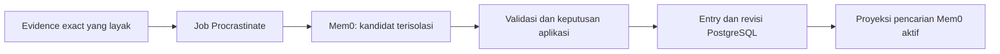

# Rencana implementasi memory dengan Mem0 OSS

Tanggal: 19 Oktober 2026. Keputusan pengguna: **memakai Mem0 OSS sebagai library, tanpa Mem0 Cloud**. Dokumen ini menetapkan rencana integrasi dan penerimaan; belum merupakan implementasi atau penerimaan NG-017. Kode produk, status Notion dan scope tiket belum diubah. Kontrak produk tetap mengikuti [Perilaku Agent](../product/03-agent.md), [NG-017](../backlog/tasks/17-memory-aktif-capture-evidence-dan-recall.md) dan [NG-018](../backlog/tasks/18-pengaturan-untuk-inspeksi-dan-koreksi-memory.md).

## Keputusan arsitektur

Mem0 menangani ekstraksi kandidat, embedding, deduplikasi awal dan ranking pencarian. Modul memory Ngertiin menangani penerimaan kandidat, owner, evidence, revisi, validitas waktu, koreksi, suppression, budget dan pemulihan. **PostgreSQL aplikasi menjadi sumber resmi apa yang diingat; indeks Mem0 dapat dibangun ulang dari data itu.**

| Bagian rancangan awal | Keputusan final |
| --- | --- |
| Fact/preference/observation dengan evidence/revisi | Tetap; schema dan lifecycle dimiliki aplikasi. |
| Ekstraksi dan pencarian semantic | Memakai Mem0 OSS sebagai implementation internal modul memory. |
| Hybrid lexical + semantic | Mem0 search digabung dengan FTS atas data canonical. RRF menggabungkan ranking, bukan skor mentah yang berbeda skala. |
| Profil inti kecil | View atas fakta aktif yang dikonfirmasi; tanpa ringkasan LLM terpisah pada tahap awal. |
| Capture background | Tetap Procrastinate. Mem0 async bukan pengganti antrean durable. |
| Chat/Task dan checkpoint | Tetap LangGraph; referensi memory dapat dicabut walau permintaan Task tetap mengikat snapshot asal. |
| MEMORY.md | Bukan penyimpanan resmi kedua. Inspeksi/edit melalui modul memory; representasi dokumen dapat menjadi view/export berikutnya. |

Mem0 stabil yang diaudit adalah `mem0ai==2.2.1`. Capture-nya ADD-only; keyword/entity meranking ulang kandidat semantic dan tidak memperluas candidate set. Graph memory tidak tersedia pada OSS sekarang. Karena itu, koreksi dan lexical recall independen tidak boleh diasumsikan selesai oleh SDK. [Audit Mem0](./mem0-evaluation-2026-10-19.md), [migrasi resmi](https://docs.mem0.ai/migration/oss-v2-to-v3).

## Konfigurasi dan penyimpanan

- Pin `mem0ai==2.2.1` dan lock dependency; cek resolver terhadap Python dan LangChain yang sudah digunakan. Pasang paket/provider yang diperlukan, tanpa semua extras.
- Gunakan PostgreSQL/pgvector yang sudah berjalan, dengan nama tabel/collection eksplisit untuk kandidat dan proyeksi memory aktif. Tidak menambah Qdrant server, graph server atau akun Mem0 Cloud.
- Konfigurasikan LLM dan embedder secara eksplisit. Uji Bahasa Indonesia/English sebelum menetapkan model embedding dan dimensinya. Simpan identitas model/dimensi/versi indeks; perubahan model memerlukan reindex, tidak mencampurkan vector yang tidak kompatibel.
- Reranker dan spaCy English tidak menjadi prasyarat V1. Native FTS PostgreSQL tetap dipakai. Verifikasi dependency minimal tidak mengunduh model NLP saat runtime. `ts_rank_cd` bukan BM25.
- Matikan telemetry SDK dengan `MEM0_TELEMETRY=false` sebelum import; provider LLM/embedding tetap mengikuti konfigurasi pemrosesan aplikasi.
- **History resmi berada di PostgreSQL aplikasi.** SDK Python tetap membuat SQLiteManager walau vector store PG. Target konfigurasi `history_db_path=":memory:"` untuk instance operation/job yang dibuang dan ditutup setelah selesai; tidak ada history SDK permanen atau instance capture lintas job yang menimbun pesan. Konteks ekstraksi dipilih ulang dari evidence yang masih layak oleh aplikasi.
- Konfigurasi SQLite sementara harus dibuktikan melalui smoke test sebelum integrasi produk. Jika versi tersebut tidak mendukungnya dengan benar, selesaikan integrasi storage melalui extension yang teruji sebelum rilis; jangan diam-diam kembali ke `~/.mem0/history.db`.

Dasar dukungan: [konfigurasi Mem0](https://docs.mem0.ai/open-source/configuration), [PGVector](https://docs.mem0.ai/components/vectordbs/dbs/pgvector), [history config](https://github.com/mem0ai/mem0/blob/94c3fe9f238f3dbf29c9ce98643bd71eb13077cd/mem0/configs/base.py#L29-L45), [SQLite constructor](https://github.com/mem0ai/mem0/blob/94c3fe9f238f3dbf29c9ce98643bd71eb13077cd/mem0/memory/storage.py#L11-L19).

## Modul dan data resmi

Tambahkan satu modul `ngertiin/memory/` mengikuti pola domain backend. Interface untuk pemanggil mencakup capture, recall, inspect, correct, forget dan pengaturan capture; pemanggil tidak mengakses Mem0 langsung. Detail Mem0, penyimpanan dan rekonsiliasi tetap internal, tanpa framework multi-provider baru.

Data yang diperlukan:

- Entry dan revision: ID aplikasi, owner, jenis, pernyataan, status, revisi aktif, waktu diketahui, waktu berlaku bila diketahui, confidence dan relasi penggantian.
- Evidence: referensi pesan/file/result exact beserta revision/hash dan anchor pendukung. Confidence adalah sinyal, bukan bukti kebenaran; kandidat yang tidak memiliki dukungan cukup tetap candidate atau ditolak.
- Suppression: scope fakta/topik dan referensi sumber yang dilarang dipakai ulang. Simpan metadata minimum yang diperlukan; audit forget tidak menyimpan kembali plaintext fakta yang dihapus.
- Capture job dan index operation: source revision, pipeline version, request key, receipt Mem0, state/lease dan retry. Owner memory generation meningkat ketika kebijakan/correction/forget mencabut konteks lama.
- Pengaturan capture dan pencatatan biaya: memisahkan evaluasi background dari operasi kontrol pengguna.

Perubahan keadaan memakai transaksi aplikasi dan optimistic revision. Panggilan LLM/embedding berada di luar transaksi panjang; hasilnya diperiksa kembali saat commit.

## Capture: kandidat dahulu, baru diterima

1. Setelah pesan selesai atau file/result siap, buat job bounded dengan source revision exact. Auto-capture memprioritaskan pernyataan pengguna yang layak; file/result diproses bila konteks atau permintaan pengguna memang mendukung personal memory. Tidak mengarsipkan seluruh dokumen ke memory.
2. Sebelum inference, cek owner, capture enabled, sumber masih ada, budget, secret, suppression dan exclusion persona. Gunakan `persona.store.memory_exclusions` agar permintaan/proposal persona, termasuk yang ditolak, tidak berubah menjadi memory. Assistant output, kutipan dan sumber web/file tidak otomatis menjadi fakta pengguna.
3. Jalankan Mem0 `add(infer=True)` pada collection kandidat, terisolasi menurut capture job dan owner. Hasilnya belum boleh di-recall oleh chat atau menjadi sumber dedup lintas job. Konteks pendukung yang terbatas disediakan aplikasi dengan identitas sumber; hasil yang tidak dapat ditautkan ke evidence exact ditolak.
4. Normalisasikan kandidat ke schema aplikasi, cocokkan evidence, klasifikasikan jenis dan perubahan terhadap fakta aktif. LLM boleh mengusulkan interpretasi dan hubungan konflik; code memvalidasi referensi, scope, state dan commit. Jika diperlukan pemeriksaan semantik terstruktur tambahan, lakukan satu batch bounded dan catat biayanya: tidak menjanjikan seluruh capture cukup satu LLM call.
5. Sebelum menerima, periksa lagi revision sumber, owner generation dan suppression. Simpan entry/revision, hubungan evidence dan index operation secara atomik. Kandidat ambigu tetap candidate dan tidak masuk prompt.
6. Indexer memproyeksikan teks yang sudah diterima melalui `add(infer=False)` beserta ID/revisi aplikasi pada metadata; tidak mengekstrak ulang fakta yang telah disetujui. Mem0 ID disimpan sebagai mapping, bukan ID domain. Pemanggilan ini dapat menghitung embedding lagi; biaya dan latency masuk pengukuran.
7. Simpan receipt, bersihkan kandidat dan tutup history SDK sementara. Rekonsiliasi berdasarkan job ID/metadata jika write berhasil tetapi receipt belum tersimpan. Kandidat orphan dibersihkan oleh job recovery dengan TTL; jangan mengandalkan destructor atau keberhasilan satu jalur saja.

Idempotency aplikasi berlaku pada source revision + pipeline/request key. Retry yang sudah memiliki hasil tersimpan melanjutkan publication/cleanup. Pada unknown outcome, query dan rekonsiliasi sebelum mengulang inference; duplicate projection tetap dideduplikasi menurut ID/revisi aplikasi dan dibersihkan.

Permintaan eksplisit untuk mengingat memperoleh status pending selama capture, lalu konfirmasi tersimpan hanya setelah commit canonical berhasil. Kegagalan inference tidak boleh menghasilkan klaim telah menyimpan memory. Proyeksi yang masih pending dapat dilayani melalui FTS canonical yang sah.

## Recall dan konteks eksekusi

1. Ambil profil inti kecil dan kandidat Mem0 dengan owner yang berasal dari auth backend, lalu ambil kandidat FTS canonical secara independen. Gabungkan ranking melalui RRF dan deduplikasi ID/revisi. Jalur FTS mempertahankan peluang menemukan nama/kode yang luput dari kandidat semantic Mem0.
2. Baca kembali entry/revisi canonical: harus aktif, owner sesuai, evidence layak, waktu cocok dan tidak suppressed. Record vector yang belum terdaftar, stale, orphan atau forgotten tidak dipakai, termasuk ketika cleanup indeks terlambat.
3. Bentuk konteks dengan batas token aktual yang mencakup teks, label dan metadata. Simpan daftar memory ID/revisi/generation yang dipakai agar keputusan dapat diaudit dan dicabut. Memory diperlakukan sebagai data; tidak memberi izin tool, mengganti Soul, saldo atau status Task.
4. Lakukan recall bounded sebelum model call Chat/Task yang memerlukan personal context; tool inspeksi/pencarian membaca melalui modul yang sama. Jika indeks gagal, gunakan fakta inti/FTS yang sah; jika data resmi tidak dapat diverifikasi, lanjutkan tanpa memory dan jangan mengaku telah mengingat sesuatu.
5. Revalidasi referensi memory sebelum melanjutkan model/tool calls dan publication. Ketika correction/forget membuat generation berubah, batalkan atau bangun ulang konteks memory yang terdampak. Checkpoint, draft dan Task snapshot tidak menjadi jalur untuk memakai ulang memory yang sudah dicabut. Instruksi/izin asli Task tetap tidak berubah.

Mulai dengan cap konfigurabel yang kecil untuk jumlah kandidat/fakta, total memory tokens, input/output extraction, model calls, retries dan budget per owner/global. Tetapkan angka melalui trial integrasi dengan ledger biaya yang ada, termasuk admission, embedding dan retry; jangan menambah SKU atau mengklaim latency/biaya sebelum diukur.

## Koreksi, perubahan dunia, source delete dan forget

| Peristiwa | Perilaku yang ditetapkan |
| --- | --- |
| Fakta lama salah | Revision lama corrected; fakta baru aktif bila evidence mendukung. Fakta salah tidak menjadi jawaban historis. |
| Fakta benar lalu berubah | Revision lama berakhir masa berlakunya, revision baru berlaku kini. Riwayat dapat menjawab pertanyaan historis bila evidence dan hak akses tetap sah. |
| Evidence dihapus/basi | Cabut dukungan sumber itu dan evaluasi ulang fakta/turunannya. Fakta boleh bertahan jika masih memiliki evidence independen yang sah; yang tidak didukung tidak dipakai sebagai fakta. |
| Pengguna meminta forget | Commit suppression dan cabut entry/revisi terkait dari recall; naikkan generation. Purge plaintext/embedding dari canonical memory, kandidat, proyeksi, core view dan turunan/cache yang terlacak. Retry dan replay sumber lama tidak boleh mengaktifkannya kembali. |
| Pengguna mematikan capture | Blok job baru dan hasil job lama lewat generation/policy recheck. Memory aktif yang sudah ada tetap dapat diperiksa/dikoreksi/dilupakan; mematikan capture bukan perintah menghapus semuanya. |

Forget segera mencabut penggunaan secara logis ketika transaksi berhasil. Cleanup fisik yang masih pending harus terlihat sebagai pending dan diretry; jangan mengklaim seluruh salinan sudah dihapus sebelum receipt/reconciliation selesai. Suppression dan pemeriksaan canonical mencegah hasil SDK stale masuk kembali selama cleanup.

Forget memory tidak otomatis menghapus chat/file asli atau jawaban yang sudah terkirim. Sumber lama ditandai tidak layak untuk capture kembali atas scope yang dilupakan; memory-derived context/checkpoints dan output turunannya yang terlacak harus direvalidasi. Jika pengguna ingin menghapus sumber, gunakan operasi penghapusan sumber tersendiri. Perintah eksplisit baru untuk mengingat lagi dapat mencabut suppression dengan revision baru; kemunculan biasa dalam riwayat tidak cukup.

SDK `delete()` sendiri mencatat plaintext lama pada history; karena itu tidak boleh menjadi seluruh implementation forget. Target history SDK sementara dan purge state aplikasi di atas merupakan perubahan penting dari integrasi Mem0 standar. Backup mengikuti retention sistem dan tidak dipakai untuk recall; setelah restore, replay tombstone sebelum melayani traffic memory. [Delete upstream](https://github.com/mem0ai/mem0/blob/94c3fe9f238f3dbf29c9ce98643bd71eb13077cd/mem0/memory/main.py#L2114-L2143).

## Urutan delivery dan gerbang penerimaan

1. **Trial integrasi kecil sebagai langkah awal NG-017.** Buktikan dependency resolution, PGVector, history SDK sementara, capture ke kandidat, publication raw ke indeks aktif, receipt/recovery dan biaya. Keputusan memakai Mem0 sudah dipilih; trial menguji cara integrasi, bukan membuka kembali riset vendor tanpa sebab.
2. **Storage dan lifecycle.** Migration incremental untuk canonical entries/revisions/evidence, suppression, job/index operation dan settings; owner checks, idempotency serta generation. Tidak mengganti migration baseline atau mereset data.
3. **Capture dan recall.** Integrasikan exclusion NG-016, source NG-034, ledger budget, Chat/Task dan snapshot/checkpoint handling. Backend kontrol inspect/correct/forget/capture-off tersedia untuk verifikasi kontrak NG-017.
4. **Penerimaan NG-017.** Jalankan static/build checks yang relevan, inspector lifecycle dan walkthrough browser dengan model nyata. Rekam evidence dan batas yang belum lolos; hanya tandai selesai setelah seluruh kontrak tiket terpenuhi.
5. **NG-018.** Hubungkan fondasi yang sama ke UI sumber, daftar memory, edit/forget dan capture toggle. Terima empty/loading/error, mobile/focus dan kontrol saat allowance habis. Memory tidak tampil sebagai fitur lengkap sebelum kontrol pengguna yang diperlukan tersedia.

Skenario wajib: recall lintas thread; Bahasa Indonesia/English; negasi/nama/kode; no-evidence abstention; assistant inference tidak dipromosikan; persona rejected tidak tertangkap; koreksi versus perubahan historis; source deletion; forget saat extraction/indexing/generation berjalan; replay setelah reload/restart; duplicate/concurrent capture; owner B mencoba ID owner A; provider/index failure; budget habis dan capture-off. Ukur kualitas recall/grounding serta p50/p95 dan seluruh biaya di luar angka vendor.

Rilis bertahap memakai konfigurasi capture/recall dan owner development terlebih dahulu. Jika Mem0 bermasalah, hentikan job/inference memory, pertahankan kontrol serta data canonical/suppression dan gunakan fallback yang sah. Rebuild indeks hanya dari revision aktif yang diizinkan, tidak dari seluruh history. Setelah penerimaan, sinkronisasi status Notion dan mirror mengikuti workflow proyek dengan readback; tidak dilakukan hanya karena dokumen rencana selesai.
