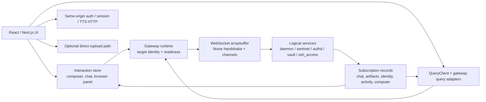

# 03 · Frontend, Transport & Kontrak Data

Sumber: [Notion](https://app.notion.com/p/3fdabdd6187381e3aaa8f456a6dbd1cf) · Readback: 2026-10-18T06:04:56.780944+00:00

<!-- notion-content:start -->
<table_of_contents/>
Tanggal audit: 18 Oktober 2026. Build yang terlihat: `dpl_13w2XhxKwKs7oW6RrPKNJxMESSbw`.
Dokumen ini menganalisis JavaScript yang dikirim ke browser. Ia melengkapi observasi UI, bukan menggantikan bukti bahwa suatu API benar-benar dipanggil atau operasi backend berhasil. Tidak ada pesan privat, nilai cookie, credential, storage value, maupun payload pengguna yang dibaca untuk audit ini.

## 1. Kesimpulan teknis yang paling kuat

1. **Frontend menyediakan runtime agent yang berpusat pada target gateway/VM**, dengan target identity, readiness, confidential-VM credential recovery, event replay, serta pemisahan koneksi primary/shared-agent. Ini terlihat pada implementasi transport dan state fencing, bukan hanya copy pemasaran.
2. **Chat memakai kontrak subscription di atas kanal WebSocket biner dengan implementasi Noise**, bukan bukti SSE chat. Registry memetakan `chat.stream`, `chat.subscribe`, dan banyak operasi lain ke permintaan HTTP-shaped yang dienkripsi dan dimultipleks dalam service frames. String protokol yang tertanam adalah `Noise_XX_25519_AESGCM_SHA256`.
3. **Frontend membedakan penerimaan pesan, streaming, replay, dan kepastian pengiriman.** Outbox memakai antrean FIFO, optimistic message, target fencing, status `awaiting_ack`, serta retry terbatas pada pesan yang belum terkirim atau penolakan startup tertentu.
4. **Artifact adalah resource tersendiri dengan identitas, status, open target, preview, dan capabilities.** Sinkronisasi artifact memakai snapshot berpotongan dan pembaruan navigation, dengan pemeriksaan integritas sebelum snapshot dipublikasikan ke UI.
5. **Permission dan approval adalah bagian kontrak produk.** Ada inventory, policy defaults, owner scope `space`/`schedule`, revisi untuk perubahan policy, approval decide/edit/history, dan penanda target agar hasil lama tidak menimpa state VM baru.
6. **Data UI menggabungkan cache server dan store interaksi lokal.** Terlihat QueryClient, gateway-scoped query adapters, cache file/blob yang eksplisit, serta external store dengan API `createStore`, `subscribeWithSelector`, dan `devtools`. Penyebutan Zustand adalah inferensi dari API tersebut; versi library tidak dibuktikan.
Semua poin di atas berstatus **observed static**: implementasinya ada dalam bytes artefak. Keaktifan runtime, privilege user, enforcement server, dan topologi deploy tetap perlu bukti lain.

## 2. Provenance dan batas cakupan

### Bukti REA

| ID ringkas | Evidence ID aktual | Makna |
| --- | --- | --- |
| E0 | `ev_ea428e6ce0aa17d7182aa1eb3c235b44ba7b8e3f45af28274eeab4fd37e831d3` | Inspeksi halaman publik/logged-out yang disediakan investigasi induk |
| E1 | `ev_48541e373916d12acf2fb54d0a0f91850db420dd7d877b72e4c63b5513439d43` | Receipt ekspor script publik yang disediakan investigasi induk; digest receipt `e946df2e1510a595e9b04915d8779093dd1b93fd01afcec51d37200c00477629` |
| E2 | `ev_3118eb2894143c3cdacc62932c872bf6b64db2b1f6c1733706b9e717b4676572` | Parent analisis REA atas 9 script publik, 690.315 bytes, 9 parse sukses |
| E2s | `ev_b29d816a621599ea8c815538e5c1145a40a8ed20eb3ed2bade1d34b3690aba3c` | Summary E2 yang tersimpan lokal |
| E3 | `ev_1be87df5702e20626a0a9f7c6c743fc2c1ea4c6da588e5deed8be9f5df49c078` | Parent REA atas registry, gateway runtime, upload wrapper dan TTS; 4 file/207.860 bytes, tanpa parse failure |
| E3s | `ev_a5484210722c090835041ab9d222a499ed2e81821ee117c5cbee1477f6638507` | Summary E3 |
| E4 | `ev_3ef37aea9ccdb037efb5d84e1fa748379b4e903052ce94638b9d1cd06a6b2c62` | Parent REA atas 8 file protokol, chat, artifact, permission, cache, goal, attachment; 491.688 bytes, tanpa parse failure |
| E4s | `ev_3d826b3f5e96afa376119309179940aa0efec40d6c76d641676d5f492fefe9fd` | Summary E4 |

REA E2 hanya memilih 9 dari 54 file; semantic graph sebagian tertahan akibat result-budget, dengan static/module facts tetap tersedia. E3/E4 memilih 4 dan 8 file dari inventori 200 file (199 JavaScript + manifest); semantic node ceilings sengaja dipasang untuk membatasi ukuran graf. Summary mengatakan graph partial. Statistik `modules: 0` menunjukkan REA tidak memberikan rekonstruksi modul Turbopack yang lengkap. Detail kontrak di bawah juga diverifikasi melalui pembacaan bytes sumber yang di-hash, bukan disimpulkan dari graf lengkap.
E2 trace literal `/api/auth/session/reset`, `ev_56802e784af1614175f626e1c61ea9bc97c393337a7dff1eb9c3fd5c78abb8b5`, menghasilkan no-match pada graph partial meskipun literal ada dalam sumber. Ini contoh batas extractor, bukan bukti fitur tidak ada. Trace tidak dipakai untuk menyangkal kontrak.

### Dua jalur akuisisi yang berbeda

- **Public capture REA:** `public-capture.json` SHA-256 `9d244515a58afe070e0c775f600d23cdbde1dee0fcc401a7d5a477273ae101c6`; 54 source diekspor di `scripts-public/files/`. Capture mulai setelah attach. Origin filter membuang 10 script yang origin-nya tidak dapat diatribusikan. Raw network bodies, cookies, storage values, dan WS payload tidak dipertahankan oleh REA. Tidak ada dropped event yang dilaporkan, tetapi ini tidak memulihkan aktivitas sebelum attach.
- **Artefak app publik:** 199 exact static chunk URLs terlihat melalui CUA `pageAssets` inventory `72fe8a08-c825-4ab5-ab2b-a4e498b561f6` pada rendered authenticated UI, kemudian diunduh HTTP publik **tanpa cookie/authorization**. Semua 199 berstatus 200; total 10.075.471 bytes. Manifest `scripts-app-public/manifest.json` menyimpan URL, SHA-256, content type, ukuran, dan build. Ini bukti akuisisi CUA + HTTP, bukan hasil capture REA E0.
REA root identity untuk directory app yang dianalisis: `fd4682286e56650ae5de052adf5f6b911f03fbce62da8ccf004b9a57775e8dba`. Root identity public export: `604dbed6703d6b4a4b466c19c359b6aa38c32341151fe4d35afda04b6a8a46ae`.

### Artefak pendukung

- `frontend-route-registry.json`: 338 deklarasi method literal yang unik, lengkap dengan HTTP method, route template, service/channel/noise flags jika tertulis, serta source byte offsets. Satu method memakai variable lokal untuk `shared_space.callback` dan tidak dimasukkan extractor literal-only.
- `frontend-source-evidence.json`: 32 excerpt terpilih dengan exact URL, SHA-256 yang diperiksa ulang terhadap file, ukuran dan byte range UTF-8 `[start,end)`. Identifier `F:...` di bawah mengacu ke key pada file ini.
- `frontend-public-analysis-summary.json`, `frontend-app-analysis-summary.json`, `frontend-contract-analysis-summary.json`: summary REA aktual beserta limitations.
Tidak dilakukan source-map fetch, eksekusi script lokal, endpoint probing, penulisan konfigurasi akun, maupun operasi terhadap resource privat.

## 3. Bentuk arsitektur yang didukung frontend


Diagram adalah rekonstruksi statis. Nama service dibaca dari route/enum. Ia tidak membuktikan bahwa lima service berjalan sebagai lima process, container, atau server terpisah. Backend framework, database, queue, orchestration engine, model routing dan sandbox internals tidak tersedia dari sumber ini.
Next.js/Turbopack teramati dari script URLs dan bootstrap `globalThis.TURBOPACK`; React serta compile-time memo cache terlihat di komponen. Deployment ID juga dipakai oleh client consistency/reload recovery. Exact Next/React/library versions tidak ditetapkan.

## 4. Gateway dan transport

**Observed static — E3/E4; F:gateway.binary_noise, gateway.http_encoding, gateway.noise_handshake, gateway.dispatch.**
Koneksi membuka `new WebSocket(...)`, menetapkan `binaryType="arraybuffer"`, lalu melakukan `performNoiseHandshake`. Source memuat Noise XX X25519/AES-GCM/SHA-256, generated service schemas, dan frame handling untuk request, response, body chunk, serta reset. Request yang ber-route dienkripsi melalui `encryptHttpRequest`; chunk binary dikirim lewat socket. Implementasi ini bukan wire capture yang memastikan versi peer atau konfigurasi server.
Registry memetakan nama RPC produk menjadi HTTP-shaped route, service, dan channel. `resolveHttpRouteRequest` mengisi path parameters, menghapus parameter yang telah dipakai dari object query/body, dan URL-encode parameter. Wildcard subpath meng-encode setiap segment. GET menambahkan sisa params ke query string; request non-GET memakai JSON kecuali route memiliki `requestBody:"empty"`. Default service yang dipakai transport adalah `daemon`; channel default `main`, dengan `media` untuk beberapa binary response.

| Area | Contoh kontrak static |
| --- | --- |
| Chat | `chat.history → GET /chat/history`; `chat.history_window → GET /chat/history-window`; `chat.stream → POST /chat/stream`; `chat.subscribe → POST /chat/subscribe` |
| Session | `sessions.list → GET /api/session/list`; `sessions.get → GET /api/session/list/{id}`; start/archive/unarchive/pin/unpin/rename/delete |
| Files | `fs.list/read/reads/write/delete/rename/mkdir/library/search/export` → POST `/fs/...`; `fs.raw → GET /fs/raw/{*path}` |
| Artifacts | list, share, remove, fetch_url, pin, slides.rebuild, subscribe |
| Agent state | skills list/disconnect/disable; subagents list/status; config get/update; identity; model get/set |
| Connectors | list/detail/connect/info/permissions/scopes/link/disconnect; account link/unlink; callback routes |
| Goals | list/detail/update/reorder/delete/suggestion decision, `goal_prompt` |
| Tasks | list/runs/run/delete/subscribe |
| Computer/browser | lease/context/preview/subscribe, task takeover/present/viewer/heartbeat/close/release/stop |
| Permissions | inventory/settings/active/scoped/revoke/reset/network-rules/connector policy; approval list/detail/decide/edit/history |

`noiseOnly` adalah flag deklaratif frontend yang membatasi jalur transport. Ia bukan bukti otomatis endpoint tersebut terbuka ke internet atau dapat diakses user ini. Debug/redteam/access routes yang ikut terbungkus juga tidak membuktikan entitlement aktif.
Subscription menggunakan records JSON di body kanal biner: parser mengakumulasi decoded text, mengurai record, memproses acknowledgement awal, lalu menyerahkan event envelope. Ini berbeda dari SSE HTTP. Envelope dispatch yang terlihat: `res {id,status,payload|error}` dan `event {event,payload,ts_ms,seq}`. Handler `client.invoke` memilih command handler berdasarkan `command_id`; `approvals.snapshot` juga disimpan sebagai snapshot terbaru agar subscriber baru mendapat state awal.
Beberapa resource besar memakai media channel dan bounded response budget. Binary responses dikembalikan sebagai Blob; reset/timeout/limit membuat request gagal dan membersihkan pending stream. Close codes yang tertanam antara lain 4004 decrypt error, 4006 response limit, 4008 subscription lost, 4010 subscription ended, 4011 invalid subscription record. Zstd request/response codec ada dalam source, tetapi keberhasilan negosiasi kompresi runtime tidak diuji.

### Readiness dan recovery

**Observed static — F:gateway.request_fencing, gateway.reconnect.**
- Target terdiri dari gateway URL dan VM name; pending request dapat mengikat `expectedGatewayTargetKey`/`expectedTargetKey`. Response target lama ditolak dengan target-changed error.
- Antrean sebelum ready/selama handshake dibatasi 100 request. Pada media channel, pending requests dibatasi 200.
- Socket open memiliki timeout 15 detik. Heartbeat dan visibility probe memeriksa liveness; probe membedakan halaman visible/hidden.
- Maksimum auto reconnect yang tertanam 50, dengan backoff attempt constant 10. Delay memakai fase awal 1 detik untuk mode tertentu, kemudian exponential factor 1,5, cap 8 detik dan jitter hingga 20%. Ini formula source, bukan pengukuran recovery.
- Handshake memeriksa target/attestation/trust dan dapat mengarahkan pengguna ke enroll/unlock credential flow. Confidential VM harus mencapai enrollment health `ENROLLED` sebelum dinyatakan siap. Credential storage failure dibedakan dari handshake yang retryable.
- Shared-agent connection mempunyai policy, target/ticket dan strict attestation evaluator tersendiri. Scope privilege dan keamanan backend tidak diuji dari frontend.

## 5. Chat: send, acknowledgement, event replay, dan state

**Observed static — E4; F:chat.subscribe_contract, chat.send_contract, chat.outbox, **[**chat.events**](http://chat.events)**.**
Berikut adalah **rekonstruksi kontrak dari object construction frontend**, bukan schema backend yang otoritatif. Field opsional bergantung pada route, capability, voice state dan attachment branch.
```typescript
type SubscribeParams = {
  capabilities: string[];
  after_stream_seq?: number;
  after_chat_event_seq?: number;
  session_id?: string;
};

type ChatSend = {
  message?: string;             // branch text lama
  items?: AttachmentOrText[];   // branch structured items
  node_id: string;
  capabilities: string[];
  session_id?: string;
  model?: string;
  in_reply_to?: string;
  reply_to_target?: unknown;
  hidden_prompt?: string;
  product_request?: { space: unknown };
  client_ip?: string;
  timezone?: string;
  metadata?: {
    active_panel?: unknown;
    goal_creation_target?: { kind: string };
    thread_is_dictation_used?: boolean;
    message_origin?: string;
  };
  // Voice-routing fields may be appended by a separate builder.
};

type ChatSendAck = {
  message_id: string;
  reply_to_message_id?: string;
  session_id?: string;
};
```
`chat.subscribe` untuk draft hanya menyertakan capabilities; main/thread menyertakan replay cursors, dan thread menambah `session_id`. Cursor dinaikkan monoton dengan `Math.max`, hanya menerima finite positive integers. Capabilities yang tertanam: chat cancel, delta stream, custom reactions serta voice reply captions/live transcript. Respons subscribe dipakai untuk agent/connection identity; draft yang menjadi thread menukar draft ID dengan session ID hasil server, dengan pemeriksaan bahwa route dan transcript scope masih sesuai.
Event transcript yang diproses source mencakup `message.user`, `message.assistant`, `delta.message_start`, `delta.text_append`, `delta.message_done`, `delta.presentation`, `delta.placeholder`, `tool_call.started/completed`, dan delta tool start/done. Resource dapat menautkan image/video/file/citation; ada recursive sub-agent content dan normalisasi tool result. Event sequence, message IDs, tombstone/deletion dan transcript revision dipakai untuk menolak history stale dan menghindari kemunculan kembali pesan yang telah dihapus. Ini memperlihatkan model conversation yang lebih luas daripada string text tunggal.
Outbox frontend memakai FIFO maksimum 32 reservation, budget bytes sekitar 64 MiB, expiry 5 menit, AbortSignal, serta release untuk mengaktifkan reservation berikutnya. Pemeriksaan budget dilakukan terhadap antrean yang sudah ada pada waktu reserve; source ini tidak cukup untuk menyatakan hard cap final total secara universal. Optimistic message mempunyai `deliveryStatus:"sending"` dan fase `preparing`, `queued_for_connection`, lalu `awaiting_ack`. Sesudah ack, optimistic ID dipertemukan dengan server message ID.
Retry aman dibatasi pada GatewayRequestError dengan `deliveryState:"not_sent"` atau penolakan `startup_not_ready`/`session_busy`; target-changed error secara eksplisit dikecualikan. Interval retry 2 detik. `ack_uncertain` adalah kategori kegagalan UI yang dibedakan dari not-sent. Tidak teramati field idempotency backend yang cukup untuk mengklaim exactly-once send. UUID optimistic message tidak boleh disamakan dengan dedup key server.
Send juga tertahan bila ada blocking approval yang belum selesai. Readiness/activation invalidation, route generation, session scope dan current gateway dicek berulang sebelum mengirim dan sebelum menerapkan hasil.

## 6. Attachment dan file ingestion

**Observed static — E3/E4; F:files.attachment_contract, files.attachment_threshold, files.rupload, files.upload_defaults.**
Frontend memuat setidaknya dua jalur upload. Kehadiran keduanya tidak menetapkan branch yang aktif pada semua akun.

### Structured attachment ke gateway/VM

```typescript
type AttachmentOrText =
  | { type: "text"; text: string }
  | { type: "image"; mime_type: string; data_base64: string; filename: string }
  | { type: "file"; mime_type: string; data_base64: string; filename: string }
  | { type: "file_ref"; mime_type: string; path: string; filename: string };
```
Image branch memakai inline base64. File non-image memakai `file_ref` bila melewati threshold; source menaruh threshold 10 MiB, sedangkan video tanpa capability `video_file_ref_ingest` memakai threshold 60 MiB. Generated path berada di `workspace/user/files/` dengan sanitasi nama, counter dan suffix random. Ini pembuatan path frontend, bukan bukti actual filesystem layout backend.
Upload dapat dimulai sebelum send, dengan AbortController, `stageBeforePublish:true` dan target-scoped cleanup. Saat send dibatalkan, scope berganti, atau upload ternyata tidak dipakai, cleanup dicoba. Object URL preview juga diretain/revoke secara eksplisit. MIME category, filename, rawFile/base64, processing state, upload promise dan published path dipisahkan agar draft dan upload tidak tercampur.

### Direct rupload

Source helper lain mengirim POST binary ke `https://rupload.meta.ai/gen_ai_document_gen_ai_tenant/{uuid}`. Header identity file meliputi panjang, nama URL-encoded, MIME type, offset, serta OAuth token dari auth context. Audit hanya melihat nama header dan construction expression, tanpa membaca nilai credential.
Media handle diambil dari variasi field `media_id`, `h`, `file_id`, `fileId`, atau `id`. HTTP 401 memicu session recovery. Wrapper UI memvalidasi file, menampilkan uploading/complete/error dan memegang preview URL. Default config yang tertanam: 40 MiB per file, 10 file per upload, 120 detik video, 9 halaman PDF, beserta daftar MIME/ext yang luas. Config tersebut tidak cukup membuktikan semua limit ditegakkan backend atau pada seluruh branch upload.

## 7. Artifact dan library

**Observed static — E4; F:artifacts.wire_node, artifacts.snapshot_reducer, artifacts.subscription.**
Artifact node mempunyai wire shape berikut, direkonstruksi dari normalizer frontend:
```typescript
type ArtifactNodeWire = {
  artifact_ref: string;
  type?: "web" | "document";
  source?: "space" | "saved_space" | "file";
  format?: string;
  display_name?: string;
  status?: "ready" | "constructing" | "updating" | "failed" | "interrupted";
  created_at_ms?: number;
  updated_at_ms?: number;
  last_opened_at_ms?: number;
  last_activity_at_ms?: number;
  frequency_score?: number;
  is_pinned?: boolean;
  pinned_order?: number;
  section?: "pinned" | "recent" | "all";
  open_target:
    | { kind: "space"; slug: string }
    | { kind: "saved_space"; shortcode: string; url?: string }
    | { kind: "file"; path: string };
  preview?: { icon_url?: string; thumbnail_url?: string; width_px?: number; height_px?: number };
  capabilities?: { can_open?: boolean; can_pin?: boolean; can_delete?: boolean; can_rename?: boolean; can_share?: boolean };
};
```
Normalizer menolak node tanpa `artifact_ref` atau open target valid, memberi default untuk beberapa field lain, dan hanya mengaktifkan capability bila nilainya `true`. Artifact reference helper membentuk `space:{slug}`, `saved_space:{shortcode}`, dan `file:{path}`. UI dapat menampilkan documents, web artifacts dan shared artifacts dalam satu catalog tanpa menganggap semuanya satu jenis file.
`artifacts.subscribe` mengirim `{collection,sort}`. Collection yang terlihat: all/web/documents/shared; sort meliputi last_opened/last_modified/title. UI last_created dimapping ke wire last_modified dalam helper ini. Snapshot event membawa `collection`, `sort`, `artifacts[]`, `chunk_number`, `chunk_count`, `total_count`.
Frontend menyimpan staged snapshot, menghitung raw rows sebelum filtering, memeriksa urutan chunk dan konsistensi metadata, lalu memastikan raw count sama dengan total count sebelum status `ready`. Jika gagal, staged snapshot dibersihkan dan status menjadi failed. Updates/removes diterapkan lewat `navigation.items.updated`/`navigation.items.removed`. Ref count dan cleanup mengatur lifecycle subscriber; optimistic removal punya commit/rollback dan diterapkan sebagai lapisan visibility sehingga snapshot baru tidak langsung memunculkan kembali item yang sedang dihapus.
Pinning mengirim `artifact_ref`, boolean pinned dan opsional posisi before/after artifact ref. Ordering menempatkan pinned dulu dengan fractional order, lalu recency/title dan tie-break identity. Ada file-type inference untuk docx/md/pptx/xlsx/txt serta parsed spreadsheet/slide previews.
Sharing source memeriksa resolved serving-VM type; standard dan confidential sama-sama dianggap tersedia, sedangkan unresolved/unbound diblokir frontend. Ini tidak boleh disederhanakan menjadi larangan sharing untuk CVM. Backend sharing review/fix/status dan Cloudflare share helper ada, tetapi publikasi artifact tidak dilakukan dalam audit ini.

## 8. Cache, local state, dan isolation

**Observed static — E4; F:cache.query_defaults, cache.file_keys, cache.gateway_context, **[**chat.store**](http://chat.store)**.**
QueryClient singleton default memakai stale time 60 detik, GC 5 menit, maksimum satu retry untuk error yang bukan rate-limit, dan tidak refetch otomatis saat window focus. Gateway query adapter menyediakan query options, set/remove data, invalidate/invalidateAll, prefetch dan infinite pagination. Ia dapat memilih noiseFn, route registry, atau queryFn fallback. Wrapper context menambahkan expected target sehingga request dan cache tidak terbuka terhadap perubahan VM tanpa sengaja.
Query context memuat gateway URL, VM name, target key, gateway scope key, sendRequest, filesystem facade, readiness dan waitForTransport. Banyak domain query memasukkan gateway scope. Namun file content keys pada helper yang dibaca hanya memakai normalized path dan content subtype, bukan gateway identity. Karena itu reset target/protected session merupakan bagian isolation yang penting, bukan boleh diasumsikan semua cache key sudah scoped.
File keys mencakup stat, text dengan maxBytes, blob/range, spreadsheet dan pptx slides. File content memakai stale time Infinity dan GC 30 menit; explicit write/rename/delete invalidation mereset derivative caches. Blob URL cache memiliki generation/path version, active reference count dan revocation, termasuk parsed slide images.
Store lokal memisahkan chat, composer, tasks, files, identity, recording, avatar, search, device context, audio player dan browser panel. Draft composer disimpan per route dengan generation; ada pembatasan jumlah draft 20 serta kira-kira 24 MiB reserved/inline content. `resetGatewayTargetState` membersihkan credential state, file tree, blob cache, artifact connections, voice transient state serta sebagian besar query/mutation caches; full protected session reset juga menghapus store terlindungi dan persistent state.

## 9. Session lifecycle dan client consistency

**Observed static — E2; F:session.lifecycle, session.admission, session.client_version.**
Identity frontend memakai `{viewerId,sessionBindingId}`. `hatch-auth` BroadcastChannel menyinkronkan logout, VM reset, VM ready, dan admission invalidation antar-tab. VM-ready payload memerlukan gateway URL, VM name dan readiness `noise`/`shell`; sender ID menghindari menangani pesan sendiri.
Admission invalidation adalah bentuk strict tiga-field `{type:"hatchAdmissionInvalidated",reason,status}`. Session/401 menuju `/`, entitlement/403 menuju `/blocked`, activation/403 menuju `/access`. Ini membedakan alasan ketidaktersediaan produk di client; status dan keputusan backend tidak diuji.
Teardown quiesce owner, membatalkan credential session, membersihkan CVM recovery/provisioning/trust state serta protected persistent state, lalu POST `/api/logout` atau `/api/auth/session/reset` dengan sessionBindingId. Response 409 memicu reload; fallback menuju logout route. Promise ownership dan identity comparisons mencegah cleanup sesi lama menimpa sesi baru.
Client consistency membaca deployment ID dari chunk URL, membandingkan `/api/client-version`, dan membatasi reload attempt per deployment melalui sessionStorage. Voice operation dapat menahan reload. Ini mengurangi risiko lazy chunk dari deployment lama gagal setelah app diperbarui; hasil recovery tidak diukur.

## 10. Permission, approval, dan human-in-the-loop

**Observed static — E3/E4; F:permissions.scoped_update, permissions.inventory.**
Route service `sentinel` menampung approval, active permissions, scopes, network rules, policy connector dan beberapa transport/proxy modes; service `daemon` menyediakan permission inventory. Nama service adalah logical routing evidence, bukan klaim deployment.
Inventory frontend mengharapkan tepat lima section: connector, website, artifact, scheduled_task, direct_network_protocol. Entry type bisa permission, owner, atau protocol. Owner artifact memakai scope `space`; owner scheduled task memakai scope `schedule`, display name, required permissions, manage-permissions availability dan daftar permission. Protocol mode dibatasi allow/ask/deny.
Scoped GET mengirim `scope_type`, `scope_id` dan comma-joined connectors. Normalizer memverifikasi response owner scope sama dengan request. Hasil meliputi revision, connectors/methods, web-read default, websites dan inherited websites. Mutation scoped update mengirim:
```typescript
{
  scope_type, scope_id,
  expected_revision,
  connector, method, mode,
  display_name
}
```
Mutation memakai captured approval target token, memeriksa target masih current setelah waitForTransport, menyertakan expected target, menonaktifkan automatic retry dan menginvalidasi permission views setelah state generation yang tepat. Ini observasi optimistic concurrency pada client, bukan bukti server membandingkan revisi secara atomik.
Approval routes mencakup list/detail, editable message, decide, edit-message dan history. Snapshot event langsung memperbarui approval cache. Bulk decision dibatasi concurrency 2, maksimum 10 approval per composer action. UI menahan chat send ketika approval yang memblokir belum diselesaikan. Network/proxy mode dan permission defaults bisa dikonfigurasi lewat typed routes, tetapi audit ini tidak mengubahnya.

## 11. Goals, tasks, dan proactive work

**Observed static — E4; F:goals.wire, goals.actions; registry E3.**
Goal normalizer menerima id/goal_id dan mengembalikan title, summary, momentum, momentum status on_track/at_risk/behind, description, emoji/image, source user_goal/assistant_tracking, lifecycle active/paused/retired/completed, timestamps, parentGoalId, sortOrder, recursive subGoals, sessionId dan isThread. Detail berisi goal, updates, suggestions, associations, recentBriefing dan briefings. Association yang tampak mencakup space, document dan cron, sehingga goal dapat ditautkan ke artifact/file/schedule.
Update goal mengharuskan sedikitnya title, description, status atau parentGoalId; parentGoalId dikirim sebagai parent_goal_id, termasuk null untuk melepaskan parent. Reorder, delete, suggestion accept/reject contract terpisah. Source menangani `goal_lifecycle_transition_in_progress`. Goal list user goal, assistant tracking, completed dan detail memakai query cache stale time 5 detik.
Task registry mengungkap GET `/tasks`, GET `/tasks/runs`, POST `/tasks/{job_id}/run`, DELETE `/api/tasks/{job_id}` dan subscription `/tasks/subscribe`. Store memiliki schedules/runs, selected job, loading/error, serta run dedup by run_id. Query parameter untuk deep-link scheduled task serta approval owner schedule tersedia.
**Unknown:** full serialized schedule schema, timezone/cron semantics, creation/edit API, missed-run policy, retry/catch-up guarantees, event-to-task scheduler backend, dan apakah schedule dieksekusi ketika browser tutup. Chunk editor/scheduler lengkap tidak ditemukan pada kumpulan modul yang dibaca. Endpoint/telemetry names tidak membuktikan durabilitas scheduler.

## 12. Browser/computer dan agent-to-UI capabilities

**Observed static — registry E3; E4 F:ui.client_control.**
Browser task contract menyediakan viewer attach, takeover, present, heartbeat, close, release, stop, refresh-environment, end-and-release serta lease info. Clipboard read/copy/paste diwajibkan memakai typed Noise methods; helper menolak synthetic generic route yang mencoba menarget clipboard. Clipboard route responses mempunyai byte limits tersendiri. Computer preview memakai binary/media channel dengan task ID dan SHA-256 pada route.
Browser task widget normalizer membedakan control owner dan owner kind user/main_agent/cron. Store memegang browser panel state dan dismissed task banners. Frontend mengiklankan client capabilities serta menerima `client.invoke`; command resolver hanya menerima UI commands yang terdaftar, seperti navigation, appearance mode/chat theme, settings, goals, ideas, files/library/artifacts, scheduled task dan space. Request memerlukan invoke ID dan command ID valid. Hasil dikirim melalui client invoke result route.
Ini mendukung inferensi bahwa agent dapat memandu UI dan menghadirkan task ke pengguna. Tidak membuktikan agent boleh menjalankan semua command, browser isolation tertentu, remote browser provider, atau keamanan takeover lease di server.

## 13. Voice dan SSE yang memang terlihat

**Observed static — E3; F:voice.sse.**
Preview voice mempunyai HTTP SSE path konkret: POST `/api/hatch/voice/tts/stream`, JSON `{voiceId,text,audioFormat:"mp3"}`, header `Accept: text/event-stream`. Parser mengenali data event `[DONE]`, `tts.done`, dan `tts.delta` yang membawa audio base64, lalu mendecode ke bytes. Abort membatalkan reader dan membersihkan lock. Path fallback `/api/hatch/voice/tts` mengambil JSON audio.
Voice runtime lainnya punya typed gateway routes untuk start/end call, user speech, media endpoint, available/custom voices, pipeline profiles, dictation, active voice dan persisted settings. Kehadiran SSE pada TTS tidak boleh digunakan sebagai bukti chat SSE atau menyamakan voice preview dengan keseluruhan real-time voice pipeline.

## 14. Inferensi desain yang layak dibawa ke rekonstruksi

Berikut **proposal rekonstruksi**, bukan klaim bahwa backend Muse menggunakan implementasi yang sama:
1. Pisahkan session admission, gateway readiness, chat delivery, generation state, dan artifact lifecycle. UI perlu dapat menjelaskan menunggu koneksi, menunggu ack, generating, approval required dan gagal secara terpisah.
2. Buat target/session token untuk async work. Query, mutation, upload cleanup dan event handler harus menolak hasil dari session atau VM yang telah ditinggalkan.
3. Simpan conversation event cursors terpisah dari message rendering. Replay harus memakai monotonic cursor dan deletion tombstone/revision sehingga reconnect tidak menghidupkan pesan lama.
4. Jadikan artifact resource first-class, dengan discriminated open target dan server-returned capabilities. Generation job dan artifact yang dibuka pengguna memiliki lifecycle berbeda.
5. Perlakukan snapshot stream sebagai transaksi UI: stage, verify sequence/count, kemudian publish. Jangan mengganti catalog dengan snapshot setengah jadi.
6. Gunakan owner-scoped permission dengan revision dan backend atomic compare-and-set; tampilkan inherited permission berbeda dari grant lokal.
7. Definisikan retry berdasarkan delivery certainty, bukan semua network error. Untuk rekonstruksi baru, tambahkan idempotency key eksplisit di backend apabila duplicate send harus dicegah.
8. Untuk scheduler baru, tentukan kontrak durabilitas terpisah (timezone, DST, retry, catch-up, disable/delete race, ownership dan quota). Kumpulan frontend ini belum menjawabnya.
9. Implementasi baru tidak perlu meniru Noise/CVM tanpa kebutuhan threat model yang sama. Kontrak produk dan ownership/state boundaries dapat diadopsi tanpa menyalin detail crypto/deploy yang belum divalidasi.

## 15. Checklist pertanyaan audit

| Pertanyaan | Status dari sub-audit frontend | Gap yang tersisa |
| --- | --- | --- |
| Frontend stack dan pembagian state | Terjawab sebagian kuat dari code | Versi library, source original, build config |
| Transport chat dan replay | Terjawab static | Wire execution, peer negotiation, server history retention |
| API/RPC product surface | 338 method literal + satu variable-bound method | Active entitlement, server availability, request/response schema lengkap |
| Chat delivery/retry | Terjawab static | Backend idempotency dan settlement guarantees |
| Upload/file contracts | Terjawab static untuk dua jalur | Active branch per akun; final server limits dan scanners |
| Artifact schema dan sync | Terjawab static | Generation backend, export correctness, public share execution |
| Permission/HITL | Terjawab static | Server enforcement, revision atomicity, policy precedence |
| Goals/proactive modeling | Terjawab sebagian | Actual autonomous decision loop dan external triggers |
| Scheduling | Registry/store terlihat; detail belum terjawab | Schedule schema/editor, durability, missed-run/retry semantics |
| Browser/computer | Contract surface terlihat | Provider, sandbox implementation, lease safety |
| Auth/session isolation | Terjawab static | Server auth implementation dan real recovery tests |
| Runtime private data/model/provider | Tidak diperiksa | Sengaja di luar cakupan ini |

Seluruh source range dan SHA pada evidence ledger memungkinkan pemeriksaan ulang tanpa menganggap inferensi sebagai observasi runtime. Klaim deployment/backend tetap terbuka sampai ada bukti yang sesuai.
<!-- notion-content:end -->
