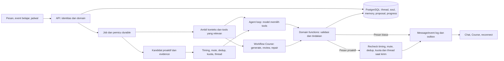

# Teknologi untuk agent proaktif Ngertiin

Tanggal riset: 14 Oktober 2026. Metode: dokumentasi resmi, dokumentasi arsitektur produk, dan sumber pihak pertama. Ini evaluasi desain dan shortlist PoC; belum ada benchmark runtime Ngertiin atau perubahan atas keputusan arsitektur yang sudah disetujui.

## Jawaban utama

**LangGraph masih kandidat utama untuk baseline Python Ngertiin, tetapi tidak ada dasar riset ini untuk menyebutnya framework nomor satu secara universal.** Kemampuan agent personal yang proaktif bergantung pada kombinasi agent loop, penyimpanan domain, scheduler/event, recovery, aturan pengiriman, dan pengalaman pengguna. Pemilihan framework loop hanya menyelesaikan sebagian masalah itu.

Baseline yang tercatat adalah **LangChain `create_agent` untuk chat dinamis, LangGraph untuk workflow Course, dan Procrastinate untuk job/jadwal**. Rekomendasi sekarang: pertahankan sebagai kandidat A, sederhanakan cara pemakaiannya, lalu bandingkan satu irisan produk dengan **Pydantic AI + DBOS sebagai kandidat B** sebelum membangun seluruh fondasi. Pilih TypeScript dengan AI SDK + satu engine durable hanya bila penyatuan bahasa backend/frontend menjadi keputusan produk dan tim yang disengaja. [Keputusan sebelumnya](agent-framework-selection.md), [Arsitektur Ngertiin](../product/04-arsitektur-dan-delivery.md).

Baseline ini merupakan keputusan dokumentasi. Riset tidak menganggap runtime tersebut sudah dibangun atau menggunakan biaya migrasi kode yang belum terbukti sebagai alasan mempertahankannya.

Readability belum dapat dinilai dari jumlah fitur dokumentasi atau contoh lima baris. Yang perlu dibandingkan adalah kode aplikasi sesungguhnya, termasuk approval tertunda, worker mati, stream putus, retry, dan maintenance setelah deploy.

## Pola yang relevan dari produk referensi

| Referensi | Yang dapat diverifikasi | Implikasi untuk Ngertiin |
| --- | --- | --- |
| Muse | Kerja terjadwal dan berdasarkan event; evaluasi sebelum hasil ditampilkan; main chat dan side chats; memory dapat diperiksa/diedit; approval terstruktur. [Introducing Muse](https://introducing.muse.ai/) | Proaktivitas perlu seleksi manfaat serta timing, thread, dan state yang tahan lama. |
| Grok Bot | Routines berbeda dari skills; automation mempunyai pemicu jadwal/event, pengujian, timezone, history, dan idempotency. [Skills, routines, automations](https://docs.x.ai/grok-bot/skills-routines-and-automations) | Instruksi yang dapat dipakai ulang dan mekanisme pemicu merupakan tanggung jawab terpisah. |
| Hermes Agent | Arsitektur mendokumentasikan `AIAgent` dan tool dispatch tersendiri, SQLite + FTS5, serta cron dengan sesi agent baru. [Architecture](https://hermes-agent.nousresearch.com/docs/developer-guide/architecture), [Cron](https://hermes-agent.nousresearch.com/docs/user-guide/features/cron) | Agent proaktif dapat dibangun dengan loop langsung dan infrastruktur aplikasi; graph bukan syarat. |
| OpenClaw | Heartbeat menjalankan turn periodik pada main session. Agent loop mengatur serialisasi per sesi dan writer claim yang disimpan. [Heartbeat](https://docs.openclaw.ai/heartbeat), [Agent loop](https://docs.openclaw.ai/concepts/agent-loop) | Concurrency percakapan dan koordinasi writer sama pentingnya dengan kemampuan memilih tool. |

Muse juga menjelaskan pemisahan state aplikasi dalam database dari runtime agent, serta enforcement approval melalui Sentinel pada sisi host. **Inference:** kemampuan model perlu dibatasi dan diterapkan oleh backend. Tidak ada bukti dalam sumber yang ditelaah untuk menyimpulkan Muse atau Grok Bot menggunakan LangGraph. [Pendekatan safety/security Muse](https://research.meta.ai/blog/security-and-safety-for-ai-agents-our-approach-with-muse).

Untuk Ngertiin, ambil pola pengalaman dan batas tanggung jawabnya. Mengadopsi seluruh runtime bot desktop/general-purpose akan menambah fitur dan semantik yang belum dibutuhkan learning product.

## Kebutuhan Ngertiin yang menentukan pilihan

Dokumen produk menetapkan satu identitas personal dengan soul dan memory lintas thread, tool dinamis, proposal soul/Course dengan approval, dan workflow panjang dengan execution ID sendiri. Proaktivitas mempunyai batas dua pesan per hari per pengguna lintas thread, quiet hours 21.00–07.00, mute, dedup, serta pengiriman ke thread terkait. [Agent Ngertiin](../product/03-agent.md).

Course harus mempublikasikan node pertama setelah lolos checks dan review, melanjutkan node lain di background, melakukan repair terbatas, dan menahan hasil yang gagal. [Arsitektur dan quality gate](../product/04-arsitektur-dan-delivery.md).

Kebutuhan pembeda adalah tool selection dinamis, approval yang tidak mengunci side chat, recovery yang mempertahankan tahap selesai, reconnect tanpa action ganda, serta konsistensi kuota lintas worker/thread.

## Pisahkan loop, workflow, dan policy

Diagram adalah rekomendasi desain. Queue dan workflow bisa dikelola engine yang sama. Satu agent personal tidak berarti satu execution yang hidup terus atau satu graph yang menampung seluruh state aplikasi.

Ownership, revision, kuota, publication, dan koreksi/forgetting memory tetap aturan domain biasa. Framework membungkus fungsi pada batas execution. Message/event log dan outbox menghubungkan execution dengan UI serta reconnect.

## LangChain, LangGraph, dan Deep Agents

`create_agent` memberi loop model–tool yang dapat dikonfigurasi, dengan tools dan prompt langsung serta middleware tambahan bila diperlukan. Agent LangChain dibangun di atas runtime LangGraph; memakai keduanya bukan otomatis dua engine workflow yang terpisah. [LangChain overview](https://docs.langchain.com/oss/python/langchain/overview), [Agents](https://docs.langchain.com/oss/python/langchain/agents).

LangGraph memberikan checkpointer per thread dan store lintas thread. State runtime tersebut berbeda dari data domain seperti progress, proposal dan kuota. Persistent checkpointer perlu dikonfigurasi pada penggunaan library; in-memory saver hilang saat restart. [Persistence](https://docs.langchain.com/oss/python/langgraph/persistence).

Untuk readability, **mulai dengan Functional API pada workflow yang nyaman ditulis sebagai Python biasa**. `@entrypoint` dan `@task` membungkus control flow biasa. Graph API lebih tepat ketika branch, fan-out/join, shared state dan inspeksi struktur memang membantu reviewer. Keduanya mempunyai kemampuan inti persistence, streaming dan HITL; bentuk graph bukan prasyarat durability. [Choosing APIs](https://docs.langchain.com/oss/python/langgraph/choosing-apis).

Saat Functional API dilanjutkan, entrypoint berjalan kembali dan hasil task yang sudah tersimpan dipakai ulang. Random/time/I/O harus berada pada task; task yang terputus dapat dieksekusi kembali sehingga side effect masih memerlukan idempotency. [Functional API](https://docs.langchain.com/oss/python/langgraph/functional-api).

Interrupt menyimpan state dan dapat menunggu tanpa batas, tetapi node dimulai lagi dari awal saat resume. Tindakan sebelum interrupt harus aman diulang. Backend tetap memvalidasi pemilik, proposal ID, revision, keputusan dan apakah action sudah diterapkan. [Interrupts](https://docs.langchain.com/oss/python/langgraph/interrupts).

Untuk Course yang mahal, gunakan PoC durability `sync`: checkpoint selesai sebelum langkah berikutnya. `async` mempunyai jendela kehilangan checkpoint saat crash; `exit` tidak memungkinkan recovery mid-run dari crash. Pending writes memungkinkan hasil cabang yang berhasil dipertahankan ketika cabang lain gagal. [Checkpointers](https://docs.langchain.com/oss/python/langgraph/checkpointers).

**Deep Agents belum diperlukan sebagai default.** Harness ini menambahkan filesystem/context management, subagent, memory, serta pilihan sandbox/skills/planning. Untuk companion yang terutama memanggil API belajar dan memory terstruktur, `create_agent` memberi ruang lebih kecil untuk dibaca. Evaluasi Deep Agents ketika research luas atau pekerjaan workspace membutuhkan kemampuannya. [Deep Agents overview](https://docs.langchain.com/oss/python/deepagents/overview).

Jangan menilai kemampuan library mandiri dari fitur **Agent Server**. Agent Server mempunyai API, persistence, queue, cancellation dan signaling sendiri, dengan PostgreSQL dan Redis dalam arsitekturnya. Mengadopsinya adalah pilihan deployment tersendiri, bukan kemampuan queue/cron yang otomatis hadir setelah `pip install langgraph`. [Agent Server](https://docs.langchain.com/langsmith/agent-server).

## Pydantic AI + DBOS: pesaing Python yang serius

Pydantic AI menempatkan type Python/Pydantic dan hasil tervalidasi pada API agent. `output_type` dibawa ke tipe `result.output`; schemas/validators membantu kontrak Course dan kandidat memory. Lolos schema tidak membuktikan kualitas pedagogi. [Output](https://pydantic.dev/docs/ai/core-concepts/output/).

Approval tersedia melalui deferred tools: pending request dikembalikan, lalu continuation menerima keputusan/hasil eksternal. Simpan conversation dan metadata pending secara utuh agar approval tertunda tidak hanya bergantung pada RAM. [Deferred tools](https://pydantic.dev/docs/ai/tools-toolsets/deferred-tools/).

Conversation storage menjaga continuity chat; durable execution menjaga run yang sedang berjalan ketika crash. `StepPersistence` memberi snapshots dan event trail pada batas step, tetapi dokumentasi membedakannya dari recovery ketika crash di tengah step. Jadi Pydantic AI tanpa engine durable bukan pembanding setara untuk LangGraph checkpoint + recovery job. [Persistence](https://pydantic.dev/docs/ai/core-concepts/persistence/), [Step persistence](https://pydantic.dev/docs/ai/harness/step-persistence/).

Integrasi DBOS saat ini memakai `DBOSDurability` dan `@DBOS.workflow`; `DBOSAgent` telah deprecated. Capability saja tidak membuat `agent.run()` di luar workflow menjadi durable. Function tools yang diregistrasi langsung **tidak otomatis dibungkus**: beri `@DBOS.step` pada I/O/non-determinism. Agent `name` dan toolset ID harus stabil. Streaming dalam workflow dibuffer sampai model step selesai; untuk pengiriman live gunakan `event_stream_handler` pada `DBOSDurability`, dengan side effect idempotent karena handler dapat terulang. [DBOS integration](https://pydantic.dev/docs/ai/capabilities/durable_execution/dbos/).

DBOS dapat menangani queue dengan concurrency global/worker/partition, serta schedule yang tersimpan dan dapat diperbarui saat runtime. Ini berpotensi mengganti Procrastinate sekaligus execution layer; **jangan menambahkan DBOS sebagai engine ketiga** pada baseline tanpa kebutuhan berbeda yang jelas. [Queues](https://docs.dbos.dev/python/reference/queues), [Scheduling](https://docs.dbos.dev/python/tutorials/scheduled-workflows).

DBOS mereplay workflow dan memakai hasil step selesai; step yang gagal dapat dicoba lagi. Commit exactly-once berlaku untuk transaksi yang memakai integrasi datasource DBOS, bukan semua HTTP request atau semua write SQLModel biasa. Datasource SQLAlchemy menambah tracking transaksi. [Workflow guarantees](https://docs.dbos.dev/python/tutorials/workflow-tutorial), [Transactions/datasources](https://docs.dbos.dev/python/tutorials/transaction-tutorial).

Untuk recovery lintas executor, Conductor dapat mendeteksi server mati dan meminta executor lain memulihkan workflow. Evaluasi kebutuhan control plane, cara recovery tanpa/bersamanya, dan biaya operasi yang nyata. Memiliki PostgreSQL sebagai fondasi tidak membuat deployment HA selesai dengan sendirinya. [DBOS architecture](https://docs.dbos.dev/architecture).

**Penilaian:** kandidat yang menarik bila tim lebih nyaman dengan fungsi Python bertipe dan satu engine untuk jobs/schedule/workflow. Belum terbukti lebih sederhana untuk Ngertiin: konfigurasi durability tool, live stream, serialization dan versioning tetap harus masuk dalam perbandingan kode.

## Pilihan TypeScript

### Vercel AI SDK + satu engine durable

AI SDK menyediakan agent loop TypeScript, tools bertipe, output terstruktur dan UI streaming. `ToolLoopAgent` sendiri merupakan runtime in-memory; kemampuan multi-step bukan jaminan crash recovery. [Agents overview](https://ai-sdk.dev/docs/agents/overview), [ToolLoopAgent](https://ai-sdk.dev/docs/reference/ai-sdk-core/tool-loop-agent).

Dokumentasi terkini menyediakan `WorkflowAgent` dari `@ai-sdk/workflow`. Ia berjalan di fungsi dengan `'use workflow'`; tools I/O harus menggunakan `'use step'` untuk durability. `needsApproval` dapat memarkir approval lintas restart. `WorkflowChatTransport` mendukung reconnect, tetapi raw model chunks dan UI chunks mempunyai cursor berbeda. API route tetap harus menerapkan authorization. Dokumentasi juga membedakan API dan stream dari `DurableAgent` lama; jangan mencampur contoh lintas versi. [WorkflowAgent](https://ai-sdk.dev/docs/agents/workflow-agent).

Workflow SDK memakai Vercel World atau adapter Worlds; Local World untuk development. [Deployment](https://workflow-sdk.dev/docs/deploying). Postgres World terkini disebut **reference implementation**, belum dioptimalkan untuk scale/speed/security dan routes HTTP workflow tidak mempunyai auth bawaan. Sumber menyarankan adaptasi sebelum produksi. TanStack Start/build integration dan pilihan hosting harus diverifikasi; self-hosting bukan sekadar mengganti connection string. [Postgres World](https://workflow-sdk.dev/worlds/postgres).

Alternatifnya **AI SDK + Inngest**: model/tool call menjadi durable steps; event/jadwal memulai run dan `step.waitForEvent` menunggu approval tanpa worker aktif. Completed steps memakai hasil tersimpan; kode di luar step berjalan kembali. Satu opaque agent loop dalam satu step tidak otomatis membuat setiap tool checkpointed. [Durable agents](https://www.inngest.com/docs/durable-execution/durable-agents), [Concepts](https://www.inngest.com/docs/durable-execution/concepts). Self-hosting tetap membawa server dan storage/queue. [Self-hosting](https://www.inngest.com/docs/self-hosting).

AI SDK UI untuk reconnect stream biasa juga membutuhkan penyimpanan message/active stream dan, pada recipe resminya, Redis + `resumable-stream`. Reconnect browser dan recovery producer setelah crash adalah dua kebutuhan berbeda. Disconnect jangan otomatis membatalkan generation; explicit stop perlu endpoint dan cancellation state. [Resume streams](https://ai-sdk.dev/docs/ai-sdk-ui/chatbot-resume-streams).

**Penilaian:** layak bila memilih backend TypeScript untuk berbagi contracts dan kemampuan tim. Mengganti FastAPI yang direncanakan hanya karena frontend React belum mempunyai bukti manfaat yang cukup.

### Mastra

Mastra mengemas agent, workflow, memory, HITL dan tooling dalam ekosistem TypeScript. Memory mencakup message history, observational memory, working memory dan semantic recall. Scope `resource`/`thread` membantu memisahkan pengguna dan percakapan, tetapi aturan evidence, koreksi dan forgetting Ngertiin tetap harus ditentukan aplikasi. [Memory](https://mastra.ai/docs/memory/overview).

Dokumentasi durable agents mempunyai perbedaan penting: recovery durable agent default `off`; checkpoint `running` dan recovery boot perlu konfigurasi `recovery.durableAgents: 'auto'`. Persistent suspended snapshots mendukung approval tetapi tidak identik dengan recovery semua pekerjaan yang berjalan. Resumable streams memakai event cache/pubsub; cache default in-memory hanya bertahan dalam proses, sehingga deployment beberapa replica atau restart perlu backend yang sesuai. [Durable agents](https://mastra.ai/docs/harness/durable-agents).

**Penilaian:** menarik bila integrated memory, workflow, Studio dan harness mengurangi pekerjaan aplikasi. Untuk prioritas rendah abstraction, bandingkan kode domain dan failure path dengan AI SDK + engine; tambahan konsepnya perlu manfaat nyata.

## Restate dan Temporal

Restate memberikan jurnal durable, persistent session, concurrency coordination, dan approval lewat durable promise/awakeable. [Restate AI](https://docs.restate.dev/ai), [Approvals](https://docs.restate.dev/ai/patterns/human-in-the-loop). Ada middleware AI SDK dan `RestateAgent` untuk Pydantic AI di service handler. Tetap perlu runtime Restate dan batas durable I/O. **Penilaian:** alternatif engine ketika koordinasi session/lintas layanan membutuhkannya; tidak perlu ditumpuk di atas DBOS. [AI SDK integration](https://docs.restate.dev/ai/sdk-integrations/vercel-ai-sdk), [Pydantic integration](https://pydantic.dev/docs/ai/capabilities/durable_execution/restate/).

Temporal memisahkan orchestration deterministik dalam workflow dan model/tool I/O dalam activities, dengan server Temporal tersendiri. Activity yang gagal di tengah dapat dimulai ulang. Integrasi Pydantic AI mendukung streaming, termasuk live handlers/Workflow Streams, sehingga menyebutnya tidak mendukung streaming tidak akurat. **Penilaian:** kuat bila kebutuhan operasi dan workflow lintas layanan lebih luas; untuk fondasi kecil berbasis PostgreSQL, pembagian activity/workflow dan operasionalnya harus mempunyai manfaat yang dapat dibuktikan. [Pydantic AI + Temporal](https://pydantic.dev/docs/ai/capabilities/durable_execution/temporal/).

## Kegagalan dan replay yang harus dipahami

Procrastinate secara eksplisit menjelaskan bahwa worker yang mendapat `SIGKILL` dapat meninggalkan job `doing`, dan job itu tidak dilanjutkan jika tidak ada tindakan recovery. Dokumentasi menunjukkan heartbeat, `get_stalled_jobs` dan task periodik `retry_job`. Retry ini menjalankan kembali job; **checkpoint LangGraph adalah mekanisme terpisah yang menghindari pengulangan tahap AI yang sudah selesai**. Persisted queue saja belum membuktikan resume end-to-end. [Retry stalled jobs](https://github.com/procrastinate-org/procrastinate/blob/main/docs/howto/production/retry_stalled_jobs.md?plain=true).

Untuk semua pilihan, approval yang tertunda harus melepaskan eksekusi/slot aktif. Endpoint approval memvalidasi DB sebelum resume; pause runtime tidak membuktikan revision masih berlaku. Dua pengiriman proaktif perlu transaksi/reservation kuota lintas thread; batas concurrency per thread saja tidak menjamin batas harian per pengguna.

Jika proses mati setelah HTTP action berhasil tetapi sebelum hasil disimpan, request dapat terulang. Gunakan idempotency key atau ledger action pada batas domain. Jika model mati setelah beberapa token, gunakan identitas attempt dan aturan reset/finalisasi agar UI tidak menyambung teks dari dua attempt yang berbeda. Ini konsekuensi desain replay, bukan klaim semua engine mampu menjamin exactly-once external effects.

## Apakah LlamaIndex dan LiteLLM wajib?

**Keduanya bukan prasyarat agent proaktif.** Baseline sudah mencantumkannya, tetapi adopsi setiap library perlu masalah yang konkret dan batas yang kecil.

LlamaIndex memberi ingestion pipeline, splitting, transformations, embedding serta vector index. Ini berguna bila ingestion/retrieval memerlukan banyak connector atau pipeline yang memang mengurangi kode aplikasi. [VectorStoreIndex dan ingestion](https://developers.llamaindex.ai/python/framework/module_guides/indexing/vector_store_index/).

pgvector sendiri mendukung vector search di PostgreSQL; dokumentasi resminya menunjukkan kombinasi full-text search dan vector search dengan RRF/reranker. **Inference:** retrieval awal yang sempit bisa berupa service SQL/pgvector langsung tanpa framework retrieval kedua. Jika tetap memakai LlamaIndex, posisikan sebagai implementasi retrieval di balik fungsi seperti `search_learning_context(user_id, query)`, bukan agent/runtime kedua. [pgvector hybrid search](https://github.com/pgvector/pgvector#hybrid-search).

LiteLLM berguna untuk gateway provider, alias model, routing/load balancing, fallback dan budget lintas pengguna/team. [Routing](https://docs.litellm.ai/docs/routing), [Budgets](https://docs.litellm.ai/docs/proxy/users).

**Inference:** jika awalnya hanya dua model pada satu provider, SDK/provider adapter yang sudah tersedia pada framework dapat mengurangi satu service. Jika gateway sudah dibutuhkan untuk kontrol biaya atau beberapa deployment, pertahankan LiteLLM dengan tanggung jawab gateway saja. Model selection untuk pedagogi tetap keputusan aplikasi; gateway budget tidak menggantikan Course/session budget atau global proactive quota. Periksa total attempts ketika retry SDK, gateway, agent, workflow dan queue digabungkan.

Tidak ada rekomendasi menghapus komponen yang sudah disepakati tanpa PoC; evaluasi ini menunjukkan kapan komponen itu menghasilkan manfaat nyata.

## Shortlist stack yang konkret

| Pilihan | Kombinasi | Kapan lebih sesuai |
| --- | --- | --- |
| **A — baseline yang disederhanakan** | TanStack Start/React; FastAPI + SQLModel/Alembic; PostgreSQL/pgvector; LangChain `create_agent`; LangGraph Functional/Graph sesuai kebutuhan; Procrastinate; R2; LangSmith/structlog; LiteLLM dan LlamaIndex bila manfaatnya terbukti | Tim nyaman Python; workflow Course bercabang; checkpoint/HITL penting; ingin mempertahankan arah yang sudah dipilih. |
| **B — finalist Python** | Frontend/API/data sama; Pydantic AI + DBOS; DBOS queue/schedule mengganti Procrastinate; function tools dan domain contracts langsung; Logfire/OTel atau tracing yang dipilih; gateway/retrieval scoped bila perlu | Tim mengutamakan hasil bertipe dan imperative Python; satu engine execution menghasilkan lebih sedikit kode recovery yang harus dipelihara. |
| **C — pilihan bahasa TypeScript** | TanStack Start; PostgreSQL/pgvector + ORM TS; AI SDK + Inngest **atau** Workflow SDK **atau** Restate; domain functions langsung; R2; tracing | Penyatuan bahasa menjadi prioritas; tim memilih operasi engine yang sesuai; manfaat contracts/UI melebihi biaya beralih dari FastAPI. |
| **D — bundle TypeScript** | Mastra + PostgreSQL dan cache/pubsub produksi sesuai deployment; frontend/domain DB tetap milik aplikasi | Integrated memory, workflows, harness dan developer tooling memang digunakan cukup banyak. |

Semua pilihan adalah penilaian arsitektur berdasarkan sumber di atas, bukan ranking performa. Pilihan C memilih satu engine; daftar tersebut tidak menyarankan menginstal semuanya.

## Cara menjaga kode readable

1. Gunakan domain functions seperti `propose_soul_change`, `record_memory_observation`, dan `publish_course_node`; tool wrapper tipis memanggilnya.
2. Execution state berisi ID/revision, hasil tahap, budget dan referensi artifact. Bedakan thread dan Course execution; jangan menggandakan seluruh DB domain ke state runtime.
3. Workflow linear memakai fungsi/loop dengan durable boundaries; graph dipakai saat branch/join membantu membaca alur. Timing/mute/kuota tetap backend policy.
4. Batasi model attempts, iterations, repair dan biaya. Tambahkan supervisor multi-agent, memory vendor atau generic factory setelah kebutuhan konkret membuktikan manfaatnya.

Daftar ini adalah rekomendasi implementasi Ngertiin; framework memberi primitives, tetapi batas modul dipilih aplikasi.

## PoC yang mengunci keputusan

Bandingkan **A vs B** dengan tools, schema, model/provider, fixtures dan UI yang sama. Scope kecil harus memuat perilaku failure nyata, bukan hanya happy path chat.

| Skenario | Gate yang harus lulus |
| --- | --- |
| Soul proposal ditunda; worker mati; user membuka side chat | Proposal tetap dapat ditemukan; side chat berjalan; revision lama ditolak; approve dua kali menerapkan satu action. |
| Node pertama Course selesai; crash saat review node berikutnya | Node valid tetap dapat dipakai; completed model stage tidak dipanggil ulang tanpa kebutuhan; publish tidak duplikat; repair budget bertahan. |
| Stream putus setelah tool action atau beberapa token | Reconnect membaca run yang sama; action tidak diulang karena browser refresh; teks dua attempt tidak tercampur; explicit stop membatalkan producer. |
| Dua worker memproses kandidat dari thread berbeda | Maksimal dua pesan per hari total secara atomik; quiet hours berdasarkan timezone; mute/focus dicek lagi sebelum kirim; kandidat yang sama tidak dibroadcast. |
| Pengguna mengoreksi/menghapus memory | Recall berubah lintas thread; observation lama dari evidence yang sama tidak memunculkan kembali fakta yang sudah dihapus. |
| Deploy saat approval dan Course masih berjalan | Payload dan workflow versi lama dapat diselesaikan atau dimigrasikan dengan jalur eksplisit; tidak menjadi stalled run tanpa diagnosis. |

Catat effort implementasi, jumlah kode/framework glue yang harus dipelihara, waktu developer memahami failure path, recovery latency, panggilan model ulang, biaya per Course/chat, ukuran persisted history, dan kemampuan menjelaskan satu trace end-to-end. Untuk gates correctness, satu pelanggaran seperti publication ganda atau quota bocor sudah cukup untuk menahan kandidat.

Dokumentasi live menampilkan AI SDK v7/WorkflowAgent dan Pydantic AI durability capabilities. PoC perlu mem-pin package/version dan lockfile; package belum diinstal atau diuji pada repo.

Jika goal akhir meliputi menjalankan generated code atau browser tools, tambahkan execution sandbox pada tool yang membutuhkannya. E2B dan Daytona menyediakan sandbox dengan SDK Python/TypeScript. Ini perluasan capability tersendiri dan belum diperlukan untuk proaktivitas melalui API belajar. [E2B](https://docs.e2b.dev/), [Daytona](https://www.daytona.io/docs/en/).

## Keputusan yang disarankan

**Sederhanakan baseline dan uji A vs B.** Pertahankan LangGraph bila PoC memenuhi gate dengan kode yang mudah dibaca; pilih Pydantic AI + DBOS bila kode dan operasi terbukti lebih sederhana. TypeScript dipilih jika satu bahasa bernilai bagi tim. Popularitas/GitHub stars tidak menjadi dasar keputusan.

Yang belum terbukti: runtime mana paling readable untuk tim Ngertiin, recovery di hosting yang dipilih, compatibility model gateway/provider dengan strict schema/tool/streaming, biaya keseluruhan retry/repair, kualitas proaktivitas, dan mutu pedagogi. Framework tidak menentukan seluruh hasil itu; PoC serta evaluasi produk yang menentukannya.
