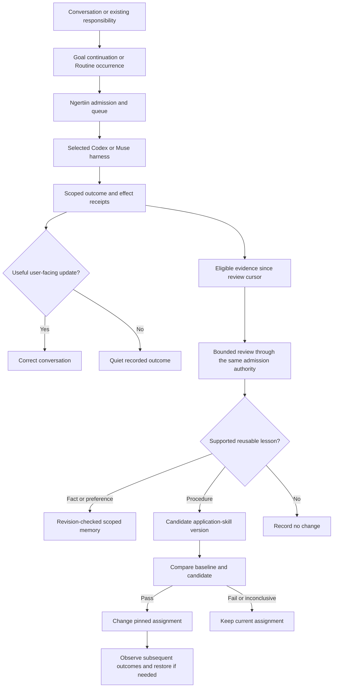

# Proactive agents and self-improvement: competitor source study

Date: 2026-11-07. Scope: Hermes Agent, OpenClaw, Openbot and Nanobot, with a bounded look at Hermes's separate self-evolution project. This is source research and an implementation proposal for Ngertiin, not a product-scope decision, runtime change or effectiveness benchmark.

## Assessment

Ngertiin already has the essential execution foundation for proactivity: persistent responsibilities, time-based Routine, occurrence identities, admission, scoped tool receipts, quiet publication and recovery. The useful addition is a deliberate learning process around that foundation: record outcomes, extract a supported lesson, revise scoped memory or an application-owned skill, evaluate the change, and retain a reversible activation history.

The competitors provide different parts of this design:

| Project | Proactive mechanism | Learning mechanism | Most useful reference for Ngertiin |
| --- | --- | --- | --- |
| Hermes Agent | Session heartbeat and standing cron through canonical admission; separate occurrence and delivery accounting | Post-turn memory/skill review, read-before-edit guards and idle curator | Learning from corrections and reusable successful methods; maintaining a skill library |
| OpenClaw | Ordinary automation jobs, idle/active-hours policies and occurrence recovery | Skill Workshop procedural learning; Dreaming memory consolidation | Scoped review runs, learned-skill ownership, provenance and reversible changes |
| Openbot | Application-owned Routine, mailbox admission, missed-run policy and native recovery | Automatic factual-memory review; user-requested skill revisions | The closest application/harness boundary to the current Ngertiin design |
| Nanobot | Gateway cron, checklist heartbeat and gated delivery | Compaction journal followed by scheduled Dream edits to memory and workspace skills | A clear two-stage consolidation design and useful examples of incomplete rollback coverage |

These are mechanisms observed in code. Their presence does not establish that one project produces better results. The ordinary learning paths inspected here do not demonstrate a mandatory held-out task-success comparison before every skill change. None of these inspected paths updates model weights.

## Method and source identity

The requested reverse-engineer-anything skill routes complete source repositories to ordinary source analysis. No REA binary session, decompilation, installation or runtime capture was needed. The research skill was used for parallel primary-source investigation. GitHub repository/file APIs and focused source checkouts supplied evidence; web search supplied orientation. Firecrawl search returned HTTP 402 and was replaced by available GitHub/web access.

Knowledge-graph MCP discovery found no available search_graph/trace_path/get_code_snippet/query_graph/get_architecture tools in this session. Targeted source searches and direct reads were used as the documented fallback. No competitor runtime, model invocation, test suite or benchmark was executed. Source-test definitions indicate intended coverage, not passing tests in this study.

| Repository | Exact inspected commit | Version boundary |
| --- | --- | --- |
| [NousResearch/hermes-agent](https://github.com/NousResearch/hermes-agent/commit/cf7003f3fa650e2cebc06a0af0c09dabaf5ee367) | cf7003f3fa650e2cebc06a0af0c09dabaf5ee367; 2026-11-07 08:13:06 UTC | Source manifest declares 0.0.0; identify this investigation by SHA |
| [openclaw/openclaw](https://github.com/openclaw/openclaw/commit/4ca233c908c68b9e0e8afb4b83f1f4723d028dc0) | 4ca233c908c68b9e0e8afb4b83f1f4723d028dc0; 2026-11-07 08:35:08 UTC | Source package 2026.11.1 |
| [nightly-labs/openbot](https://github.com/nightly-labs/openbot/commit/88e107ab8d737d7b03abe22d91a55e1d98b1c0f8) | 88e107ab8d737d7b03abe22d91a55e1d98b1c0f8; 2026-11-07 08:46:44 UTC | Source package 0.63.0 |
| [HKUDS/nanobot](https://github.com/HKUDS/nanobot/commit/12c7d116a066710651b40b1d0647f27e449f0b5a) | 12c7d116a066710651b40b1d0647f27e449f0b5a; 2026-11-06 16:46:09 UTC | Source package nanobot-ai 0.4.1 |
| [NousResearch/hermes-agent-self-evolution](https://github.com/NousResearch/hermes-agent-self-evolution/commit/0a929e3aa20e15cf04dc7c28492a7d41a5139125) | 0a929e3aa20e15cf04dc7c28492a7d41a5139125; 2026-06-17 11:53:04 UTC | Separate optimization project, not the main agent's ordinary review |

Versions describe the inspected trees, not a guarantee that a released installer contains them. Mutable documentation can lag source: the OpenClaw heartbeat change below is one concrete example.

## What proactive and learning mean here

Proactivity requires a reason to wake, authority to do useful work, remembered state, and an appropriate delivery decision. A periodic model call supplies only the wake. Four forms should remain distinguishable:

1. Scheduled work: a reminder, report or check with explicit timing.
2. Responsibility continuation: an unfinished outcome with a durable owner and next useful step.
3. Event-conditioned work: a particular event resumes an existing instruction or wait.
4. Contextual initiative: relevant current evidence warrants a useful observation during an eligible interaction.

Learning also has distinct outputs. Facts/preferences belong in scoped memory; reusable procedures belong in skills; task progress belongs in Goal/run state. Reflection produces a proposed lesson. Consolidation removes duplication or contradiction. Improvement requires evidence that using the revised procedure helps subsequent tasks. A model saying its own lesson is useful does not establish that last step.

## Hermes Agent

### Proactive execution

Hermes separates a session heartbeat from standing cron work. Heartbeat persists its instruction and firing state, coalesces missed intervals, and uses a claim that can be refunded when admission never reached execution. Gateway admission checks the canonical FIFO and resolved session lineage. This avoids creating an unrelated parallel execution path for a check. [Heartbeat claim/refund](https://github.com/NousResearch/hermes-agent/blob/cf7003f3fa650e2cebc06a0af0c09dabaf5ee367/hermes_cli/heartbeat.py#L219-L257), [gateway admission](https://github.com/NousResearch/hermes-agent/blob/cf7003f3fa650e2cebc06a0af0c09dabaf5ee367/gateway/run_heartbeat_acceptance.py#L12-L79).

Cron advances recurring slots before dispatch and retains a pending occurrence for the crash window before claim. Delivery has its own ledger: a process lost during sending leaves an unknown result rather than an automatic resend. The transferable principle is to distinguish scheduled occurrence, admitted execution, task outcome and delivery outcome. [Cron dispatch](https://github.com/NousResearch/hermes-agent/blob/cf7003f3fa650e2cebc06a0af0c09dabaf5ee367/cron/scheduler_tick.py#L92-L193), [pending-slot recovery](https://github.com/NousResearch/hermes-agent/blob/cf7003f3fa650e2cebc06a0af0c09dabaf5ee367/cron/occurrences.py#L58-L103), [unknown-delivery handling](https://github.com/NousResearch/hermes-agent/blob/cf7003f3fa650e2cebc06a0af0c09dabaf5ee367/cron/delivery_queue.py#L282-L318).

### Learning

The default review thresholds are 10 user turns for memory and 10 accumulated tool iterations for skills. Finalization can start a background review from the completed transcript; interrupted turns and configurations can suppress it. These are upstream defaults, not measured optimal values for Ngertiin. [Configuration](https://github.com/NousResearch/hermes-agent/blob/cf7003f3fa650e2cebc06a0af0c09dabaf5ee367/agent/agent_init.py#L1160-L1240), [post-turn review dispatch](https://github.com/NousResearch/hermes-agent/blob/cf7003f3fa650e2cebc06a0af0c09dabaf5ee367/agent/turn_finalizer.py#L591-L616).

The skill reviewer looks for corrections, reliable reusable methods and outdated loaded instructions. It prefers improving an existing skill rather than generating one per incident. The runtime restricts review tools; current-target reads and locked-skill checks protect edits. These controls are stronger than a prompt alone. However, the review prompt encourages frequent persistence, and the ordinary path does not establish a task-quality comparison before accepting a lesson. [Lesson-selection policy](https://github.com/NousResearch/hermes-agent/blob/cf7003f3fa650e2cebc06a0af0c09dabaf5ee367/agent/background_review.py#L430-L526), [tool dispatch restrictions](https://github.com/NousResearch/hermes-agent/blob/cf7003f3fa650e2cebc06a0af0c09dabaf5ee367/agent/background_review.py#L1116-L1156), [read/lock guards](https://github.com/NousResearch/hermes-agent/blob/cf7003f3fa650e2cebc06a0af0c09dabaf5ee367/tools/skill_manager_guards.py#L211-L251).

Curator performs library hygiene using activity/staleness, with recoverable archives and protection for pinned/locked/cron-referenced skills. Its LLM consolidation is off by default. Usage and age are useful maintenance signals, but neither measures correctness. Also, Hermes's write policy can cover installed/bundled skills unless locked; Ngertiin must retain its stricter application-owned-only boundary. [Curator defaults](https://github.com/NousResearch/hermes-agent/blob/cf7003f3fa650e2cebc06a0af0c09dabaf5ee367/agent/curator.py#L1-L35), [aging and protections](https://github.com/NousResearch/hermes-agent/blob/cf7003f3fa650e2cebc06a0af0c09dabaf5ee367/agent/curator.py#L209-L263).

## OpenClaw

### Proactive execution and a documentation correction

At the inspected revision, old special heartbeat monitors migrate into ordinary editable automation jobs. Setup can provision an owner check with a default 30-minute interval, idle-only admission and an empty-checklist skip. A durable provisioning receipt prevents deletion being undone by restart. Older indexed documentation describing startup continually reconciling a special monitor does not describe this pin. [Pinned migration guide](https://github.com/openclaw/openclaw/blob/4ca233c908c68b9e0e8afb4b83f1f4723d028dc0/docs/gateway/heartbeat.md#L19-L48), [default job and provisioning](https://github.com/openclaw/openclaw/blob/4ca233c908c68b9e0e8afb4b83f1f4723d028dc0/src/cron/default-proactive-job.ts#L23-L138).

Admission enforces occurrence identity and handles active work, active hours and deferred idle work. Startup retains uncertain interrupted execution/delivery instead of blindly replaying a one-shot. Quiet completion is distinct from a visible announcement. These are relevant execution patterns, not evidence that Ngertiin needs OpenClaw's scheduler. [Runnable checks](https://github.com/openclaw/openclaw/blob/4ca233c908c68b9e0e8afb4b83f1f4723d028dc0/src/cron/service/timer-runnable.ts#L71-L167), [active-hours/idle checks](https://github.com/openclaw/openclaw/blob/4ca233c908c68b9e0e8afb4b83f1f4723d028dc0/src/cron/service/timer-execution.ts#L130-L179), [startup repair](https://github.com/openclaw/openclaw/blob/4ca233c908c68b9e0e8afb4b83f1f4723d028dc0/src/cron/service/startup-run-repair.ts#L30-L80), [quiet finalization](https://github.com/openclaw/openclaw/blob/4ca233c908c68b9e0e8afb4b83f1f4723d028dc0/src/cron/isolated-agent/run-finalize.ts#L324-L346).

Standing intents are another useful distinction: event-conditioned contextual reminders can match before an eligible interactive reply, with scope, expiry, cooldown and fire budgets. They are not a general external-event watcher. Their lexical matching should not replace Ngertiin's semantic responsibility/cancellation decisions. [Standing-intent kernel](https://github.com/openclaw/openclaw/blob/4ca233c908c68b9e0e8afb4b83f1f4723d028dc0/extensions/memory-core/src/standing-intents-kernel.ts#L196-L324).

### Procedural learning through Skill Workshop

This snapshot includes real procedural adaptation. When available and eligible, Skill Workshop defaults to auto mode and can queue experience review after 10 model iterations. Review waits for a 30-second idle window, coalesces by agent/session and excludes internal/background work to prevent recursive review. Counters are process memory, so restart resets accumulated trigger progress. [Mode defaults](https://github.com/openclaw/openclaw/blob/4ca233c908c68b9e0e8afb4b83f1f4723d028dc0/extensions/skill-workshop/src/config.ts#L24-L35), [review scheduling and exclusions](https://github.com/openclaw/openclaw/blob/4ca233c908c68b9e0e8afb4b83f1f4723d028dc0/extensions/skill-workshop/src/experience-review-scheduler.ts#L16-L26), [coalescing/source anchors](https://github.com/openclaw/openclaw/blob/4ca233c908c68b9e0e8afb4b83f1f4723d028dc0/extensions/skill-workshop/src/experience-review-scheduler.ts#L287-L372).

The review forks through an exact source transcript entry and permits only the Workshop tool. Mutations recheck cancellation, authority, current mode and read-before-edit. The prompt normally permits no change and asks for at most one supported reusable lesson. The numerical one-change limit is prompt-level in the inspected path. Already committed changes survive a later abort; review is not one all-or-nothing transaction. [Anchored review](https://github.com/openclaw/openclaw/blob/4ca233c908c68b9e0e8afb4b83f1f4723d028dc0/extensions/skill-workshop/src/experience-review.ts#L25-L80), [per-write checks](https://github.com/openclaw/openclaw/blob/4ca233c908c68b9e0e8afb4b83f1f4723d028dc0/extensions/skill-workshop/src/tool.ts#L104-L124), [review prompt](https://github.com/openclaw/openclaw/blob/4ca233c908c68b9e0e8afb4b83f1f4723d028dc0/extensions/skill-workshop/src/experience-review-prompt.ts#L27-L53).

Workshop distinguishes learned procedures from facts and imported/bundled skills and exposes version history/undo. A separate skill-compression path has a model audit for preserving rules, but this is not a held-out task-success benchmark for ordinary learning. Its unused-skill cleanup deliberately excludes Codex because missing native-read telemetry cannot prove non-use. [Ownership and undo](https://github.com/openclaw/openclaw/blob/4ca233c908c68b9e0e8afb4b83f1f4723d028dc0/docs/tools/skill-workshop.md#L12-L39), [compression audit](https://github.com/openclaw/openclaw/blob/4ca233c908c68b9e0e8afb4b83f1f4723d028dc0/extensions/skill-workshop/src/skill-diet.ts#L438-L508), [Codex observation boundary](https://github.com/openclaw/openclaw/blob/4ca233c908c68b9e0e8afb4b83f1f4723d028dc0/extensions/skill-workshop/src/unused-archive.ts#L29-L58).

### Memory consolidation through Dreaming

Dreaming separates short-term staging, thematic/reflection signals and durable promotion. Documentation describes it as enabled by default within the selected memory-plugin/configuration and available automation infrastructure. Promotion filters sources, requires sufficient signals and distinct eligible user queries, then rechecks live fingerprints before applying a change. Synthetic scheduler recalls do not satisfy query diversity. [Dreaming phases](https://github.com/openclaw/openclaw/blob/4ca233c908c68b9e0e8afb4b83f1f4723d028dc0/docs/concepts/dreaming.md#L13-L139), [promotion criteria](https://github.com/openclaw/openclaw/blob/4ca233c908c68b9e0e8afb4b83f1f4723d028dc0/extensions/memory-core/src/short-term-promotion.ts#L104-L156), [live-source validation](https://github.com/openclaw/openclaw/blob/4ca233c908c68b9e0e8afb4b83f1f4723d028dc0/extensions/memory-core/src/short-term-promotion-apply.ts#L245-L345).

The consolidation model returns structured operations; the host composes sourced content, retaining preimages, expected-hash checks and lineage. This is a more useful adoption pattern than copying an unconstrained prompt that rewrites memory wholesale. It still does not establish semantic truth or improved task success. [Structured consolidation](https://github.com/openclaw/openclaw/blob/4ca233c908c68b9e0e8afb4b83f1f4723d028dc0/extensions/memory-core/src/dreaming-consolidation.ts#L387-L475), [guarded publication](https://github.com/openclaw/openclaw/blob/4ca233c908c68b9e0e8afb4b83f1f4723d028dc0/extensions/memory-core/src/short-term-promotion-apply.ts#L490-L647).

## Openbot

### Application-owned proactive work

Openbot uses one shared wake timer over durable routine sources. Before firing, it rereads the routine, applies missed-run/live-run policy, and admits through the ordinary mailbox with an occurrence key. Startup distinguishes skipping missed work from running one catch-up occurrence. Its quiet result and failed task result are distinct even when the provider turn completed. [Shared timer](https://github.com/nightly-labs/openbot/blob/88e107ab8d737d7b03abe22d91a55e1d98b1c0f8/src/backend/routine-timer.ts#L3-L133), [due revalidation](https://github.com/nightly-labs/openbot/blob/88e107ab8d737d7b03abe22d91a55e1d98b1c0f8/src/backend/agent/routine-scheduler.ts#L876-L939), [occurrence-key admission](https://github.com/nightly-labs/openbot/blob/88e107ab8d737d7b03abe22d91a55e1d98b1c0f8/src/backend/agent/routine-scheduler.ts#L1008-L1072), [missed-run policy](https://github.com/nightly-labs/openbot/blob/88e107ab8d737d7b03abe22d91a55e1d98b1c0f8/src/backend/routine-store.ts#L742-L822), [quiet/failure distinction](https://github.com/nightly-labs/openbot/blob/88e107ab8d737d7b03abe22d91a55e1d98b1c0f8/src/backend/agent/routine-quiet-runs.ts#L11-L94).

Boot recovery asks provider history about orphaned deliveries and retains uncertainty rather than repeating an effect. Application-owned scheduling with native-harness execution is the relevant architectural match for Ngertiin. Event/webhook paths exist upstream, but they do not promote Ngertiin's optional webhook scope. [Provider reconciliation](https://github.com/nightly-labs/openbot/blob/88e107ab8d737d7b03abe22d91a55e1d98b1c0f8/src/backend/agent/boot-recovery.ts#L137-L200).

### Factual memory review, distinct from skill improvement

Default review occurs after 20 qualifying turns, or after 15 minutes idle with at least three new turns; clear/thread-close also trigger it. User work takes priority. The counters/cursor are process memory rather than durable progress. Automatic/routine/channel turns do not continually retrigger ordinary conversation review. [Review triggers and state](https://github.com/nightly-labs/openbot/blob/88e107ab8d737d7b03abe22d91a55e1d98b1c0f8/src/backend/agent/memory-review.ts#L22-L146), [idle admission](https://github.com/nightly-labs/openbot/blob/88e107ab8d737d7b03abe22d91a55e1d98b1c0f8/src/backend/agent/memory-review.ts#L207-L253), [turn eligibility](https://github.com/nightly-labs/openbot/blob/88e107ab8d737d7b03abe22d91a55e1d98b1c0f8/src/backend/agent/turn-lifecycle.ts#L1511-L1520).

Review is tool-free generation of bounded add/update/forget operations. It targets stable facts/preferences/decisions, excludes progress logs and expects no change for most chats. Redaction, protected manual entries, clear epochs and changed-memory checks constrain publication. This is a useful design for factual maintenance, not automatic discovery of better tool procedures. [Proposal schema and prompt](https://github.com/nightly-labs/openbot/blob/88e107ab8d737d7b03abe22d91a55e1d98b1c0f8/src/backend/agent/memory-review-prompt.ts#L8-L61), [redacted inputs](https://github.com/nightly-labs/openbot/blob/88e107ab8d737d7b03abe22d91a55e1d98b1c0f8/src/backend/agent/memory-review.ts#L293-L332), [publication protections](https://github.com/nightly-labs/openbot/blob/88e107ab8d737d7b03abe22d91a55e1d98b1c0f8/src/backend/agent/agent-memories.ts#L178-L254).

Skill creation/revision/installation is described as user-requested, with revision checks and pinned installed copies. No automatic baseline-evaluate-promote cycle was established in these core paths. Memory review already existed at Ngertiin's older Openbot reference, so it should not be described as a newly introduced November feature. [Skill tool contract](https://github.com/nightly-labs/openbot/blob/88e107ab8d737d7b03abe22d91a55e1d98b1c0f8/src/backend/agent/skill-tools.ts#L55-L91), [memory review at the prior source pin](https://github.com/nightly-labs/openbot/blob/01e4b18e238e5de72a3570162c9f4275bb585786/src/backend/agent/memory-review.ts).

Openbot may select a cheaper same-provider background model. This is an upstream product choice; any Ngertiin background selection must remain explicit and preserve the selected connection/account/billing contract. [Background model selection](https://github.com/nightly-labs/openbot/blob/88e107ab8d737d7b03abe22d91a55e1d98b1c0f8/src/backend/agent/background-model.ts#L4-L20).

## Nanobot

Nanobot makes the two stages easy to see: compaction writes an incremental history journal; scheduled Dream consumes the journal and updates durable knowledge/procedures. Dream is configured enabled with a two-hour interval by default; it uses the gateway's ordinary cron infrastructure. Standalone SDK use does not by itself start that scheduler. [Dream configuration](https://github.com/HKUDS/nanobot/blob/12c7d116a066710651b40b1d0647f27e449f0b5a/nanobot/config/schema.py#L63-L90), [system-job registration](https://github.com/HKUDS/nanobot/blob/12c7d116a066710651b40b1d0647f27e449f0b5a/nanobot/cli/gateway_runtime.py#L919-L946), [documented two-stage flow](https://github.com/HKUDS/nanobot/blob/12c7d116a066710651b40b1d0647f27e449f0b5a/docs/memory.md#L18-L55).

The Dream prompt separates personal facts, behavior, project knowledge and reusable workflows. It asks for repeated concrete workflows before creating a skill, merges overlap and permits no change. That repetition criterion is prompt guidance, not proof of a host-enforced two-example gate. [Dream routing and retention policy](https://github.com/HKUDS/nanobot/blob/12c7d116a066710651b40b1d0647f27e449f0b5a/nanobot/templates/agent/dream.md#L1-L42).

The code consumes at most 20 unprocessed journal entries per prompt, passes restricted file tools and advances the cursor only on normal completion. A finally block still commits durable-memory edits after an incomplete run. A normal terminal result therefore means processing ended, not that every edit was useful. Heartbeat reads active checklist tasks, suppresses direct tool delivery, and separately evaluates whether to notify. Copying that extra notification inference would need a concrete benefit over Ngertiin's existing structured quiet decision. [Prompt batching/tool scope](https://github.com/HKUDS/nanobot/blob/12c7d116a066710651b40b1d0647f27e449f0b5a/nanobot/agent/memory.py#L506-L589), [Dream execution and cursor](https://github.com/HKUDS/nanobot/blob/12c7d116a066710651b40b1d0647f27e449f0b5a/nanobot/cli/gateway_runtime.py#L649-L705), [heartbeat and notification gate](https://github.com/HKUDS/nanobot/blob/12c7d116a066710651b40b1d0647f27e449f0b5a/nanobot/cli/gateway_runtime.py#L708-L779).

A particularly useful limitation: Dream may edit workspace skills, but its GitStore tracks only SOUL.md, USER.md, memory/MEMORY.md and the cursor. The inspected memory restore mechanism therefore does not establish rollback coverage for learned skill files. Ngertiin's immutable skill revisions are a better persistence seam for its own implementation. [Actual tracked paths](https://github.com/HKUDS/nanobot/blob/12c7d116a066710651b40b1d0647f27e449f0b5a/nanobot/agent/memory.py#L52-L84), [restore implementation](https://github.com/HKUDS/nanobot/blob/12c7d116a066710651b40b1d0647f27e449f0b5a/nanobot/utils/gitstore.py#L430-L489).

## Separate evaluated evolution: useful, but not proven integration

Hermes's separate self-evolution project contains train/validation/holdout evaluation, GEPA/MIPRO optimization and baseline/candidate scoring. This is closer to measurable improvement than saving a self-authored lesson. It remains text optimization through inference, not model-weight training, and is separate from the main agent's review. [Optimization and holdout comparison](https://github.com/NousResearch/hermes-agent-self-evolution/blob/0a929e3aa20e15cf04dc7c28492a7d41a5139125/evolution/skills/evolve_skill.py#L82-L225).

Its implementation should be verified before reuse. The inspected validation pipeline does not invoke its separately defined test-suite runner; its skill-body/frontmatter handling also appears inconsistent. Output code writes local candidate/metrics files rather than establishing the README's claimed PR flow. These are static discrepancies, not reproduced runtime failures. Borrow the evaluation design, not an assumption that this tool is ready to integrate. [Constraint pipeline](https://github.com/NousResearch/hermes-agent-self-evolution/blob/0a929e3aa20e15cf04dc7c28492a7d41a5139125/evolution/core/constraints.py#L30-L85), [frontmatter validator](https://github.com/NousResearch/hermes-agent-self-evolution/blob/0a929e3aa20e15cf04dc7c28492a7d41a5139125/evolution/core/constraints.py#L152-L184), [output path](https://github.com/NousResearch/hermes-agent-self-evolution/blob/0a929e3aa20e15cf04dc7c28492a7d41a5139125/evolution/skills/evolve_skill.py#L255-L327), [skill loader](https://github.com/NousResearch/hermes-agent-self-evolution/blob/0a929e3aa20e15cf04dc7c28492a7d41a5139125/evolution/skills/skill_module.py#L15-L110).

## Current Ngertiin baseline

Inspected local HEAD: df25ed932b08b8819453f843f7bda5da24ede644. The working tree already contained unrelated client/docs work; no apps/server changes were present. Current source and current product guides were read directly. Historical Hermes-era ownership notes are not the current architecture.

| Already present | Source evidence | Consequence |
| --- | --- | --- |
| One scheduler/dispatcher advances Goal, group work and Routine without owning a model loop | [Background](../../apps/server/src/background.ts) and [ownership](../architecture/overview.md) | Extend this authority rather than installing a competitor scheduler |
| Durable occurrence key, atomic admission/cursor advancement, active-run suppression | [Lifecycle.fireRoutine](../../apps/server/src/lifecycle.ts) and [group schedules](../../apps/server/src/goals/group-schedules.ts) | Existing proactivity is more than a timer prompt |
| Missed periodic work coalesces to one latest occurrence | [Schedule calculation](../../apps/server/src/goals/schedule.ts) | Preserve this behavior and its generation checks |
| Structured quiet publication with restrictions | [Goals.noUpdate](../../apps/server/src/goals/service.ts) and [Routine API](../architecture/goals-routines-api.md) | A check can finish without another chat bubble |
| Scoped memory identity, current revision, tombstones and originating run | [Memory service](../../apps/server/src/learning/memories.ts) | Corrections can update facts without rebuilding a global memory file |
| Immutable hashed application-skill versions; assignments pin a version | [ApplicationSkills](../../apps/server/src/learning/application-skills.ts) | Candidate revision can exist while the active version remains unchanged |
| Fresh per-turn memory/tombstone/skill context and explicit sharing boundaries | [Run learning context](../../apps/server/src/harness/instructions.ts) and [memory/skills contract](../architecture/memory-skills-api.md) | A learning review must preserve exact DM/group/shared scope |

The bounded inspection of learning services, Background, agent instructions and learning-context injection did not establish an automatic post-run reviewer, durable review cursor, candidate evaluation record or before/after skill-quality promotion policy. The existing storage/tool APIs are a foundation for those mechanisms, not proof they already run autonomously.

## Proposed design for Ngertiin

This section is a design inference from the source study and local contracts. It does not authorize optional features or change an acceptance gate.

### Two connected processes under the existing lifecycle

The application continues to own trigger identity, admission, persistence, cancellation and recovery. Every model-based review runs through a selected native harness as bounded work. It must not become a second application inference engine, provider client or independent scheduler. No new third-party runtime is needed for this proposal.

### Proactivity: make the reason to act durable

Use Goal continuation for an already accepted ongoing outcome and Routine for scheduled checks/reminders, including goal_id: null. A heartbeat is simply a flexible periodic check represented in the existing mechanism. It does not need a second responsibility type or a Goal for every task. Treat future external-event ingestion as the separately optional scope already recorded in [feature decisions](../product/feature-decisions.md).

For useful, quiet monitoring, retain a scoped checkpoint describing what was last checked, the relevant source version/time, the last meaningful result and any already delivered condition. Before an alert, compare the current evidence with that checkpoint. An unchanged condition can remain quiet; a new blocker, answer-needed state or meaningful result can publish through existing rules. Persist the checkpoint and outcome with occurrence/generation provenance so restart does not erase deduplication. Model output alone should not override unknown-effect recovery or revive a stopped responsibility.

Where attention timing is needed, implement explicit quiet/active hours and a bounded defer policy at admission or publication. Keep urgent exceptions tied to an actual responsibility. Do not copy an arbitrary universal message quota or an upstream approval policy; neither has been selected for current Ngertiin scope.

### Learning: collect evidence before extracting a rule

Prefer these sources, in order: explicit user correction, verified task outcome/tool receipts, and repeated concrete successful procedure. An unresolved failure is evidence of a failed attempt, not proof that the tool can never work. Search results, documents and tool observations remain data; they cannot independently rewrite the agent's standing instructions or ownership rules.

Correct a clear user-supplied fact through existing scoped tools during ordinary work. For broader learning, create a durable review attempt keyed by scope and a finite source range. A periodic/idle Routine can review pending evidence without a Goal. Foreground work takes priority; review traffic does not review itself. A no-change result advances its processed cursor. Failed/unknown work retains the correct attempt state rather than starting an unbounded reflection loop.

An initial bounded review should produce at most one procedural candidate, with that limit enforced by the host. It should retain source run/message/tool references, source generations, lesson text, affected skill/version, proposed diff and validation results. These are proposed logical fields, not an existing API schema. Keep evidence references scoped; do not create an owner-wide transcript pool or expose private observations in activity/chat.

Route the output by purpose:

- Fact/preference: write or correct one scoped memory identity; respect tombstones and newer corrections.
- Reusable procedure: create/revise only an application-owned skill. Retain the old pinned assignment while evaluating the candidate.
- Task state: update the appropriate existing Goal/run/Routine rather than storing a permanent behavioral rule.
- Inconclusive observation: retain bounded evidence or discard it; no durable lesson is required.

Before each mutation, revalidate current membership/grants, source generation, expected revision and cancellation state. Skill publication, assignment changes and review receipts must have explicit idempotent identities. Reuse the existing acknowledged-mutation semantics: a later cancelled run does not magically roll back a tool receipt. Recovery reconciles exactly which edits committed. Wider sharing still requires the explicit sharing decision in the current contract; inherited harness packages remain read-only.

### Improvement: separate publishing a candidate from activating it

Use the existing version/assignment distinction as the seam. A new skill revision is a candidate until its behavior is compared with the active version. Evaluation should include the failure/correction that motivated it, representative successful cases that must remain successful, and held-out variations not used to write the lesson. Record the selected harness/model/settings and the exact candidate hash. Do not silently change connection or billing to obtain a cheaper reviewer.

Use objective task checks where available: an output parses, a file contains required evidence, a tool call meets its contract, or a user-requested transformation preserves required content. A separate model rubric can supplement these checks for prose; it should not be the only evidence for a broad claim. Evaluations involving external effects need fixtures, recorded inputs or a confined environment rather than repeating a real send/change.

Activate only when the intended benefit is supported and the existing success cases do not regress. Inconclusive results retain the current assignment. Capture subsequent corrections, recurrence of the original failure, cost and latency. A reversible assignment change can restore the last useful version; do not label absence of usage telemetry as proof of disuse, especially with native harness reads.

## Suggested delivery order and acceptance evidence

These are proposed increments, not new committed milestones. Update affected product/API scope and local verification only when implementation is selected.

| Increment | Concrete change | Evidence needed before claiming completion |
| --- | --- | --- |
| 1. Proactive usefulness | Exercise existing Routine/continuation with scoped checkpoints and meaningful-change delivery | Same occurrence admitted once across restart; paused/stopped work stays stopped; unchanged check is quiet; meaningful result reaches its originating conversation |
| 2. Factual learning | Bounded review with durable cursor, proposals and current-revision checks | User correction persists and is recalled later; stale review cannot overwrite it; tombstone is not recreated; DM/group isolation; no-change progress survives restart |
| 3. Procedural learning | Candidate application-skill revision with source provenance and retained active version | Concrete successful method/correction becomes the correct scoped candidate; inherited skills remain untouched; cancelled/duplicate review cannot make extra changes |
| 4. Measured improvement | Baseline/candidate replay, activation receipt and restore | Original problem improves on declared examples/held-out cases; previous successes remain; exact model/settings/sample denominator retained; failed/inconclusive candidate remains inactive |
| 5. Maintenance | Bounded duplicate/staleness review of accumulated lessons | Used/pinned skills are preserved, contradictions are resolved with provenance, deleted facts stay deleted, restore covers every changed resource |

For proactivity, measure useful updates per delivered update, repeated-alert rate, missed requested reminders and work spent on no-change checks. For learning, measure later task success, repeat-error rate, user correction/restore rate, review cost and foreground latency. Memory/skill write counts are activity metrics, not improvement metrics. Record sample size, pass/fail/skip, model/settings, source and limitations; source-code checks alone do not establish product effectiveness.

## Adoption record and upgrade boundary

No competitor code or dependency was added. Candidate reuse is conceptual until an implementation-specific adoption record identifies the exact selected module and adaptation under [source-adoption guidance](../development/source-adoption.md).

| Source seam | Reuse reason | Required local adaptation and upgrade checks |
| --- | --- | --- |
| Hermes post-turn review and curator | Extract reusable methods; avoid a skill per incident | Native-harness dispatch, app-owned writes only, durable cursor, bounded review and task-quality evaluation; recheck upstream tool guards/persistence together |
| OpenClaw experience review and sourced promotion | Anchored evidence, foreground priority, current-source publication | Ngertiin leases/generations/tombstones and skill assignments; enforce numerical limits in code; verify actual timeout and harness capabilities |
| Openbot memory proposals and Routine/recovery | Similar application-owned lifecycle and small structured factual changes | Durable review progress, exact DM/group ownership, current connection/billing; compare prior source pin before treating a feature as new |
| Nanobot journal/Dream separation | Distinguish compression from long-term interpretation | Scoped database records instead of global profile files; immutable skill versions; restore coverage for skills as well as facts |
| Hermes separate evolution | Baseline versus candidate and held-out evaluation | Verify/fix artifact extraction and validation first; establish a runnable evaluation before adopting an optimizer dependency |

License administration remains with the user; source provenance is retained here. New upstream features do not expand Ngertiin's required runtime, webhook, marketplace or provider scope.

## Finding ledger and remaining limits

| Research question | Status | Evidence boundary |
| --- | --- | --- |
| How do the four competitors initiate proactive work? | Answered from source | Scheduled/heartbeat/continuation/event mechanisms inspected; not every integration audited |
| How do they separate admission, execution, recovery and delivery? | Answered for cited paths | Source tracing, no runtime fault injection or delivery certification |
| Do they automatically retain facts and procedures? | Answered with distinctions | All have relevant persistence; Openbot core procedural writes remain user-requested; availability/configuration matters |
| Do stored changes prove improvement? | Answered: insufficient on their own | Ordinary paths lack an established mandatory held-out task-success gate; separate optimizer has implementation gaps |
| How should Ngertiin apply the patterns? | Answered as a proposal | Existing scheduler, scope, memory revisions and app-owned skill assignments provide the seams |
| Does this work with Ngertiin's selected Codex/Muse versions? | Unresolved | Requires native capability, learning and recovery acceptance after implementation |
| Which thresholds produce the best cost/quality/attention tradeoff? | Unresolved | No longitudinal or controlled comparative benchmark performed |

Final documentation verification passed: docs:check validated 196 Markdown files and 1,571 local links, including 101 historical links in pinned Git trees. A focused report/index check also passed local-link and whitespace validation; upstream source references use immutable commit pins. This report does not claim backend, UI, installation or production acceptance.
