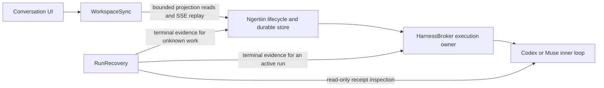

# Conversation synchronization and native receipt recovery

Implemented locally on 4 November 2026 against working-tree baseline `ba887f53a4ea44bec3b8e565fcdc58e7d5b8a091`. Existing shared-machine work is preserved. Runtime/API ownership follows [the active architecture](https://app.notion.com/p/402abdd6187381beacd6c48fa521b99f) and [NMA-060](https://app.notion.com/p/409abdd61873819b80c4dd2b3e593834), whose Done status was verified before UI work. The public contract remains 1.29.0.

## Problem and ownership

A hanging projection request held the client refresh lock indefinitely, even when SSE heartbeats continued and the backend had already finished. Reconnecting reran bootstrap without retiring that lock. Native process loss could also leave unknown work fenced until a manual receipt check, while a lost terminal notification could leave an accepted run appearing active indefinitely.



Ngertiin retains admission, queue, publication, cancellation intent and recovery authority. Native harnesses retain planning and tool execution. Receipt monitoring never submits or resumes a prompt. Successful receipt inspection does not override scope, native identity, billing, cancellation or writer-closure checks.

## Implementation

- `apps/web-client/src/lib/api-client.ts`: projection reads have a 15-second deadline covering headers and response-body consumption; commands have a 30-second deadline. Aborting a retired connection also rejects a stalled read. Invalid successful JSON fails explicitly. Existing durable operation keys remain available after uncertain command outcomes. SSE retains its existing 35-second inactivity watchdog and cannot be blocked by an unresolved cancellation promise.
- `apps/web-client/src/hooks/workspace-sync.ts`: owns one event stream and its cancellable refresh generation. It coalesces events into affected projections, acknowledges a cursor only after those reads succeed, and preserves newer dirty events during a refresh. Reconnect cancels the old stream, timers and requests before reading authoritative state. Normal stream expiry resumes its applied cursor. Visible clients reconcile every 30 seconds; foreground resume also reconciles. Offline/disposal and late responses cannot revive an obsolete generation.
- `apps/web-client/src/hooks/use-workspace.ts`: applies independent successful projections as they arrive, retaining revision/cursor and conversation-selection guards. A failed projection still fails its batch. Reconnect uses `WorkspaceSync`; the duplicate manual refresh in the error action is removed. Draft and conversation identity stay in their existing owners.
- `apps/server/src/harness/recovery.ts`: observes unknown work and stale native execution with at most two concurrent checks. Unknown outcomes use 2-second exponential backoff capped at 60 seconds. Active work is checked after 45 seconds without an observed native event and no more frequently than that while evidence remains uncertain. New native observations postpone stale checks. An uncertain read does not cancel a valid long run or release its lane.
- `apps/server/src/harness/broker.ts`: uses the existing isolated read-only adapter receipt path for both cases. An active run resolves through its existing execute/publication/transport-close/settlement owner, fencing late output. Unknown work uses lifecycle reconciliation and rechecks its current revision after I/O. Writer-close timeouts retain the writer and pending close promise; later native receipts cannot release a still-live shared writer. Identity, grant, account and billing checks remain enforced.
- `apps/server/src/main.ts`: starts recurring receipt recovery after machine recovery and logs bounded error codes with run/thread correlation. The broker stops recovery and aborts outstanding readers during shutdown. Diagnostics retain no raw native prompts or credentials.

Historical `VERSION_TOO_OLD` and `PROBE_FAILED` preparation failures retain their actionable blocked/retry states. A repaired supported runtime resumes the original undispatched input through the existing path. This change does not bypass version/auth checks or classify a backend run as failed merely because a browser connection failed.

Source provenance: this refines the existing local Openbot-derived lifecycle/broker/event seams recorded in [ADR 0001](../../architecture/adr-0001-harness-first-foundation.md). Dependency versions are unchanged; the new synchronization/recovery modules are local implementations. Upgrade checks must retain cursor replay, unknown-effect fencing, scope checks and owned-writer closure regressions.

## Verification

| Cohort | Result | Boundary |
| --- | --- | --- |
| Full backend suite | 377 passed, 0 failed; 2,359 assertions | Domain/HTTP/SQLite/protocol fixtures |
| Frontend unit suite | 41 passed, 0 failed; 8,847 assertions | Request deadlines, synchronization generations, existing presentation/streaming logic |
| New recovery browser cases | 6 passed, 0 failed | Desktop and mobile: hanging DM reconnect with draft, automatic group snapshot timeout recovery, missed-answer foreground reconciliation |
| Existing browser regression | Initial 38/40; final targeted navigation checks 4/4 | Activity, conversation, queue, stream, acknowledgement and preparation; iterations retained below |
| Backend/frontend lint, typecheck and production web build | Passed | Static/build checks; existing large-chunk build warning remains |
| Native Codex receipt read | Passed on 0.166.0, matching account/billing/session/turn; zero new prompts | Read an already-completed owner turn through a separate native client |
| Local activation | Ready at 1.29.0; Codex 0.166.0 and Muse 1.4.14-R7309.1 supported | Existing Muse executable override retained in launch |

The backend regressions cover automatic unknown recovery without prompt replay, lost completion, continued valid execution, observation freshness, foreign receipts, unrequested cancellation, shutdown and group writer quiescence. The client regressions cover hanging headers/body, explicit cancellation, invalid JSON, reconnect, retry, missed events, coalescing, late responses and cleanup.

Iterations are retained in the logs. The first new group-browser fixture attempted to edit an immutable routed input and received CONFLICT; its direct-admission transport fixture was corrected. One intermediate full backend run failed an unchanged 500 ms descendant-writer timing check during concurrent checks; the unchanged isolated check and final full 377-test suite passed. The broad browser run timed out during a 12-switch mobile navigation loop and counted a legitimate old-DM preparation retry that occurred before navigation actually committed. The preparation assertion now starts its no-more-retries boundary after confirmed selection. Final targeted desktop/mobile checks passed 4/4; the navigation test and timeout were unchanged.

Reproduction commands from the repository root:

```sh
bun test apps/server/tests
bun test apps/web-client/verification
bun run --filter @ngertiin/server lint
bun run --filter @ngertiin/server typecheck
bun run --filter @ngertiin/web-client lint
bun run --filter @ngertiin/web-client build
cd apps/web-client
bunx playwright test --config playwright.conversation.config.ts tests/conversation-recovery.spec.ts
bunx playwright test --config playwright.conversation.config.ts tests/conversation.spec.ts tests/activity.spec.ts tests/preparation.spec.ts
```

## Local activation and limits

Before graceful restart, there were no queued, active or unknown owner runs. A private SQLite backup passed integrity checking. After activation, all 485 protected conversation/domain entity bodies remained byte-identical, the run count stayed 112, and no new inference was admitted. Both the saved and active database passed integrity checks. The existing Brave tab displayed its completed group answer after foreground resume, without a hard reload; the previously active tab was restored.

[verification.json](verification.json) contains the cohort counts, native receipt and activation results. Detailed checks and adverse iterations are retained under [logs](logs/). The private backup and pre-activation entity hashes remain under local development state and the task's temporary directory.

No forced failure or new provider inference was performed in an owner conversation. Muse recovery has protocol-fixture coverage; the fresh read-only native receipt check used Codex. These are local development checks, not a guarantee against every provider, host or network failure, or distribution/production acceptance.
