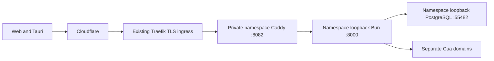

# Shared Ubuntu host profile

The owner selected `mamvps` and `https://demo.ngerti.in` on November 15, 2026. This Ubuntu 24.04 AMD64 host already runs Dokploy/Traefik and unrelated applications. Keep their Docker daemon, databases, volumes, certificates and ports intact. The architecture manifest is [`versions.amd64.json`](../versions.amd64.json); ARM64 retains its original manifest and evidence.

## Storage and operator trust

`prepare-storage.sh` creates one new, reserved 64-GiB file at `/var/lib/ngertiin-private.luks`, formats only that file as LUKS2 and mounts its filesystem at `/srv/ngertiin`. It refuses an existing image, mapper or nonempty target. `/srv/ngertiin/config` is bind-mounted at `/etc/ngertiin`. Application state, provider homes, temporary files, PostgreSQL, configuration, backup staging and the private Docker engine's complete data root belong on this filesystem. Public source/binaries and the host's existing proxy remain outside it.

The 32-byte unlock key is independently retained on the operator's FileVault-protected Mac at `~/.ssh/mamvps-ngertiin-storage.key`; never commit it, include it in a backup archive or store it beside the VPS image. The prepare/unlock scripts read it from SSH stdin through a private temporary `/run` file, removed on exit. Root and a live unlocked host remain trusted. The existing host applications are not made encrypted by this setup.

After a VPS reboot, unlock explicitly before starting Ngertiin:

```sh
ssh mamvps 'bash /opt/ngertiin/current/infra/server/shared-host/unlock-storage.sh' \
  < ~/.ssh/mamvps-ngertiin-storage.key
ssh mamvps 'systemctl start ngertiin-docker.service'
ssh mamvps 'ip netns exec ngertiin env DOCKER_HOST=unix:///run/ngertiin-docker/docker.sock docker compose --env-file /etc/ngertiin/compose.env -f /opt/ngertiin/current/infra/server/compose.yaml -f /opt/ngertiin/current/infra/server/shared-host/compose.override.yaml up -d --wait postgres ingress'
ssh mamvps 'systemctl start ngertiin.service'
```

The private engine verifies the actual LUKS2 mount and encrypted configuration filesystem before starting. No plaintext or alternate storage fallback is configured. Retain an independent copy of the storage key and separately escrow `/etc/ngertiin/backup.key`. Operator-assisted unlock is part of recovery time.

## Private engine and networking

Docker documents multiple daemons as experimental. This profile separates their socket, PID, exec root, encrypted data root, containerd process/socket/namespaces and Linux network namespace. `start-engine.sh` starts its dedicated containerd child in the same service mount/network namespaces; it never adopts the host's containerd or its `moby` namespace. Consequently, private bridge/firewall management does not overwrite Dokploy's rules. The host retains a few rules explicitly scoped to the dedicated `ngertiin-host` transit interface/address; it does not flush existing rules or restart the existing Docker daemon. See the [Docker daemon reference](https://docs.docker.com/reference/cli/dockerd/#run-multiple-daemons).



The transit pair is `172.31.82.1/30` on the host and `172.31.82.2/30` in namespace `ngertiin`. The existing Traefik bridge `172.16.0.0/24` may reach only Caddy's application port 8082. Namespace ingress otherwise permits loopback and established replies. Namespace egress uses the existing host's public uplink and rejects private, link-local and Tailscale destination ranges. The application database, readiness and native control endpoints never become public or directly reachable through that transit pair. Public application sessions and viewer grants remain required.

Install `ngertiin-network.service`, `ngertiin-docker.service`, the reviewed private `docker.json` and the `ngertiin.service.d/shared-host.conf` drop-in after ordinary bootstrap. The private service account uses its own `ngertiin` socket group; remove its membership from the unrelated host `docker` group. Set `DOCKER_HOST=unix:///run/ngertiin-docker/docker.sock` and `TMPDIR=/srv/ngertiin/tmp` in the private server environment. Create that temporary directory privately under the service account.

All database/native/operation commands must select both the namespace and private socket:

```sh
sudo ip netns exec ngertiin env DOCKER_HOST=unix:///run/ngertiin-docker/docker.sock \
  docker compose --env-file /etc/ngertiin/compose.env \
  -f /opt/ngertiin/current/infra/server/compose.yaml \
  -f /opt/ngertiin/current/infra/server/shared-host/compose.override.yaml up -d

sudo bash /opt/ngertiin/current/infra/server/shared-host/operations.sh \
  check /etc/ngertiin/operations.json
```

The operation wrapper enters the namespace and reads only the private server environment. Backup/restore still enforces the single database authority, exclusive maintenance, empty-target recovery and current tombstone union. Do not run broad cleanup commands against either Docker daemon.

## Existing HTTPS proxy

The standalone Caddy profile remains available for a dedicated host. This shared-host override serves HTTP only inside the private namespace; its account origin is still exactly `https://demo.ngerti.in`. Caddy applies the existing private-route denial, 24-MiB request ceiling, public Host replacement, SSE streaming and viewer WebSocket proxying. It does not consume the occupied public ports.

The narrowly named `traefik.demo.yaml` file adds only this hostname through Dokploy's already-enabled file provider and `letsencrypt` HTTP-challenge resolver. Install it atomically as `/etc/dokploy/traefik/dynamic/ngertiin-demo.yaml`; preserve all other provider files and certificates. Existing Traefik manages the public certificate, and Cloudflare must validate it. See the [Traefik file configuration](https://doc.traefik.io/traefik/reference/dynamic-configuration/file/). Do not weaken certificate verification or Cloudflare TLS mode to hide an origin-certificate error.

The [NMA-082 report](../../../docs/verification/nma-082/README.md) records actual deployment/client/provider/recovery results. Profile availability, successful installation and a certificate alone do not close those acceptance gates.
